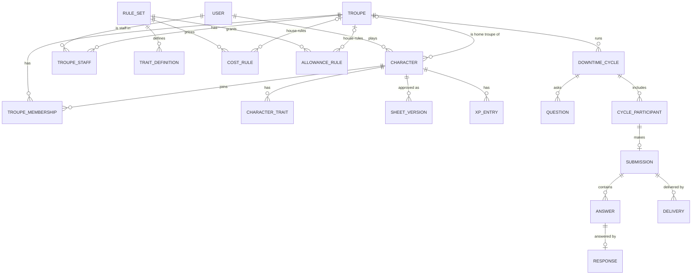

# Schema design

Status: **agreed after review**. Nothing here is built yet. Table and column
names follow `CONTEXT.md`. Where this document needs a word the glossary does
not have yet, it says so in [New terms](#new-terms-proposed-for-the-glossary).

Postgres, accessed through SQLAlchemy 2 with Alembic migrations (ADR 0002).
Every table has `id` (UUID v7, so ids sort by creation time), `created_at` and
`updated_at`. Tables holding imported Yorick data also have a nullable,
unique `legacy_id` with the Parse objectId, so old links can redirect and the
import can be re-run safely.

## Overview

## 1. People, sign-in and troupes

**`users`**: one row per person.
`email` (unique), `display_name`, `password_hash` (nullable: social-login-only
users have none), `is_custodian` (bool), `discord_user_id` (nullable).
Imported Parse bcrypt hashes go straight into `password_hash` and are upgraded
to argon2 on the user's next sign-in.

**`auth_identities`**: linked sign-in providers.
`user_id`, `provider` (`discord` | `google`), `subject`; unique on
(`provider`, `subject`).

**`sessions`**: server-side sessions behind an HTTP-only cookie.
`user_id`, `token_hash`, `expires_at`, `revoked_at`.

**`troupes`**
`name`, `description`, `lead_user_id` (**not null**), `archived_at` (nullable).
Keeping the lead as a non-null column on the troupe is what makes "exactly one
lead storyteller" a database guarantee rather than an application check.
Handing over the lead is an update to this column.

**`troupe_staff`**
`troupe_id`, `user_id`, `role` (`storyteller` | `assistant_storyteller` |
`narrator`); unique on (`troupe_id`, `user_id`). The lead storyteller is
**not** listed here: the lead has every storyteller permission by being the
lead.

**`troupe_memberships`**: which troupes a character has joined.
`troupe_id`, `character_id`, `joined_at`, `left_at` (nullable). Kept after a
character leaves, so the history stays.

## 2. Characters

**`characters`**
`player_id` → users, `splat`, `name`,
`status` (`draft` | `active` | `retired`),
`home_troupe_id` (nullable),
`approved_version_id` → sheet_versions (nullable: a draft has never been
approved).

A character starts as `draft`. It becomes `active` when its first home troupe
change is approved, because that approval is also its first sheet approval.
It is never deleted, only retired.

**`character_traits`**: the character's sheet as it currently stands,
including edits not yet approved.
`character_id`, `trait_definition_id`, `rating` (nullable for traits that have
no rating, such as clan or archetype), `free_rating` (dots granted without
cost, for example by creation or by another merit), `detail` (free text, for
example a specialisation or a merit's subject), `note`.

Clan, tribe, seeming, archetype, sect and similar choices are traits with no
rating, not columns on `characters`. That puts all of a sheet in one place, so
approvals, reconciliation and cost conditions such as "in-clan" all read from
the same table.

**`sheet_versions`**: every approved sheet, frozen.
`character_id`, `number` (1, 2, 3…), `snapshot` (JSONB: the full trait list at
approval), `approved_by`, `approved_at`, `approval_id`.
The **approved sheet** is `characters.approved_version_id`. What is waiting for
approval is the difference between `character_traits` and that snapshot, so
nothing has to track pending changes separately.

**`xp_entries`**: the XP history; append-only.
`character_id`, `kind` (`award` | `purchase` | `settlement`), `amount`
(positive for an award, negative for a spend, either for a settlement),
`reason`, `entered_on`, `entered_by`.
For a **purchase**: `trait_definition_id`, `from_rating`, `to_rating`, and
`cost_basis` (JSONB: which cost rule priced it and its values at the time).
For a **settlement**: `reconciliation_item_id`.
Balance is the sum of `amount`. Purchases are never updated. When
reconciliation changes what a purchase effectively cost, it adds a
`settlement` entry pointing at the reconciliation item, so the original price
and the correction both stay visible.

**`long_texts`**: `character_id`, `kind` (for example `background`,
`history`), `body`; unique on (`character_id`, `kind`).

**`portraits`**: `character_id` or `troupe_id` (exactly one set),
`storage_key` (object storage, S3 or R2), `thumbnails` (JSONB of size →
key).

## 3. Rules

**`rule_sets`**: the generic rules for one splat.
`splat`, `name` (for example "BNS MET Vampire"), `version`.

**`trait_categories`**: `rule_set_id`, `key` (for example `skills`,
`merits`, `disciplines`), `name`, `group_name`, `position`, `rated`,
`max_rating`, `house_rules_per_trait`.

**`trait_definitions`**: everything a sheet can contain.
`category_id`,
`name`, `max_rating` (null for unrated), `description` (the **trait
description**), `page_reference`.

**`cost_rules`**: how much XP a trait costs.
`rule_set_id`, `troupe_id` (null = generic rule; set = **house rule**),
`category_id`, `trait_definition_id` (nullable: null means the whole category),
`condition` (JSONB, nullable), `scheme`, `rate`, `cost_table` (JSONB, for the
`table` scheme), `text` (nullable: a house rule's own wording, shown with the
trait description).
A house rule for a merit or flaw must name it. Categories carry a
`house_rules_per_trait` flag saying so, and the application refuses a
category-wide house rule for them.

| Scheme | Meaning | Yorick example |
|---|---|---|
| `per_dot` | each dot costs `rate` (may be negative) | attributes: 3 per dot; flaws: −1 |
| `progressive` | dot *n* costs *n* × `rate` | in-clan disciplines: 3, 6, 9… |
| `table` | dot *n* costs `cost_table[n−1]` | Generation: 1, 4, 6, 8… |
| `fixed` | the trait costs `rate` in total | a merit with a set price |
| `free` | costs nothing | focuses, specialisations |
| `not_allowed` | the trait cannot be bought | techniques below generation 3 |

The cost of a trait is the price of its rating less the price of its free
rating. A purchase costs the difference between the trait's cost after and
before.

`condition` uses a small, fixed vocabulary that code knows how to evaluate,
for example `{"in_clan": true}` or `{"generation": {"gte": 3, "lt": 5}}`. The
**values** are data a troupe can change. The **meaning** of a fact such as
"in-clan" stays in code (`horatio/rules/splats.py`).

To choose a cost rule: **any matching house rule beats any matching generic
rule**. Within whichever of the two has a match, a rule naming the trait beats
a whole category, and a rule testing more facts beats one testing fewer. Two
rules still tied is a mistake in the rules and is refused, never guessed. So a
troupe that re-prices all skills gets all skills at its price, even where the
generic rules had a more specific skills rule. A trait no rule covers is
refused too, never treated as free.

The generic rule sets live in `backend/src/horatio/rules/data/` as TOML and
are loaded with `uv run python -m horatio.rules`. Loading replaces a rule set's
generic cost rules and leaves house rules alone. The Vampire file is checked
against 13,952 prices produced by Yorick's own cost code
(`tools/yorick_oracle/`).

**`allowance_rules`**: how traits change a character's action allowance.
`rule_set_id`, `troupe_id` (null = generic; set = house rule),
`action_kind_id`, `trait_definition_id` (nullable: null is the base allowance
everyone gets), `min_rating`, `scheme` (`fixed` | `per_dot`), `amount` (may be
negative, for flaws). The same "house rule beats generic rule" lookup applies.

**`creation_rules`**: the starting dots a new character picks (Yorick's
"skills: one at 4, two at 3…").
`rule_set_id`, `troupe_id` (nullable), `category`, `rating`, `picks`.
Creation dots go into `character_traits.free_rating`, not into purchases.
Troupes can house-rule creation rules.

## 4. Approvals and reconciliation

**`approvals`**: the single queue storytellers and assistant storytellers
work from.
`character_id`, `troupe_id` (the troupe whose staff decide), `kind`
(`sheet_change` | `home_troupe_change`), `status` (`pending` | `approved` |
`declined` | `withdrawn`), `requested_by`, `decided_by`, `decided_at`,
`player_note`, `staff_note`.

**`home_troupe_changes`**: the details of a `home_troupe_change` approval.
`approval_id`, `from_troupe_id` (nullable for a first home troupe),
`to_troupe_id`.

**`reconciliation_items`**: one row per difference found.
`home_troupe_change_id`, `trait_definition_id`, `difference` (`cost_differs` |
`not_allowed` | `creation_differs`), `old_cost`, `new_cost`,
`proposed_settlement` (the player's choice), `settlement` (the staff's final
choice), `xp_delta`.
Settlements are `keep_price` | `pay_difference` | `refund_difference` |
`remove_and_refund` for purchases, and `add_free_dots` | `remove_dots` |
`pay_for_dots` for `creation_differs` (the troupe's creation rules give more or
fewer starting dots than the character was built with). The player must propose a settlement for every item
before the request can be submitted; a character with any unsettled item is
not let into the troupe. Approving the change writes one `settlement` XP entry for
each item with a non-zero `xp_delta`, applies any trait removals, and freezes a
new sheet version, all in one transaction.

## 5. Downtimes

**`action_kinds`**: `rule_set_id`, `troupe_id` (nullable: a troupe may add its
own), `key`, `name`, `structured_fields` (JSONB describing extra inputs; for
example influence actions ask for an influence, a specialisation and a level).

**`downtime_cycles`**: `troupe_id`, `name`, `opens_at`, `closes_at`,
`grace_ends_at`, `status` (`draft` | `open` | `closed` | `complete`).
Creating a cycle copies the previous cycle's questions into it.

**`questions`**: the **downtime form**. Each cycle owns its own rows, so
editing one cycle's form can never change another's.
`cycle_id`, `position`, `kind` (`action` | `custom`), `action_kind_id` (for
action questions), `prompt`, `help_text`, `answer_type` (`long_text` |
`short_text` | `choice` | `number` | `yes_no`), `options` (JSONB), `required`,
`visible_to` (JSONB, nullable: for example only one splat or clan).

**`cycle_participants`**: who is in a cycle, and their **action allowance**.
`cycle_id`, `character_id`, `allowance` (JSONB: action kind → count),
`allowance_breakdown` (JSONB: which rules produced it, shown to the player).
Also `added_by` (null when added at opening), `removed_at`, `removed_by`.
Written when the cycle opens, for every active character whose home
troupe is the cycle's troupe at that moment. Storytellers and assistant
storytellers can add or remove participants afterwards, but can only add
characters whose home troupe is the cycle's troupe. An added participant's
allowance is worked out when they are added. A removed participant is marked
removed rather than deleted, so their submission and its responses stay. The
opening snapshot settles two rules from the glossary without extra logic:
- the allowance is fixed when the cycle opens;
- a home troupe change approved mid-cycle cannot put a character into a second
  cycle, because it is not on the new troupe's list until that troupe's next
  cycle opens.

**`allowance_adjustments`**: `participant_id`, `action_kind_id`, `delta`,
`reason`, `adjusted_by`.

**`submissions`**: `participant_id` (unique), `status` (`draft` |
`submitted`), `submitted_at`, `late_accepted_by` (nullable).

**`answers`**: `submission_id`, `question_id`, `slot` (1 to the allowance, for
action questions; always 1 for custom questions), `body`, `structured` (JSONB:
the action kind's extra fields).

**`responses`**: one per answer.
`answer_id` (unique), `body`, `status` (`unassigned` | `assigned` |
`written`), `assigned_to_user_id` (nullable), `assigned_to_any_narrator`
(bool), `assigned_by`, `written_by`, `written_at`.
A **decline** clears the assignment back to `unassigned` and is recorded in the
audit log. Accepting an any-narrator response sets `assigned_to_user_id` and
clears the flag.

**`deliveries`**: `submission_id`, `channel` (`discord` | `email`), `status`
(`pending` | `sent` | `failed`), `test_mode` (bool), `sent_at`, `attempts`,
`last_error`, `external_ids` (JSONB: Discord message ids).
At most one non-test `sent` delivery per submission and channel, enforced by a
partial unique index. That is the old "never send twice" rule as a database
constraint.

**`random_tables`**, **`random_table_entries`**: the old fill tables (feed,
herd, patrol, discipline), owned by a troupe. Placeholders such as
`[Location]` refer to other tables by name.

## 6. Cross-cutting

**`audit_events`**: `actor_id`, `troupe_id` (nullable), `entity_type`,
`entity_id`, `action`, `data` (JSONB), `at`. Append-only. Every permission-
relevant change writes one, in the same transaction as the change.

**Permissions** are not stored beyond `users.is_custodian`, `troupes.lead_user_id`
and `troupe_staff.role`. One module turns those into "can this user do this
action to this record", and every route calls it.

## Deliberately not here yet

- **Scheduled messages and NPCs** (announcements posted as an NPC). Easy to add
  later; nothing else depends on them.
- **Influence rumours.** Built from influence answers' `structured` fields and
  their responses. The query needs the old tool's Age and Blocks rules pinned
  down first.
- **Game sessions.** I suggested them earlier as a place for XP awards to hang
  off. `xp_entries.reason` covers awards for now; a `game_sessions` table can
  be added without changing anything above.

## Decisions from review

1. Troupes can add their own action kinds.
2. Troupes can house-rule creation rules.
3. Every reconciliation difference must have a proposed settlement, or the
   character is not let into the troupe.
4. The proposed terms are now in `CONTEXT.md`. Staff can add and remove
   participants after a cycle opens.
5. Merit house rules are per merit, with a new cost and optional text.
6. A character can only be a participant in its home troupe's cycles.
7. Starting dots are reconciled as well as purchases.
8. Flaws are re-priced one flaw at a time, like merits.
