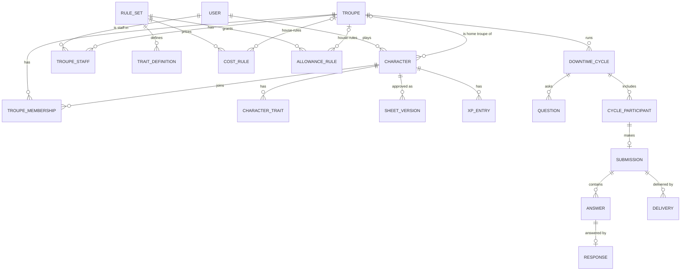

# Schema design

Status: **agreed after review**. Nothing here is built yet. Table and column
names follow `CONTEXT.md`. Where this document needs a word the glossary does
not have yet, it says so in [New terms](#new-terms-proposed-for-the-glossary).

Postgres, accessed through SQLAlchemy 2 with Alembic migrations (ADR 0002).
Every table has `id` (UUID v7, so ids sort by creation time), `created_at` and
`updated_at`. Tables holding imported Yorick data also have a nullable,
unique `legacy_id` with the Parse objectId, so old links can redirect and the
import can be re-run safely.

## Overview

## 1. People, sign-in and troupes

**`users`**: one row per person.
`email` (unique), `display_name`, `password_hash` (nullable: social-login-only
users have none), `is_custodian` (bool), `discord_user_id` (nullable).
Imported Parse bcrypt hashes go straight into `password_hash` and are upgraded
to argon2 on the user's next sign-in.

**`auth_identities`**: linked sign-in providers.
`user_id`, `provider` (`discord` | `google`), `subject`; unique on
(`provider`, `subject`).

**`sessions`**: server-side sessions behind an HTTP-only cookie.
`user_id`, `token_hash`, `expires_at`, `revoked_at`.

**`troupes`**
`name`, `description`, `lead_user_id` (**not null**), `archived_at` (nullable),
`allowed_sects` (JSON list of sect names; empty means any).
Keeping the lead as a non-null column on the troupe is what makes "exactly one
lead storyteller" a database guarantee rather than an application check.
Handing over the lead is an update to this column.

**`troupe_staff`**
`troupe_id`, `user_id`, `role` (`storyteller` | `assistant_storyteller` |
`narrator`); unique on (`troupe_id`, `user_id`). The lead storyteller is
**not** listed here: the lead has every storyteller permission by being the
lead.

**`troupe_memberships`**: which troupes a character has joined.
`troupe_id`, `character_id`, `joined_at`, `left_at` (nullable). Kept after a
character leaves, so the history stays.

## 2. Characters

**`characters`**
`player_id` → users, `splat`, `name`,
`status` (`draft` | `active` | `retired`),
`home_troupe_id` (nullable),
`approved_version_id` → sheet_versions (nullable: a draft has never been
approved).

A character starts as `draft`. It becomes `active` when its first home troupe
change is approved, because that approval is also its first sheet approval.
It is never deleted, only retired.

**`character_traits`**: the character's sheet as it currently stands,
including edits not yet approved.
`character_id`, `trait_definition_id`, `rating` (nullable for traits that have
no rating, such as clan or archetype), `free_rating` (dots granted without
cost, for example by creation or by another merit), `detail` (free text, for
example a specialisation or a merit's subject), `note`.

Clan, tribe, seeming, archetype, sect and similar choices are traits with no
rating, not columns on `characters`. That puts all of a sheet in one place, so
approvals, reconciliation and cost conditions such as "in-clan" all read from
the same table.

**`sheet_versions`**: every approved sheet, frozen.
`character_id`, `number` (1, 2, 3…), `snapshot` (JSONB: the full trait list at
approval), `approved_by`, `approved_at`, `approval_id`.
The **approved sheet** is `characters.approved_version_id`. What is waiting for
approval is the difference between `character_traits` and that snapshot, so
nothing has to track pending changes separately.

**`xp_entries`**: the XP history; append-only.
`character_id`, `kind` (`award` | `purchase` | `settlement`), `amount`
(positive for an award, negative for a spend, either for a settlement),
`reason`, `entered_on`, `entered_by`.
For a **purchase**: `trait_definition_id`, `from_rating`, `to_rating`, and
`cost_basis` (JSONB: which cost rule priced it and its values at the time).
For a **settlement**: `reconciliation_item_id`.
Balance is the sum of `amount`. Purchases are never updated. When
reconciliation changes what a purchase effectively cost, it adds a
`settlement` entry pointing at the reconciliation item, so the original price
and the correction both stay visible.

**`long_texts`**: `character_id`, `kind` (for example `background`,
`history`), `body`; unique on (`character_id`, `kind`).

**`portraits`**: `character_id` or `troupe_id` (exactly one set),
`storage_key` (object storage, S3 or R2), `thumbnails` (JSONB of size →
key).

## 3. Rules

**`rule_sets`**: the generic rules for one splat.
`splat`, `name` (for example "BNS MET Vampire"), `version`.

**`trait_categories`**: `rule_set_id`, `key` (for example `skills`,
`merits`, `disciplines`), `name`, `group_name`, `position`, `rated`,
`max_rating`, `house_rules_per_trait`.

**`trait_definitions`**: everything a sheet can contain.
`category_id`,
`name`, `max_rating` (null for unrated), `description` (the **trait
description**), `page_reference`.

**`cost_rules`**: how much XP a trait costs.
`rule_set_id`, `troupe_id` (null = generic rule; set = **house rule**),
`category_id`, `trait_definition_id` (nullable: null means the whole category),
`condition` (JSONB, nullable), `scheme`, `rate`, `cost_table` (JSONB, for the
`table` scheme), `text` (nullable: a house rule's own wording, shown with the
trait description).
A house rule for a merit or flaw must name it. Categories carry a
`house_rules_per_trait` flag saying so, and the application refuses a
category-wide house rule for them.

| Scheme | Meaning | Yorick example |
|---|---|---|
| `per_dot` | each dot costs `rate` (may be negative) | attributes: 3 per dot; flaws: −1 |
| `progressive` | dot *n* costs *n* × `rate` | in-clan disciplines: 3, 6, 9… |
| `table` | dot *n* costs `cost_table[n−1]` | Generation: 1, 4, 6, 8… |
| `fixed` | the trait costs `rate` in total | a merit with a set price |
| `free` | costs nothing | focuses, specialisations |
| `not_allowed` | the trait cannot be bought | techniques below generation 3 |

The cost of a trait is the price of its rating less the price of its free
rating. A purchase costs the difference between the trait's cost after and
before.

`condition` uses a small, fixed vocabulary that code knows how to evaluate,
for example `{"in_clan": true}` or `{"generation": {"gte": 3, "lt": 5}}`. The
**values** are data a troupe can change. The **meaning** of a fact such as
"in-clan" stays in code (`horatio/rules/splats.py`).

To choose a cost rule: **any matching house rule beats any matching generic
rule**. Within whichever of the two has a match, a rule naming the trait beats
a whole category, and a rule testing more facts beats one testing fewer. Two
rules still tied is a mistake in the rules and is refused, never guessed. So a
troupe that re-prices all skills gets all skills at its price, even where the
generic rules had a more specific skills rule. A trait no rule covers is
refused too, never treated as free.

The generic rule sets live in `backend/src/horatio/rules/data/` as TOML and
are loaded with `uv run python -m horatio.rules`. Loading replaces a rule set's
generic cost rules and leaves house rules alone. The Vampire file is checked
against 13,952 prices produced by Yorick's own cost code
(`tools/yorick_oracle/`).

**`allowance_rules`**: how traits change a character's action allowance.
`rule_set_id`, `troupe_id` (null = generic; set = house rule),
`action_kind_id`, `trait_definition_id` (nullable: null is the base allowance
everyone gets), `min_rating`, `scheme` (`fixed` | `per_dot`), `amount` (may be
negative, for flaws). The same "house rule beats generic rule" lookup applies.

**`creation_rules`**: the starting dots a new character picks (Yorick's
"skills: one at 4, two at 3…").
`rule_set_id`, `troupe_id` (nullable), `category`, `rating`, `picks`.
Creation dots go into `character_traits.free_rating`, not into purchases.
Troupes can house-rule creation rules.

## 4. Approvals and reconciliation

**`approvals`**: the single queue storytellers and assistant storytellers
work from.
`character_id`, `troupe_id` (the troupe whose staff decide), `kind`
(`sheet_change` | `home_troupe_change`), `status` (`pending` | `approved` |
`declined` | `withdrawn`), `requested_by`, `decided_by`, `decided_at`,
`player_note`, `staff_note`.

**`home_troupe_changes`**: the details of a `home_troupe_change` approval.
`approval_id`, `from_troupe_id` (nullable for a first home troupe),
`to_troupe_id`.

**`reconciliation_items`**: one row per difference found.
`home_troupe_change_id`, `trait_definition_id`, `difference` (`cost_differs` |
`not_allowed` | `creation_differs`), `old_cost`, `new_cost`,
`proposed_settlement` (the player's choice), `settlement` (the staff's final
choice), `xp_delta`.
Settlements are `keep_price` | `pay_difference` | `refund_difference` |
`remove_and_refund` for purchases, and `add_free_dots` | `remove_dots` |
`pay_for_dots` for `creation_differs` (the troupe's creation rules give more or
fewer starting dots than the character was built with). The player must propose a settlement for every item
before the request can be submitted; a character with any unsettled item is
not let into the troupe. Approving the change writes one `settlement` XP entry for
each item with a non-zero `xp_delta`, applies any trait removals, and freezes a
new sheet version, all in one transaction.

## 5. Downtimes

**`action_kinds`**: `rule_set_id`, `troupe_id` (nullable: a troupe may add its
own), `key`, `name`, `structured_fields` (JSONB describing extra inputs; for
example influence actions ask for an influence, a specialisation and a level).

**`downtime_cycles`**: `troupe_id`, `name`, `opens_at`, `closes_at`,
`grace_ends_at`, `status` (`draft` | `open` | `closed` | `complete`).
Creating a cycle copies the previous cycle's questions into it.

**`questions`**: the **downtime form**. Each cycle owns its own rows, so
editing one cycle's form can never change another's.
`cycle_id`, `position`, `kind` (`action` | `custom`), `action_kind_id` (for
action questions), `prompt`, `help_text`, `answer_type` (`long_text` |
`short_text` | `choice` | `number` | `yes_no`), `options` (JSONB), `required`,
`visible_to` (JSONB, nullable: for example only one splat or clan).

**`cycle_participants`**: who is in a cycle, and their **action allowance**.
`cycle_id`, `character_id`, `allowance` (JSONB: action kind → count),
`allowance_breakdown` (JSONB: which rules produced it, shown to the player).
Also `added_by` (null when added at opening), `removed_at`, `removed_by`.
Written when the cycle opens, for every active character whose home
troupe is the cycle's troupe at that moment. Storytellers and assistant
storytellers can add or remove participants afterwards, but can only add
characters whose home troupe is the cycle's troupe. An added participant's
allowance is worked out when they are added. A removed participant is marked
removed rather than deleted, so their submission and its responses stay. The
opening snapshot settles two rules from the glossary without extra logic:
- the allowance is fixed when the cycle opens;
- a home troupe change approved mid-cycle cannot put a character into a second
  cycle, because it is not on the new troupe's list until that troupe's next
  cycle opens.

**`allowance_adjustments`**: `participant_id`, `action_kind_id`, `delta`,
`reason`, `adjusted_by`.

**`submissions`**: `participant_id` (unique), `status` (`draft` |
`submitted`), `submitted_at`, `late_accepted_by` (nullable).

**`answers`**: `submission_id`, `question_id`, `slot` (1 to the allowance, for
action questions; always 1 for custom questions), `body`, `structured` (JSONB:
the action kind's extra fields).

**`responses`**: one per answer.
`answer_id` (unique), `body`, `status` (`unassigned` | `assigned` |
`written`), `assigned_to_user_id` (nullable), `assigned_to_any_narrator`
(bool), `assigned_by`, `written_by`, `written_at`.
A narrator answering a response sees the question, the player's answer and the character's name, never the character's sheet.
A **decline** clears the assignment back to `unassigned` and is recorded in the
audit log. Accepting an any-narrator response sets `assigned_to_user_id` and
clears the flag.

**`deliveries`**: `submission_id`, `channel` (`discord` | `email`), `status`
(`pending` | `sent` | `failed`), `test_mode` (bool), `sent_at`, `attempts`,
`last_error`, `external_ids` (JSONB: Discord message ids).
At most one non-test `sent` delivery per submission and channel, enforced by a
partial unique index. That is the old "never send twice" rule as a database
constraint.

**`random_tables`**, **`random_table_entries`**: the old fill tables (feed,
herd, patrol, discipline), owned by a troupe. Placeholders such as
`[Location]` refer to other tables by name.

## 6. Cross-cutting

**`audit_events`**: `actor_id`, `troupe_id` (nullable), `entity_type`,
`entity_id`, `action`, `data` (JSONB), `at`. Append-only. Every permission-
relevant change writes one, in the same transaction as the change.

**Permissions** are not stored beyond `users.is_custodian`, `troupes.lead_user_id`
and `troupe_staff.role`. One module turns those into "can this user do this
action to this record", and every route calls it.

## Deliberately not here yet

- **Scheduled messages and NPCs** (announcements posted as an NPC). Easy to add
  later; nothing else depends on them.
- **Influence rumours.** Built from influence answers' `structured` fields and
  their responses. The query needs the old tool's Age and Blocks rules pinned
  down first.
- **Game sessions.** I suggested them earlier as a place for XP awards to hang
  off. `xp_entries.reason` covers awards for now; a `game_sessions` table can
  be added without changing anything above.

## Decisions from review

1. Troupes can add their own action kinds.
2. Troupes can house-rule creation rules.
3. Every reconciliation difference must have a proposed settlement, or the
   character is not let into the troupe.
4. The proposed terms are now in `CONTEXT.md`. Staff can add and remove
   participants after a cycle opens.
5. Merit house rules are per merit, with a new cost and optional text.
6. A character can only be a participant in its home troupe's cycles.
7. Starting dots are reconciled as well as purchases.
8. Flaws are re-priced one flaw at a time, like merits.

## Decisions made while building

Recorded here for review; each is easy to change.

**Sheets (step 1 of the autonomous build)**

- A player can raise any rating, but can lower one only as far as its approved
  rating. Lowering undoes an unapproved purchase and refunds it at the same
  price. Taking away approved dots is for staff (not built yet).
- While a sheet change or home troupe change is waiting for approval, the
  sheet is locked: what staff approve is what they looked at. The player can
  withdraw the request to edit again.
- A purchase is refused if the character cannot afford it. Flaws give XP back.
- Only catalogue traits can be bought; `detail` holds the specific thing (a
  lore subject, a contact). Merits and flaws are bought at their catalogue
  point value, never another rating.
- Unrated categories (clan, archetype, sect, faction, title, antecedence) hold
  one choice each; choosing again replaces it, at no cost.
- New characters get the rule set's `starting_xp` (30, Yorick's figure) as an
  award, so creation is ordinary purchases until creation rules exist.
- XP awards come from the running staff of the character's home troupe.
- **A character with no Generation background counts as generation 1, the
  cheapest generation for skills and backgrounds.** That is Yorick's behaviour,
  kept for price parity; it probably wants a creation rule giving every new
  vampire a Generation dot.
- Seven clans in Yorick's descriptions have no in-clan disciplines in its clan
  rules (Gangrel: Anda, Lasombra: Corsairs, Lhiannan, Nagaraja, Nosferatu:
  Creeps, Nosferatu: Nictuku, Tzimisce: Bratovitch), so they are not in the
  catalogue yet.

**Troupes and home troupes (step 2)**

- A player adds a character to any running troupe, and removes it, without
  approval. Joining shares the sheet with that troupe's running staff.
  Asking for a home troupe also joins it.
- Leaving the home troupe leaves the character with no home troupe; it then
  plays by the plain rule set.
- "What the character paid" for a trait is its purchases net of refunds and
  of earlier settlements, so a second move reconciles against the real total.
- Settlement choices on offer: a trait the new troupe bans can be removed and
  refunded, or kept at its price; any other difference can be paid or
  refunded, kept at its price, or removed and refunded.
- Settlements the character cannot afford are refused, at request and again
  at approval.
- Approval applies settlements as `settlement` XP entries, moves the home
  troupe, makes a draft active, and freezes the sheet as approved. The old
  troupe gets an audit event (`home_troupe.moved_away`); there are no
  notifications yet.
- Creation-rule differences are not reconciled: creation rules do not exist
  yet.

**Downtimes, part 1: cycles, forms and submissions (step 3a)**

- **The Vampire allowance numbers are placeholders**: 3 general actions for
  everyone, 1 influence action per dot of each Influence background, 1
  resources action with Resources. Neither Yorick nor the old tool recorded
  the official rules. Storytellers house-rule them.
- Allowance rules add up (a base, plus each matching trait). A troupe's
  allowance rule for the same action kind and trait replaces the generic one;
  others add to it.
- Several action questions can share an action kind; the kind's allowance
  caps the total answers across them. `max_answers` caps a single question
  (such as "feed once").
- A player sees only questions for action kinds they have actions of, and
  custom questions for their splat.
- A cycle is a draft until opened. Opening fixes participants and allowances;
  only one cycle per troupe is open at a time. Closing is a storyteller's
  explicit step.
- Players save drafts and submit, and can keep editing until the grace
  period ends. After the close date a submission is marked late; after the
  grace period it needs a storyteller to accept it late.
- A question with answers cannot be removed from the form.

**Downtimes, part 2: responses and delivery (step 3b)**

- Every answer in a submitted downtime gets a response. Storytellers and
  assistant storytellers see all of them; narrators see only theirs and the
  any-narrator pool, as question, answer and character name.
- Responses can be assigned to the lead or any staff member, or to any
  narrator. Assigning to anyone outside the staff is refused.
- Once a response is written, the player can no longer change that answer;
  other answers can still change, and new ones get responses.
- Delivery needs the cycle closed, sends each submission with written
  responses once, and puts the results in the app for the player
  (`GET /characters/{id}/downtime/results`). Nothing can be rewritten after
  delivery. Discord and email delivery are not built: they need a bot token
  and a mail service.
- Fill tables belong to a troupe. Running staff edit them; any staff member
  can roll. `[Name]` placeholders are filled from the table of that name.
- Not built yet: influence rumours (need the old tool's Age and Blocks rules
  confirmed), scheduled messages and NPC senders.

**Character creation (starting dots)**

- Horatio starts fresh as a new product: no Yorick data is imported (see ADR
  0001).
- The Vampire creation rules are Yorick's: attributes 7/5/3; one focus of
  each kind; skills one at 4, two at 3, three at 2, four at 1; backgrounds
  3/2/1; disciplines one at 2, two at 1; merits and flaws 7 points each.
  Starting traits: Humanity 5, three health levels at 3, Willpower 6.
- `character_traits.creation_pick` records the pick on a trait, and those
  dots are free. A pick goes only on a trait with no bought dots, and can be
  taken back only while it has none.
- Finishing creation needs every pick placed; merit and flaw points may be
  left unspent. XP purchases are allowed during creation. A home troupe can
  only be requested once creation is finished.
- Troupes can house-rule creation rules per category: a troupe's rules for a
  category replace all the generic rules for that category. There is no API
  or screen for house rules yet (costs, allowances or creation); they are set
  through `horatio.rules.store`.
- Reconciling starting dots on a home troupe change:
  - Fewer picks at a rating (or fewer points) than the character placed: each
    trait in that pool can be **paid for** at the new troupe's prices,
    **removed** (only if it has no bought dots), or kept; enough of them must
    be paid for or removed to fit, or the request is refused.
  - More picks than the character's current rules gave: **take them**, which
    reopens character creation to place just those (the new dots then go
    through ordinary sheet approval), or leave them.
  - Differences in starting traits are not reconciled.
- Flaws taken at creation are free records: they do not give XP. Bought
  later, a flaw gives XP back as before.

**Troupe standing, deleting characters, and the troupe log**

- Characters live in their player's vault. `characters.status` is only
  `active` or `retired`; whether a character is a draft or approved is each
  troupe's call, on `troupe_memberships.standing` (ADR 0006).
- Each troupe keeps its own approved sheet: `sheet_versions.troupe_id`, and
  `troupe_memberships.approved_version_id` points at the latest.
- Asking for approval sends one request to every troupe that has not approved
  the sheet as it stands. The sheet stays locked until each decides or the
  player withdraws.
- Running staff can send a character back to draft with a reason, which the
  player sees.
- Only characters approved in their home troupe take part in its downtimes,
  using that troupe's approved sheet for allowances.
- A character in no troupe can be deleted for good. Leaving each troupe is
  logged there, and deletion adds a final entry in every troupe it was ever
  in. **Deletion removes everything about the character, including its past
  downtime submissions and their responses**; only the log entries survive,
  with the character's name.
- Every logged event that names a character stores its name with it.
- The troupe log (`GET /troupes/{id}/log`) is for storytellers and assistant
  storytellers. It is a read-only list, newest first, without read/unread
  tracking yet.
- Starting disciplines are in-clan only (`restriction = "in_clan"` on the
  Vampire creation rules), checked when picks are placed and again when
  creation is finished, since the clan can change in between.

**PCs, NPCs and titles**

- `characters.kind` is `pc` or `npc`, replacing antecedence (there is no
  Secondary). The antecedence and title categories are gone from the rule set;
  the migration removed any already chosen, including from saved approved sheets.
- PCs are built only through the creation wizard: spending XP is refused until
  creation is finished.
- An NPC belongs to a troupe (`owner_troupe_id`, also its home troupe, so the
  troupe's house rules price it). It is approved there from the start, needs
  no approval, cannot join other troupes or leave its own, and never takes
  part in downtimes. The troupe's storytellers and assistant storytellers see,
  edit and delete it; narrators and players never see it.
- NPCs can be built in the wizard, or quickly: ratings are set directly, no XP
  is spent, and a running tally shows what the build would cost a PC in that
  troupe.
- Titles are per-troupe tags given by storytellers and assistant storytellers,
  from the rule set's list (imported from Yorick) plus titles the troupe adds.
  A character can hold several. They show on the troupe's Characters tab, the
  player's sheet and the printout for that troupe, and go when the character
  leaves.

**Sects and factions**

- A trait category can name a choice it `requires`: faction requires the
  Sabbat sect. Without it the category is hidden in the wizard and the NPC
  builder and choosing from it is refused; changing away from the Sabbat drops
  the faction, for PCs and NPCs alike.
- A troupe can limit which sects' PCs may join (`troupes.allowed_sects`, set by
  its storytellers and lead as a house rule; none ticked means any). It is
  checked when a PC joins or asks for the troupe as home, and a PC with no sect
  yet is refused by a limited troupe. NPCs are never limited. Characters
  already in the troupe stay when the list changes, and a member changing sect
  later is left to the troupe's approval of the sheet.
- Fixed in passing: a change made while a list was still loading for the first
  time could leave the list stale; mutations now cancel in-flight loads before
  refreshing.

**One home troupe holds the sheet (ADR 0007, replacing ADR 0006)**

- `troupe_memberships.standing` and `standing_note` are dropped. `approved_version_id`
  now marks the sheet as the home troupe accepted it; visited troupes have none.
- `approvals.kind` adds `discipline`; `sheet_change` stays for history (waiting ones
  were withdrawn by the migration). The one-pending-per-kind index leaves disciplines
  out, so several can wait at once.
- `discipline_purchases` (`approval_id`, `trait_definition_id`, `detail`,
  `from_rating`, `to_rating`, `cost`): the dots bought and the XP spent. Declining,
  withdrawing or leaving the home troupe writes a refunding purchase entry and puts
  the rating back.
- Which categories wait on the home troupe is `NEEDS_HOME_APPROVAL` in `sheets.py`
  (just disciplines for now).

**Notifications (the bell)**

- Tasks are not stored: `horatio/notifications.py` works them out from what is
  waiting (today, pending approvals in troupes where the person holds a role that
  approves changes; the custodian alone is not asked). They appear and go exactly
  as the work does, and cannot be marked read.
- Messages are `notifications` rows (`user_id`, `kind`, `troupe_id`,
  `character_id`, `summary`, `link`, `read_at`), written by `notify()` in the same
  transaction as the event. The first is `downtime.delivered`, to the player.
- New kinds of task are a function in `TASK_SOURCES`; new messages are a `notify()`
  call where the event happens. The app polls `/notifications` every minute and on
  focus, and refreshes it after any change.

**Checks: what a sheet may hold (issues #1, #3)**

- `rule_sets.checks` (JSON) holds the rule set's checks, loaded from
  `*_checks.toml` files the rule set names in `check_files`, plus checks derived
  from the catalogue: a merit or flaw whose `requirement` names a clan, bloodline
  or generation is only for that one.
- A check names a subject (a trait, a whole category, or a name prefix) and
  `requires` or `forbids` a condition; the vocabulary is in
  `horatio/rules/checks.py`. Strength is `refuse` or `note`.
- Every change a player makes to a PC's sheet runs inside `sheets.checked`: if the
  change breaks a refuse-strength check the sheet did not already break, it is
  rolled back and refused with the check's message. Existing problems (after a
  rules change) never block unrelated changes. NPCs are built freely; their
  problems only show.
- `/characters/{id}/unavailable?category=` lists what the checks would refuse and
  why, so the wizard and the sheet can grey those choices out.
- Categories also carry `change_cost` (swap the choice after creation, e.g. a
  focus for 10 XP, written as a `fee` XP entry that reconciliation ignores) and
  `points_limit` (merits held, or XP paid out by flaws).
- `check_overrides` (`troupe_id`, `check_key`, `strength`): a troupe plays a check
  at another strength, or `off`; applied when the troupe's rules are read, so only
  to characters whose home it is. Storytellers set them on the troupe's Rules tab.
- Strength `review`: once the character has a home troupe, a change that breaks
  the check goes ahead but is held like a discipline dot (an `approvals` row of
  kind `review` with a `discipline_purchases` row): declining takes the dots back
  and refunds the XP. Before acceptance it is allowed, as acceptance reviews the
  whole sheet.

**Grants: traits that give other traits (issue #2)**

- `rule_sets.grants` (JSON), loaded from `*_grants.toml` files named in
  `grant_files`. A grant has a source trait, a kind (`add`, `free_up_to`,
  `raise_max`), a target and an amount; see `horatio/rules/grants.py`. Where the
  player chooses the target, the source trait's detail says which, and the
  catalogue lists the choices.
- `character_traits.granted_rating` is the part of a trait's rating (and free
  rating) that grants give, negative where a flaw takes dots away. After every
  sheet change, `sheets.apply_grants` brings it into line with the grants the
  sheet holds, so losing a source takes its dots back exactly; dots the player
  had bought inside a newly free range are refunded as a purchase entry.
- Categories carry `usual_max` (skills and backgrounds bought up to 5; grants
  raise it, `max_rating` stays the hard ceiling) and `max_held` (one focus per
  attribute, besides granted ones).
- Troupe rules are cached on the session; the functions in `rules/store.py` that
  write rules drop the cache.

