# Custodian

This part is for the **custodian**: the person who runs a Horatio server and looks after it as a whole. That's often also a troupe's lead storyteller. For the work of running a troupe, see [Running a troupe](running-a-troupe.md).

Everything here happens under **Custodian** in the top menu, which only the custodian sees, except where a step says otherwise.

## What the custodian is and isn't

The custodian sits above every troupe (see [the glossary](glossary.md#custodian)). A troupe's staff run that troupe; the custodian runs the server the troupes live on.

Only the custodian can:

- approve or decline requests for new troupes, make a troupe directly, and appoint a troupe's lead storyteller;
- see archived troupes, and reopen them;
- look after anyone's account: view Horatio as them, reset their password, change their email, suspend them, merge two of their accounts, and move a character from one player to another;
- see every account's email address;
- publish, return, tag and unpublish the articles staff write for [the blog](#the-blog);
- make and download backups of the whole database;
- choose the loading animation everyone sees;
- see the Site tab, the clan logos and the whole audit log, and use the Tools tab.

The custodian can also do anything a lead storyteller can, in any troupe, even one they have no role in: open its Staff tab, approve its characters, award XP, and so on. Use that sparingly. A troupe's own staff are the ones who run it, and its players expect their storytellers, not the custodian, to judge their characters.

What the custodian isn't:

- **Not a player's stand-in.** Like staff, the custodian can read any character's sheet, but only a character's player edits it. To see exactly what a player sees, use [View as](#viewing-as-someone).
- **Not one of every troupe's staff.** The custodian isn't listed on a troupe's Staff tab, and isn't sent each troupe's approvals and downtimes. Their bell has only the custodian's own work, such as new troupe requests and articles sent for the blog, and a note each time someone signs up, which opens **Custodian › People** with that person found.
- **Not a role you give in the app.** There's no button to make someone the custodian, or to stop being one. See [Becoming the custodian](#becoming-the-custodian) and [Removing a custodian](#removing-a-custodian).

## Becoming the custodian

Being the custodian is a mark on an account, set by a command run where Horatio runs, never through the app. Anyone who can run commands on the server can make themselves the custodian, and the custodian can do anything, so keep that access to the people who run the server. More than one account can be a custodian.

In every case, sign up in the app first, then make that account the custodian. You'll see **Custodian** in the top menu, and "(custodian)" beside your name, once you reload the page.

### On your own computer

When you run Horatio on your own computer with `./start-local.sh`, add your email: `./start-local.sh --custodian you@example.com`.

If you haven't signed up yet, it says so: sign up, then run it again. You can also run the command it uses, from the `backend` folder: `uv run python -m horatio.custodian you@example.com`.

### On a server

Run the same command inside the running app, for example in its container: `docker exec horatio-api python -m horatio.custodian you@example.com`.

The repository's own deployment has a script for this, `deploy/custodian.sh you@example.com`, which needs the server's SSH key. See [deploy/README.md](https://github.com/michael-tracey/horatio/blob/main/deploy/README.md) for the full steps.

### Two-step sign-in for the custodian

The custodian must sign in with two steps: after the password, a passkey or a code from an authenticator app on their phone. A passkey alone, with no password, counts as both steps. The first time you open Horatio as the custodian, it sends you to set this up, and nothing but the bell opens until you have. Keep the recovery codes it gives you somewhere safe. See [Two-step sign-in](getting-started.md#two-step-sign-in) for how it works.

Authenticator apps need the server's key (`HORATIO_TOTP_KEY`, see deploy/README.md); without it, only passkeys can be set up. Passkeys need the site on https. With neither, the custodian isn't held to it.

If you lose your phone and your recovery codes, another custodian can reset your two-step sign-in (below). If you are the only one, run this where Horatio runs: `docker exec horatio-api python -m horatio.auth.two_step reset you@example.com` (from the `backend` folder on your own computer, `uv run python -m horatio.auth.two_step reset you@example.com`). It is kept in the audit log for good, and the person is told in the bell and by email.

### Removing a custodian

The same command takes the role away again, with `--remove` before the email:

- on your own computer, from the `backend` folder: `uv run python -m horatio.custodian --remove someone@example.com`;
- on a server: `docker exec horatio-api python -m horatio.custodian --remove someone@example.com`;
- on the repository's own deployment: `deploy/custodian.sh --remove someone@example.com`.

The account stays as it is, with its characters and any staff roles; only the custodian's powers go, at once. **Custodian** leaves their top menu when they next reload the page. The last custodian can't be removed: make someone else the custodian first.

## Troupe management

**Custodian › Troupe management** holds what you do with troupes as a whole, one section under another: **New troupe**, to [make one yourself](#making-a-troupe-yourself); **Troupes**, every troupe still running, to [appoint a lead storyteller](#appointing-a-lead-storyteller); **Requests**, for [troupe requests](#troupe-requests); and **Archived troupes**, to [reopen one](#reopening-a-troupe). The tab shows how many requests are waiting.

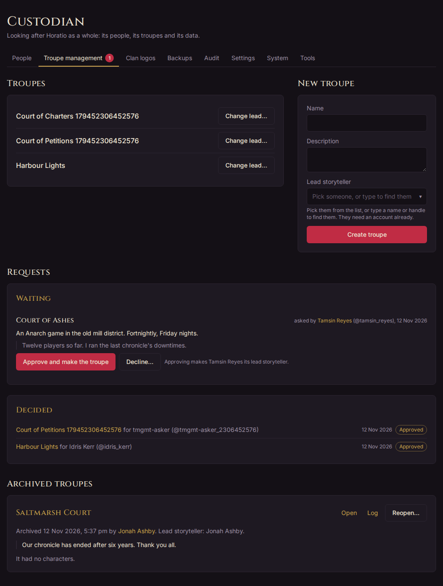

## Troupe requests

Anyone signed in can ask for a troupe of their own, from **Ask for a new troupe** at the foot of the Troupes page. They give its **Troupe name**, and optionally a **Description** and a **Note to the custodian**. Each request waits under **Requests** on **Custodian › Troupe management**, and the tab shows how many are waiting. It's on your bell too.

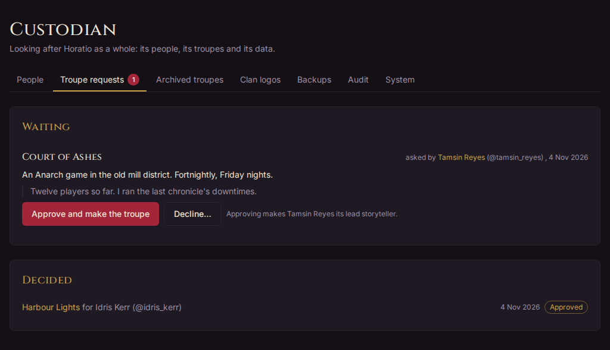

### Approving or declining a request

1. Open **Custodian › Troupe management**. Under **Requests**, **Waiting** lists the requests, the longest waiting first, with who asked and their note.
2. To say yes, choose **Approve and make the troupe**. Horatio makes the troupe with the name and description they gave, and makes the person who asked its [lead storyteller](glossary.md#lead-storyteller). They're told on their bell.
3. To say no, choose **Decline…**. You can say why under **Why not? (optional)**: they see it. Then choose **Decline**.

**Decided** lists the latest answers, approved or declined, and the requests people withdrew. An approved one links to its troupe.

### Making a troupe yourself

You can also make a troupe without a request. On **Custodian › Troupe management**, under **New troupe**, give its **Name**, a **Description** and its **Lead storyteller**, who needs an account already, then choose **Create troupe**. The **Troupes** page points you there too.

### Appointing a lead storyteller

Each troupe has one lead storyteller. Only you can change who it is, for example when a lead steps down or is suspended:

1. On **Custodian › Troupe management**, under **Troupes**, choose **Appoint a new lead…** on the troupe's row. (Or open the troupe, then its **Staff** tab, and use **Appoint a new lead** under **Lead storyteller**.)
2. Under **New lead**, pick the person, or type a name or handle to find them. The dialog says who leads it now.
3. Choose **Appoint**.

The new lead takes over at once. If they were already on the troupe's staff, their old role gives way to lead. The previous lead leaves the staff, with no role in the troupe, as the card says before you confirm; the troupe's log records who they were. If they're staying on, add them back under **Add staff** with a role. What each role can do is in [Running a troupe](running-a-troupe.md#staff-roles).

## Archived troupes

Archiving is how a troupe ends (see [Archiving a troupe](#archiving-a-troupe)). Troupes are never truly deleted.

### Archiving a troupe

A troupe's lead storyteller archives it, from the **Archive the troupe** card at the foot of the troupe's **Overview**. As the custodian you can do the same for any troupe. Horatio first shows what archiving will do, and asks for a reason, which everyone affected sees:

- the characters it's home to are left with no home troupe, and visits to it end, so their players can ask another troupe to accept them;
- an open downtime cycle ends without being answered or delivered, and games under way end;
- titles held there end; status stays;
- its NPCs stay with it.

Once archived, the troupe is closed to everyone but you.

### Reopening a troupe

**Custodian › Troupe management**, under **Archived troupes**, lists every archived troupe, the latest first: when and by whom it was archived, why, its lead storyteller, and the characters it had then. **Open** and **Log** take you to its pages, which stay readable to you.

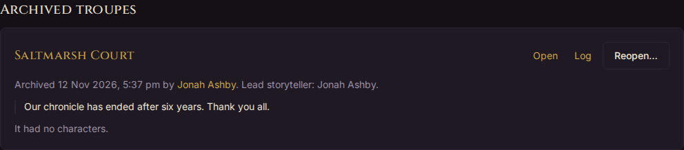

To bring one back:

1. Choose **Reopen…** on its card.
2. Give a **Reason**: those affected see it, and it goes in the troupe's log.
3. Choose **Reopen troupe**.

The troupe goes back to its staff, with its NPCs and history. The characters it let go don't come back: their players are told they can ask it to accept them again.

### Settling an old archived troupe

A troupe archived before Horatio settled characters on archiving may still hold some, marked **Still in it**, with nowhere to ask for approvals or downtimes. Its card says so and has **Settle…**. Settling does what archiving does now, with a reason, and tells their players.

## People

**Custodian › People** lists every account in a table: **Name**, **Handle**, **Email**, **Member since** and **Status**. Status shows **Suspended**, **Reset link out** or **New email waiting** when they apply. Each name opens that person's profile.

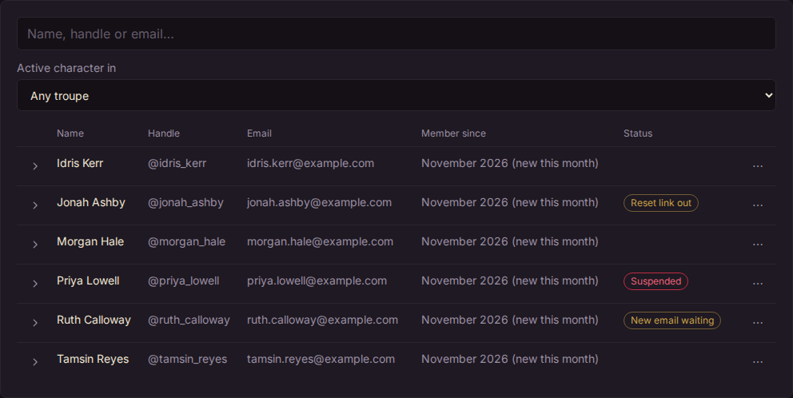

The chevron at the start of a row opens it, to show the person's handle, email and when they joined in full, and to list every character that person has, whatever its standing: active, still in creation, waiting for a troupe to accept it, or retired (with why: Final Death, off-field or inactive), and the NPCs they made, each marked as one. Each shows its picture, or its initials without one, and its home troupe, or **no home troupe**. Its name opens it. Choose the chevron again to close the row; you can have several open at once.

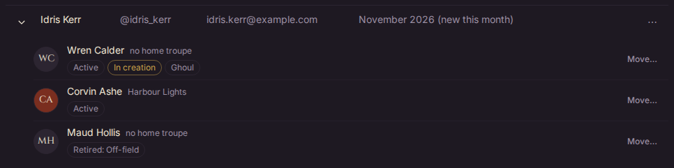

Everything you can do with an account is behind the **⋯** at the end of its row:

- to help with the account: **View as…**, **Edit email…** and **Reset password…**;
- below a line, to suspend or merge it: **Suspend…** (or **Lift suspension…**) and **Merge…**.

Each opens in a dialog over the list, so you don't lose your place.

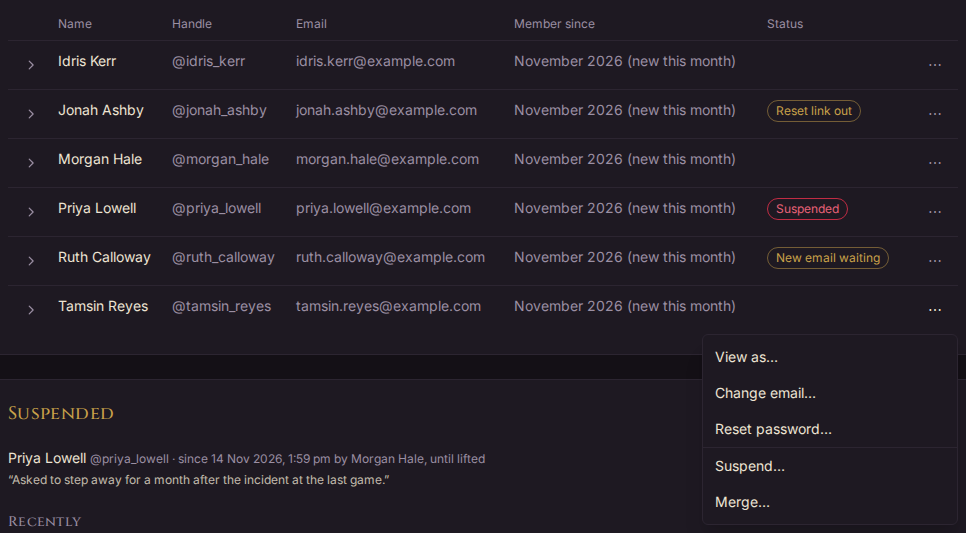

### Finding someone

- Type in **Search people** to find someone by their name, handle or email, or by a handle they used to have.
- Use **Active character in** to show only the people with an active character whose home troupe is that troupe.

Accounts closed by a [merge](#merging-two-accounts) aren't listed.

A long handle or email is cut short in its column rather than broken in two; open the row to read it in full. On a phone, each row folds into two lines: the name, then the handle and any badges, with the chevron at its start. Its email, when they joined and their characters open below it, across the card.

### Viewing as someone

When someone can't find something, or something looks wrong to them, you can see Horatio exactly as they see it, with their permissions (see [the glossary](glossary.md#view-as)):

1. Choose **⋯ › View as…** on their row.
2. Give a **Reason**, such as "Can't find their downtime". They're told, with your reason, and it goes in the audit log.
3. Choose **Start viewing**.

Horatio opens as them. A banner across the top says **Viewing as @handle, read-only**, and until when. Nothing can be changed while you view: every save is refused. Choose **Stop** in the banner to be yourself again. Viewing also ends after 30 minutes, or when you sign out.

They can see each time you viewed as them, and why, on their account's Sign-in and email tab. View as isn't offered for another custodian.

### Moving a character to another player

Sometimes a character belongs with a different player: it was built on the wrong account, or one player hands it on to another. Only its player changes; the character keeps its sheet, XP, history and troupes.

1. Open the current player's row with the chevron at its start, to list their characters.
2. Choose **Move…** beside the character.
3. Under **New player**, pick the person, and give a **Reason**. It's kept in the character's log, and told to both players and its home troupe's lead storyteller.
4. Choose **Continue**. Horatio shows what will happen: the troupes it stays in, that its sheet, XP, history, titles and status go with it, any staff role the new player has in those troupes, and any requests still waiting, which stay open for the new player.
5. Choose **Move *name* to @handle**, or **Back** to change something.

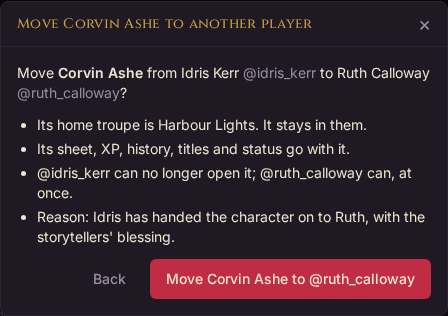

The old player can no longer open the character; the new one can at once. A character in a game on the Play View can't be moved until the game ends with **Reset for next game**, and an NPC can't be moved at all: it belongs to its troupe. To undo a move, move it back.

To hand an NPC to a player, give it instead: from the NPCs on the troupe's **Characters › Roster**, or the NPC's own page, choose **⋯ › Give to a player…** or **⋯ › Claim link…**. You can do this in any troupe, as its storytellers can (see [Giving an NPC to a player](running-a-troupe.md#giving-an-npc-to-a-player)). It becomes the player's character, at home and accepted in its troupe. If it went to the wrong person, move it to the right one as above. It can't be turned back into an NPC.

### Changing someone's email

For a player who has lost their old address:

1. Choose **⋯ › Edit email…**.
2. Give the **New email** and a **Reason**, which is for the log: they aren't shown it.
3. Choose **Send the link** (or **Make the link**, where Horatio can't send email).

They keep their old address until they open the link sent to the new one, within 7 days; then the old address is told. If Horatio can't send email on your server, you get the link to send them yourself, with **Copy link**.

While a change waits, the same dialog offers **Send the link again** (or **Make a new link**) and **Cancel the change**. An address another account already uses is refused: if both accounts are the same person's, [merge them](#merging-two-accounts) instead.

### Resetting a password

For someone locked out:

1. Choose **⋯ › Reset password…**.
2. If Horatio can send email, choose **Email a reset link** to send it to them, or **Make a link to copy** to send it yourself. Without email, choose **Make a reset link**.
3. Copy the link with **Copy link** and send it to them.

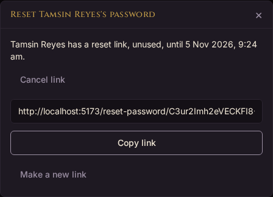

The link works once, for a day, and replaces any earlier link. Setting a new password with it signs them out everywhere else. Choose **Cancel link** to stop a link working. The same **Password** card is on a person's profile when you open it.

People can reset their own password from **Forgot your password?** on the sign-in page, but only on a server that can send email. Otherwise that page tells them to ask you.

### Resetting two-step sign-in

For someone who has lost their authenticator app and their recovery codes:

1. Make sure it is them asking, for example by talking to them.
2. Choose **⋯ › Reset two-step sign-in…** (it is there only for people who have it on).
3. Say why, and choose **Reset two-step sign-in**.

Their passkeys, authenticator app and recovery codes go, and their password alone signs them in until they set it up again. They're told in the bell and by email, with your reason, even if they've turned other emails off: the email says when it happened, and to contact the custodian if they didn't ask for it. It is kept in the audit log for good, and so is an email the mail server refused. A password reset never does this: someone with two-step sign-in who resets their password is still asked for their second step.

### Suspending someone and lifting it

Suspending keeps someone out for a while without deleting anything (see [the glossary](glossary.md#suspended-account)):

1. Choose **⋯ › Suspend…**.
2. Give a **Reason**. Only the custodian sees it.
3. Optionally, set **Until** to end it by itself. Leave it empty to lift it by hand. Times are in your own time zone.
4. Choose **Suspend *name***.

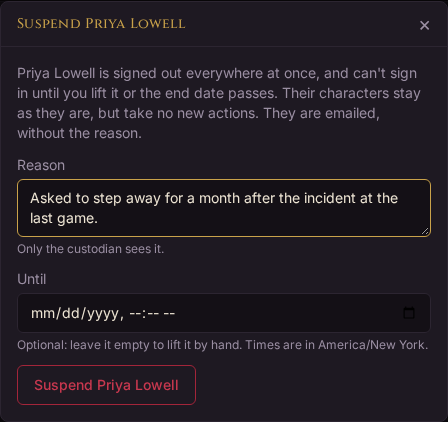

They're signed out everywhere at once, and can't sign in until you lift it or the end date passes. They're emailed to say so, without the reason, and get no other notifications while suspended. Their characters stay in their troupes, but take no new actions: no downtime answers, and no Play View taps. Their staff roles stay, but do nothing while they're away. If they lead a troupe, the Troupes page marks it **Lead suspended**, and you may want to [appoint a new lead](#appointing-a-lead-storyteller).

When they try to sign in, they're told their account is suspended and to contact the custodian. Whoever runs the server can say how, with the `HORATIO_CUSTODIAN_CONTACT` setting (an email address or a web page).

To lift it, choose **⋯ › Lift suspension…**, say **Why lift it** for the log, and choose **Lift suspension**. They're emailed to say they can sign in again.

### Merging two accounts

Someone who signed up twice, say once with Google and once with an email and password, has two accounts. Merging moves everything from one into the other, and closes the one merged away.

1. Choose **⋯ › Merge…** on either account's row.
2. Under **The same person's other account**, pick the other account.
3. Under **Which account stays?**, choose the one to keep.
4. Give a **Reason**. It's kept in the audit log and in the log of each troupe the merge touches, and told to the person and those troupes' lead storytellers. The person is always told; a lead can turn off theirs, under **Staff work › Accounts merged** on their Account › Notifications.
5. Choose **Continue**, read what will move, then choose **Merge into @handle**.

What moves: the closed account's characters, its staff roles (where both accounts are on one troupe's staff, the higher role is kept), its ways of signing in, its [blog](#the-blog) articles with any changes waiting on them, and its settings, profile details and blog author profile where the staying account has none of its own. Its handles still find the person. A suspension it's under carries over.

The closed account is signed out everywhere, can't sign in, and isn't listed or found. Its email is freed for use. What it did stays as it was, shown as "*name* (merged into @handle)".

A merge can't be undone. A custodian's account can't be the one closed, and a merge waits while one of the characters is in a game on the Play View.

### Clearing a blog author's bio or picture

Anyone on a troupe's staff can have an author page on the blog, with a bio, links and a picture they choose (see [Your blog author profile](getting-started.md#your-blog-author-profile)). To clear one that breaks the site's rules, open their page at /blog/authors/*handle*. Under **Custodian**, tick **Bio**, **Links** or **Picture**, give a **Reason** if you like, and choose **Clear**. The rest of their author profile stays. They're told in the bell, with your reason, and it's kept in the audit log, under Accounts.

### The Suspended, Password resets and Email changes cards

Under the table, three cards show what's going on with accounts:

- **Suspended**: who is suspended now, since when, by whom, until when, and why. If a suspended person leads a troupe, it says so, with a link to the troupe's Staff tab to appoint a new lead. **Recently** lists the latest suspensions and lifts.
- **Password resets**: **Links that work now**, each with **Cancel**, and **Recently**: links made, emailed, asked for and used.
- **Email changes**: **Waiting to be confirmed**, each with both addresses and **Cancel**, and **Recently**: changes started, confirmed and cancelled.

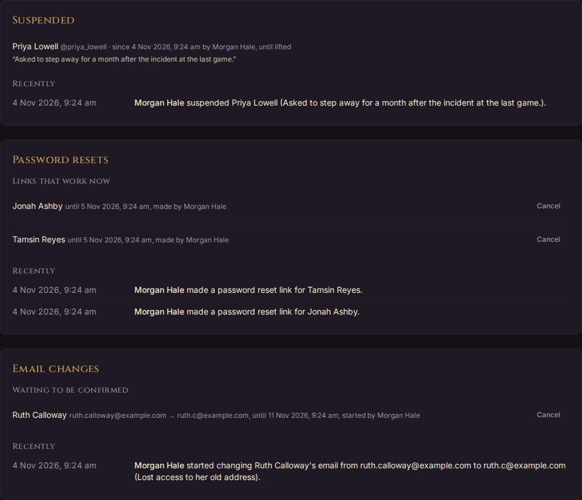

## The blog

Horatio has a blog of its own: articles on playing and running a game, for everyone who uses Horatio, written by the staff of any troupe that isn't archived, narrators included. Nothing is on it until you publish it, and readers can't comment. A published article is on the blog, at **/blog**, for anyone at all, signed in or not, with its picture; see [Reading the blog](getting-started.md#reading-the-blog). An article not published is seen only by its author and you.

How staff write an article, and what the blog asks of them, is in [Writing for the blog](blog.md).

**Custodian › Blog** has two parts: **Articles**, and the blog's **Tags** (below). **Articles** holds the articles sent to you, and the tab shows how many are waiting. It has three lists:

- **Waiting**: the articles their authors have sent you, and the changes to published articles, the longest waiting first. A published article's changes are marked **Changes**.
- **Published**: what is on the blog, the latest first.
- **Unpublished**: what you've taken down, with why.

Each article or change waiting is on your bell too, until you publish it or return it, or its author withdraws it. Choosing it opens **Custodian › Blog** with that article open to read. To have it emailed or pushed to you as well, tick it under **Custodian › Blog articles waiting** on your Account › Notifications.

Each article shows its title, author, the troupe it names (an author on staff in several chooses one, or none) and its summary. Choose **Read it** to read the whole article, with its picture, and the troupe's card when the troupe is public and not archived (see [What readers see of your troupe](blog.md#what-readers-see-of-your-troupe)).

### Publishing or returning an article

1. Open **Custodian › Blog**, and under **Waiting**, choose **Read it** on the article.
2. To put it up, choose **Publish** (for a published article's changes, **Publish the changes**). Changes take the place of what readers saw, and the article keeps the date it was first published.
3. To send it back instead, choose **Return with a note…**, say what to change under **Note to the author**, and choose **Return it**. The article is a draft again; for changes, the published article stays up as it was, and the author works on the changes.

Either way the author is told on their bell, with your note.

### Featuring, tagging and unpublishing

Under **Published**, **Feature it** marks an article as featured, and **Stop featuring** undoes it. Tag any article with the chips under it: choosing a tag adds it at once, and choosing it again takes it off. The tags are the list you keep under **Tags** (below). A retired tag an article still has shows after the others, marked **(retired)**: you can take it off, but not put it back.

To take an article down, choose **Unpublish…**, say why under **Why unpublish it?**, and choose **Unpublish**. Its author is told why on their bell. They can change it and send it to you again; publishing it then puts it back with its first date.

### An article's address

Each article has an address on the blog, made from its title, such as /blog/running-your-first-elysium. A few words are the blog's own pages and are never an article's address, such as write and tags. Until it is first published its author can change it, and so can you: choose **Change** beside **Address**. Once it has been published the address stays as it is, even if the title changes, so links to it keep working.

### What search engines and feeds see

What other sites see of Horatio is only what anyone may read: published articles, the tags they have, the pages of authors who write for the blog, and troupes' public profiles. A draft, an article waiting or unpublished, and changes not yet published are never in any of it.

- **Link previews.** A link to the blog, an article, a tag's page, an author's page or a troupe's public profile, shared in a chat or on social media, shows that page's title and description: for an article, its title, its summary (or the start of its words) and its picture. A link to anything else, or to an article that isn't published, shows Horatio's own preview, which says nothing about it.
- **Feeds.** The blog has a feed at /blog/feed.xml, and each tag one of its own, such as /blog/tags/storytelling/feed.xml, for feed readers. Each holds the 20 newest published articles, in full, with their pictures. An article you unpublish leaves the feeds within a quarter of an hour, though a reader that has already fetched it keeps its copy.
- **The sitemap**, at /sitemap.xml, lists the blog, its published articles, the tags they have, the authors' pages, and the troupes whose profile is public and not archived. An author whose account is suspended or merged into another isn't in it.
- **robots.txt** asks search engines to keep to the public pages: the blog, troupes' public profiles (/t/), the manual (/help) and About. Everything signed in, such as characters, troupes and Custodian, is closed to them, and needs signing in anyway.

All the addresses in them start with the site's address, HORATIO_PUBLIC_URL, so set that to the address people use.

### The blog's tags

**Custodian › Blog › Tags** holds the tags articles are tagged with, in the order authors and you are offered them. Horatio starts with a dozen, such as Storytelling and Safety and consent. Each shows how many articles have it, and how many of those are published. Open a tag's **Actions** menu to:

- **Rename…** it. No two tags share a name, whatever the case. Each tag has an address on the blog, made from its name: it follows a rename until a published article has the tag, then stays as it is, so links to the tag keep working. The rename box says which.
- **Move up** or **Move down**, to change the order.
- **Retire** it. A retired tag stays on the articles that have it, and still shows on them, but isn't offered for any more. **Offer it again** brings it back.
- **Merge into…** another tag, for two that mean the same. Every article with it gets the other tag instead, and the tag is removed, with its address on the blog. You can't merge into a retired tag.

Choose **Add a tag** to add one at the end of the list.

Each step goes in the audit log, under **Blog**.

## Backups

**Custodian › Backups** lists the database backups the server keeps, newest first, marked **Nightly** or **Made here**.

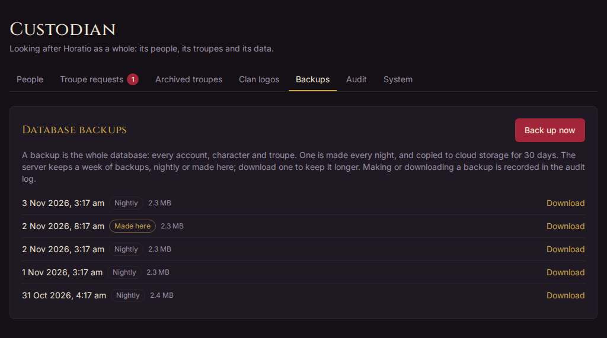

- A backup is the whole database: every account, character and troupe. Uploaded pictures, such as portraits and clan logos, aren't in it.
- Where the server runs a nightly backup, those are listed too. How long backups are kept, and whether they're copied anywhere else, depends on how the server is set up, so the tab doesn't promise either. On the repository's own deployment, the nightly job keeps a week of backups, nightly or made here, and copies each nightly one to cloud storage for 30 days.
- Choose **Back up now** to make one, before a big change for example.
- Choose **Download** beside a backup to keep a copy of your own. A backup holds everything, including password hashes, so keep downloads somewhere safe.

Making or downloading a backup goes in the audit log.

If the tab says **Backups are not set up here**, the server has no backup directory: the `HORATIO_BACKUP_DIR` setting names it. That's normal on your own computer.

Backups made here hold the database only. On the server, the nightly job also packs up the uploaded pictures (portraits and clan logos) and the Dark Pack resources and VTES symbols fetched in [Tools](#tools), beside the nightly backup.

### Restoring a backup

There's no restore button: restoring replaces everything in the database, so it's done on the server. In short, you stop the app, recreate the database, load the backup into it, and start the app again; pictures, the Dark Pack resources and the VTES symbols are restored from the night's archives beside it. The exact commands are in the "Backups" section of [deploy/README.md](https://github.com/michael-tracey/horatio/blob/main/deploy/README.md#backups).

Everything since that backup is lost, so make a fresh backup with **Back up now** first if the app still works.

## Site

**Custodian › Site** holds what's the same for everyone on the server: the loading animation, how long **Invite players** stays on a new troupe's list, mail, how emails look, and Discord. It also shows what's running. It used to be two tabs, Settings and System; their old links still land here.

Each card shows its status, and its test where it has one, in sight. What you look at less often, such as the settings behind the status, who emails come from, changing the email design and its preview, is folded under a line at the foot of the card: choose it to open it.

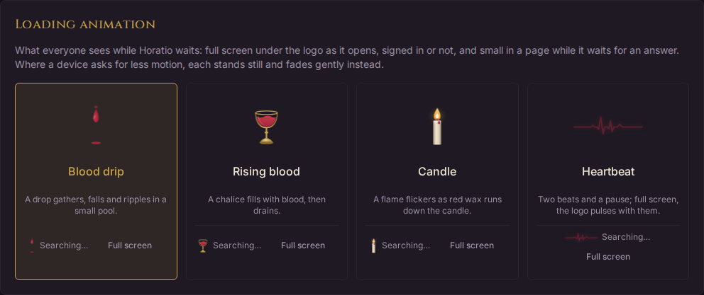

### The loading animation

While Horatio waits, it shows a loading animation: full screen under the logo as the app opens, signed in or not, and small in a page while it waits for an answer. Choose one of four:

- **Blood drip**, the one until you choose: a drop gathers, falls and ripples in a small pool.
- **Rising blood**: a chalice fills with blood, then drains.
- **Candle**: a flame flickers as red wax runs down the candle.
- **Heartbeat**: two beats and a pause. Full screen, the logo pulses with them.

Each is shown moving, with the small one that sits beside a line of text, such as a search's count. **Full screen** shows it as the app opens: choose **Close**, or anywhere, to leave. Choosing one changes it for everyone at once, and goes in the audit log. On a device set to reduce motion, each stands still and fades gently instead.

The very first screen shows before the app has asked the server anything, so it shows the animation last seen on that device. Someone who hasn't opened Horatio since you changed it sees the old one once.

### Getting your troupe ready

A new troupe's lead storyteller and storytellers see **Getting your troupe ready** on its Overview and in Settings › Getting ready: the steps a new troupe takes, each ticked from what the troupe holds (see [Getting ready](running-a-troupe.md#getting-ready)). The last step, **Invite players**, leaves the list once the troupe is a number of days old, counted from the day it was made, whether it was ticked or not. By then a troupe has players or knows how to find them, and a visit left behind by a declined request no longer keeps the step ticked.

The **Getting your troupe ready** card says the number of days now, and sets it under **Change the number of days**, from 1 to 365; it's 30 until you change it. It applies to every troupe at once, old and new. Once the step has left, the list's count leaves it out too: "5 of 7 done", not "5 of 8". Changing the number goes in the audit log.

### Mail

The **Mail** card says whether Horatio can send email, who emails come from and through which server, or if not, which settings are missing (see [Email: an SMTP service](#email-an-smtp-service)). What it uses and who emails come from are under **Details, and who emails come from**.

- **What it uses:** the mail server and port, the security (STARTTLS, SSL or none), and the username with most of it hidden. The password only shows as **Set** or **Not set**: Horatio never shows it, never keeps it in its database, and never sends it to anyone's browser. A security setting that looks wrong, such as none at all, gets a note in red.
- **Who emails come from:** a **From name**, **From address** and **Reply-To** of your own, over the server's `HORATIO_MAIL_FROM`. Every email Horatio sends uses them from then on. Leave a box blank to use the server's. The From address must be one your mail provider lets Horatio send from, or it refuses the email. A troupe's own Reply-To, for its downtime results, still wins over yours. Saving goes in the audit log.
- **Send a test email:** sends one to your own address straight away. If the mail server refuses, the card says why in plain words, naming the setting to check, with what the server said under it.
- **Mail that failed lately:** listed only when something has failed. Downtime results and quests' news sent by email that failed or are being tried again, and notification emails Horatio gave up on. Each says when and why. Open one to see it where it lives, or choose **Retry** for one Horatio gave up on.

The server, username and password stay in `deploy/production.env`: change them there, then redeploy with `deploy/deploy.sh --no-build`.

### Email design

The **Email design** card sets how every email Horatio sends looks: password resets, email changes, suspensions, notifications and the daily digest, account merges, and downtime results and quests' news. Each email goes as a formatted email with a plain-text version beside it, for mail apps that want only text. The card says in a line what is in the header now, whose colours, and whether there is a footer of your own; the boxes are under **Edit the design**, and the preview under **Preview a sample email**.

- **Header:** the site's name, on a header colour with a text colour, or a **header picture** in its place, such as a logo. The picture is made at most 1200 × 400 px and kept small, as a PNG (if it has transparency) or a JPEG, never WebP, which some mail apps can't show. It travels inside every email, so it shows without signing in, and Horatio never learns who opened one. Where a mail app blocks pictures, the site's name shows instead. A picture too detailed to make small enough is refused, with the reason.
- **Accent:** for buttons and the line under the header. Links use it too, darkened where they must be to read on white.
- **Footer:** a few lines of your own, up to 1,000 characters, such as who runs this Horatio and how to reach them. **Bold**, *italic*, [links](https://example.org) and bare links work. Under it, each email still says why it came and how to stop it, and "Sent by Horatio" with the site's address: your footer can't remove those.
- **Preview:** a sample email as a mail app shows it, **Light** or **Dark**, at **Phone** or **Desktop** width, and as **Plain text**.
- **Send me this email:** sends the sample to your own address, to see it in your own mail app. It shows only while mail is set up.

Leave a box as it was to keep Horatio's own: its name, night and gold. **Put back Horatio's name and colours** does that for all of them at once. The card warns when the header's text is hard to read on its colour. Each change goes in the audit log.

### Discord

The **Discord** card says whether the Horatio bot can work, and if not, which of the three settings are missing (see [Discord: the Horatio app and its bot](#discord-the-horatio-app-and-its-bot)), and how many troupes have connected a server. What it uses, the links for Discord's developer portal and the troupes connected are under **Details, and the troupes connected**.

- **What it uses:** the client ID. The client secret and bot token only show as **Set** or **Not set**, never their values.
- **For Discord's developer portal:** the **OAuth2 redirect** to register, made from `HORATIO_PUBLIC_URL`, and an **Invite link for the bot**, each with **Copy**. The invite adds the bot to a server by hand, asking for [every permission the bot uses](#discord-the-horatio-app-and-its-bot) (opened again for a server the bot is in already, it updates the bot's permissions there); troupes connect their own servers from **Setting up › Connectors**, which tells Horatio which server is theirs.
- **Check the bot:** asks Discord who the bot is, with the server's token, and shows its name and how many servers it's in. A refused token says so, naming the setting.
- **Troupes connected:** each troupe that has connected a Discord server, its server's name, how many characters have a channel for their results, whether it has a test channel, and which posts have a channel.
- **Discord posts that failed lately:** listed only when something has failed. Results, quests' news and posts to Discord that failed or are being tried again, each with when and why, and **Retry** for one Horatio gave up on.

The credentials stay in `deploy/production.env`: change them there, then redeploy with `deploy/deploy.sh --no-build`.

### What is running

At the bottom, **What is running** shows the app the server is running, so you can tell whether a fix has gone live:

- **Version**: the commit the running app was built from, linked to its code on GitHub, and marked "with uncommitted changes" if any went in. A build not made by `deploy/deploy.sh`, such as one on your own computer, says so instead.
- **Built**: when that build was made.
- **Running since**: when the app last started.
- **Database**: the migration the database is on, marked **Up to date**, or **Behind** with the migration this build expects. Behind means the database needs migrating: see [Updating the server](#updating-the-server).
- **PostgreSQL**: the database server's version.

## Tools

**Custodian › Tools** holds upkeep that would otherwise need a command on the server. Each tool is a card that says what it does, shows what it would change, and changes nothing until you say so. The cards that fetch files from elsewhere say what the server has now. The [import from Yorick](#importing-characters-from-yorick) and the [boon ledger import](#importing-a-boon-ledger) are here too: their cards open them.

### Fitting NPC creation picks

An NPC built without the wizard (built quickly, made sheeted from Stock, or imported from Yorick) has its creation picks fitted to its sheet, so its starting dots are free as a player character's are, and it isn't worth more XP than a player character with the same sheet. Every change to its sheet fits them again. NPCs no one has changed since that came in need fitting once:

1. Under **Fit NPC creation picks**, choose a troupe. Archived troupes aren't offered.
2. Choose **Preview**. It lists each NPC to fit, with what its sheet is worth in XP now → after fitting, and the total. Nothing changes yet.
3. Choose **Fit**. The troupe's log and the audit log say who did it and how many NPCs changed.

Picks staff placed or took off by hand on an NPC's **Creation picks** card are kept. Fitting again changes nothing, so it's safe to run twice.

Some characters are left as they are, and the preview says why: NPCs built in the wizard, whose picks are the ones placed there; Stock NPCs, which have no sheet; and NPCs already given to players (see [Giving an NPC to a player](running-a-troupe.md#giving-an-npc-to-a-player)), whose picks and XP are their own now.

On the server, `python -m horatio.npc_picks` does the same for every troupe at once.

### The Dark Pack resources

The Dark Pack logo on the About page and the clans' symbols on badges come from Paradox's free Dark Pack kit. Horatio never ships them, as the [Dark Pack Agreement](https://www.paradoxinteractive.com/games/world-of-darkness/community/dark-pack-agreement)'s licence belongs to whoever runs the server. The **Dark Pack resources** card fetches them onto the server:

1. Check the **Address**. It's filled with Paradox's download, the shared Dropbox folder behind **Download Free Content** on the agreement's page. Change it only if Paradox moves the kit; it must start `https://`.
2. Tick **I accept Paradox's Dark Pack Agreement for this server**. The licence is yours to accept, as the server's custodian.
3. Choose **Fetch and import**. The server downloads the kit, about 450 MB, and imports it in the background: the card shows how far it has got, and you can leave the page and come back. The import keeps only what Horatio uses, about a megabyte, and deletes the download.

The card then says when they were imported and from where, whether the Dark Pack logo is there, and which clans have a symbol. The logo and symbols show at once, with no restart. **Fetch and import again** replaces them, for a newer kit.

If a fetch fails (the address has moved, or Dropbox refuses), the card says why, and whatever was imported before stays. If it keeps failing, import the kit on your own computer instead and upload the result:

1. Download the kit from the agreement's page.
2. From Horatio's `backend` folder, run `uv run python -m horatio.dark_pack path/to/the-download.zip`. It takes Paradox's download as it comes, or the two zips inside it, and writes the `dark-pack` folder.
3. Zip that folder, then under **Or upload an import made on your own computer**, tick the agreement and choose **Upload the zip**.

**Remove** takes the logo and symbols off the server, once you've confirmed. Badges then show only the clan logos uploaded in [Clan logos](#uploading-a-clan-logo). Each fetch, upload and removal is in the audit log. [dark-pack/README.md](https://github.com/michael-tracey/horatio/blob/main/dark-pack/README.md) has the details for running Horatio on your own computer.

### VTES symbols

The **VTES symbols** card fetches the symbols of *Vampire: The Eternal Struggle* from [KRCG](https://static.krcg.org/): its clan symbols, its discipline symbols (inferior and superior), its game icons and the Sabbat's path symbols, each plain and again with the white border printed cards draw them with; its three fonts; and its two logos, VTES's and the Dark Pack's. Characters' Jyhad cards show them, the disciplines white-bordered, with KRCG's capacity drop: a hidden, just-for-fun card of a vampire in the style of a VTES crypt card, which falls back to three-letter abbreviations and a drawn drop without them. Later they may show beside clans and disciplines, and as Discord emoji. They're free to use under the Dark Pack Agreement too; wherever Horatio shows them, it credits KRCG and gives Paradox's notice.

1. Check the **Address**, `https://static.krcg.org/` unless KRCG moves.
2. Tick **I accept Paradox's Dark Pack Agreement for this server**.
3. Choose **Fetch**. The server fetches a thousand or so small files one at a time, with a pause between each to be polite, so it takes several minutes.

The card then says when they were fetched, how many there are of each kind (SVG, WebP and PNG, and WebP and PNG white-bordered) and group (clans, disciplines, superior, icons and paths), which fonts and logos came, and which of Horatio's clans, bloodlines and disciplines have a symbol and which don't. It lists any PNG over 256 KB, the most Discord allows for an emoji. Symbols fetched before Horatio took the white-bordered ones are marked: **Fetch again** to have them, as Jyhad cards draw their disciplines with them and use the plain ones until then. **Fetch again** replaces them all, keeping the last set if it fails; **Remove** takes them off the server, once you've confirmed.

### Jyhad card templates

The **Jyhad card templates** card takes the clans' 2020 crypt card templates: the Dark Pack's "Community Created Card" frames, one for each clan and antitribu, named `2020_Crypt_<Clan>.png`. A character's Jyhad card is then drawn on its clan's template instead of Horatio's own frame:
- **The portrait** sits in the template's oval.
- **The disciplines** stack up the sidebar on the left from its foot, beside the text box, as a printed crypt card has them: the inferior ones first, the superior at the bottom, KRCG's white-bordered squares and diamonds once the VTES symbols are fetched.
- **The name** goes across the top.
- **The text** goes in the pale box at the bottom.
- **The capacity** goes on the printed blood drop.

Which template a card uses:
- **A bloodline with its own template** (True Brujah, Ahrimanes, Samedi, Kiasyd, Ishtarri) uses that one; any other bloodline uses its clan's.
- **A Sabbat character** uses the antitribu's template where there is one, and a Sabbat Caitiff the Panders'.
- **A clan with no template** (or a server with none) keeps Horatio's frame.

The templates are Paradox's, under the Dark Pack Agreement, so Horatio never ships them: you upload them here, and only people who can see a character are sent its card's template.

1. Tick **I accept Paradox's Dark Pack Agreement for this server**.
2. Choose **Upload templates**, and pick the PNGs, or a zip of them. All of them come to about 47 MB.

Horatio checks each one: its file name must name a clan, and it must be a PNG of the 2020 templates' size (819 × 1114) with its oval where theirs is. It keeps them as WebP beside the Dark Pack resources. The card then says what the upload added, what it left out and why (a second copy of a clan, a file of another size), which templates are here, and which of Horatio's clans and bloodlines have one. An upload adds to those already here; one of a clan already here replaces it. **Remove** takes them all off the server, once you've confirmed.

## Clan logos and the Dark Pack import

Game badges show a character's clan logo beside its picture, or in its place when it has none. The official clan symbols belong to the game's publisher, so Horatio ships none. There are two ways to give the clans logos:

- **Fetch the Dark Pack resources.** Paradox's Dark Pack Agreement lets a free fan app like Horatio use its clan symbols and the Dark Pack logo, but the licence is personal to whoever runs the server. So each server fetches them itself, in **Custodian › Tools**.
- **Upload your own** for any clan or bloodline, if your troupes have the right to use the images.

An uploaded logo always wins over a Dark Pack symbol. A bloodline without its own logo uses its clan's; a clan without one shows only its name.

### Uploading a clan logo

1. Open **Custodian › Clan logos**. Type in the search box to find a clan or bloodline. The count says how many have a logo.
2. Choose **Upload** beside the clan, and pick an image: PNG, JPEG, WebP or HEIC. A PNG with a transparent background prints best.
3. To change it, choose **Replace**. To remove it, choose **×**.

A clan using its Dark Pack symbol shows it on a light square marked **Dark Pack**. If the tab says **Uploads are not set up here**, the server has no upload directory: the `HORATIO_UPLOAD_DIR` setting names it.

### Importing the Dark Pack resources

Fetch them in **Custodian › Tools**: see [The Dark Pack resources](#the-dark-pack-resources). The files must never be committed to the repository. Until the logo is on the server, the About page reminds you, as the custodian, that the agreement asks for it.

## Importing characters from Yorick

A troupe moving from Yorick can bring its characters with it, as sheeted NPCs of the troupe. Staff then give each one to its player as they sign up (see [Giving an NPC to a player](running-a-troupe.md#giving-an-npc-to-a-player)). Yorick's printout has no players, XP or history, so none of those come across: a character's XP is set when it's given to its player.

A troupe can come across over months, a few players at a time. Upload a newer page whenever you like: importing it again updates the characters made before, and what you've worked out for the troupe, its names and your choices, stays for the next page.

You'll need:

- the troupe made in Horatio, with its lead storyteller;
- the troupe's **Print Characters** page from Yorick, saved from the browser as a complete web page. That gives an `.html` file and a folder of the same name ending in `_files`, which holds the portraits. Zip the two together. The `.html` alone works too, without portraits.

The page holds real players' names and emails. Horatio keeps it only for the import, where only you can reach it, and deletes it once it's imported, when you choose **Delete the page**, or 30 days after you uploaded it. The report from it is deleted 30 days after it was made. Uploading, importing, deleting and downloading are recorded in the audit log.

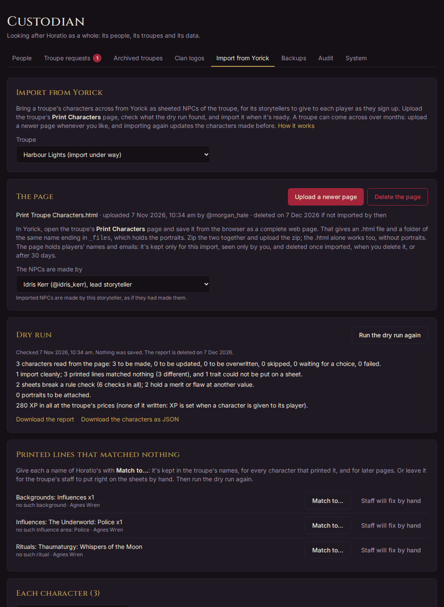

### Upload the page

1. Open **Custodian › Tools**, choose **Open the import** on the **Import from Yorick** card, and choose the **Troupe**.
2. Choose **Upload the page**, and pick the zip or the `.html`. **Upload a newer page** replaces it later.
3. Under **The NPCs are made by**, choose who makes them: the lead storyteller, or one of the troupe's storytellers.

A dry run starts as soon as the page is uploaded. It saves nothing. It runs in the background, a minute or two for a big troupe, and you can leave the page while it does.

### Read the dry run

**Dry run** sums up what the import would do: how many characters it would make or update, how many lines matched nothing, the rule checks the sheets break, and what they're worth in XP at the troupe's prices. **Download the report** has all of it, character by character, and **Download the characters as JSON** has each character as read and as matched. **Each character** lists them, with what became of each; open one to see its unmatched lines, rule checks and portrait.

### Characters already here under the same name

Where a character already in the troupe has the name of one on the page, and isn't one this import made, the dry run lists it under **Already here under the same name**. Names match ignoring capitals and spacing. It looks at the troupe's NPCs and at its players' characters, at home, visiting or being built for it.

Choose what to do with each:

- **Overwrite** the one here: it becomes the imported character, its printed traits set as on a later import, keeping anything else on its sheet. Only a sheeted NPC of the troupe can be overwritten. A player's character changes through the troupe's approvals, and a Stock NPC has no sheet.
- **Skip it**: it isn't imported, now or later, until you change your mind.
- **Import it as a new NPC beside it**.

Until you choose, it isn't imported, and the import waits. Your choice is kept for later pages.

### Put names to what matched nothing

**Printed lines that matched nothing** lists each line once, with the characters that printed it. For each:

- **Match to…** gives it one of Horatio's names, such as an Influence area written another way, or a merit Yorick spells differently. Type to narrow the choices. It's kept in **The troupe's names**, for every character that printed it and for later pages. Remove one there with **×**.
- **Staff will fix by hand** leaves it for the troupe's staff to put right on the sheets afterwards. It's counted apart, and the import goes ahead without it.

Lines the troupe's own lists don't allow (**Specialisations** in the troupe's settings) show here too: add them to the troupe's list, or match them to one on it.

A table of names written for the old command-line import, in the shape of `backend/src/horatio/yorick_names.toml`, can be added with **Add from a table…**.

After changing names or choices, choose **Run the dry run again** to see what the import will do now. Repeat with the troupe's lead storyteller until the list is clean, or holds only what staff will fix by hand.

### Import

Under **Import**, choose **Import into *troupe***, then **Import**. It can't start while names or choices have changed since the dry run, or while a printed character still needs a choice. It:

1. makes a backup first, as **Back up now** does ([Backups](#backups)), and stops if it can't. Where backups aren't set up, as on your own computer, tick **import without one** first;
2. makes each character a sheeted NPC of the troupe, with its portrait where it has one;
3. saves them all at once, or none if any one fails;
4. deletes the page. The report stays, now saying what was done.

Rule checks don't stop a character coming in: what its sheet breaks is flagged on it, as on any sheet. Each NPC's log says it was imported, with its Yorick id.

Yorick's printout doesn't show a character's extra in-clan disciplines: a Caitiff's chosen three, or one a merit such as Additional Common Discipline makes in-clan. The import finds them only where the sheet names them: an **In clan:** line the player wrote in the notes printed with it (such as `In clan: Animalism, Auspex, Presence`), or a merit's detail (`Vestiges of Greatness (3, Vicissitude)`). Each one beyond the clan's own goes under **Extra in-clan disciplines**, except a path that a Thaumaturgic or Necromantic Expertise printed without its path can take: the path becomes that merit's. For the rest, staff add them on the NPC's sheet, under **Extra in-clan disciplines**: the NPC's creation picks are fitted again, and its XP follows.

A merit that gives another merit (Piece That Remains, Auspicious, Old Habits, Shadows of the Past) is printed with the merit it gives as its detail, such as `Piece That Remains (2, (Ventrue Royalty))` or `Auspicious (1, Rugged)`. The import makes that its choice, as a player's would be: the merit given is free, and its own grants apply, so Ventrue Royalty given this way places its 4, 3 and 2 on the NPC's backgrounds. A merit given that matches nothing is listed under **Matched nothing**, where **Match to…** puts it right; one the merit can't give (Auspicious copies only a General merit) is listed under **Could not be put on the sheet**. An NPC imported before this has the merit but not what it gives: import it again from a new printout, or have its staff choose what the merit gives on the NPC's **Sheet** tab (see [Making an NPC](running-a-troupe.md#making-an-npc)). Either way the merit it gives is held that way, and its creation picks are fitted again.

Importing again updates the characters it made before, rather than making them twice. It sets their names and printed traits again, and leaves anything staff added by hand. A character already given to its player is left alone.

If the server restarts during a dry run or an import, the page says so. Nothing was saved: run it again.

## Importing a boon ledger

A troupe that kept its boon ledger in a spreadsheet can bring it into Horatio's (see [Boons](running-a-troupe.md#boons)). The import reads the sheet's own layout: a **Master** tab with a boon on each row, and a **Characters** tab giving each character's **Canonical Name** and its aliases (**Alias 1** to **Alias 11**). Columns are found by their headings, wherever they are. The tabs worked out from Master (Active, Settled, Standings and so on) aren't read, except that a **Flagged for Harpy** tab's **Review Comments** become the note on a flagged boon's flag.

The sheet holds players' names and emails. It's read when you choose it, and never kept on the server. No email is put on a boon or in the report: where a row's **Input Email** is an account's here, the boon is marked as entered by that account, and otherwise by no one.

1. Download the sheet as `.xlsx` (in Google Sheets, **File › Download › Microsoft Excel**).
2. Open **Custodian › Tools**, choose **Open the boon import** on the **Import a boon ledger** card, and choose the **Troupe**.
3. Choose **Choose the spreadsheet**, and pick the file. A dry run reads it at once and saves nothing.
4. Read the report, and **Download the report (CSV)** to keep it or share it with the troupe's staff.
5. Under **Import**, choose **Import into *troupe***, then **Import**. Every boon is saved at once.

### What comes across

- **Type** is the boon's kind: trivial, minor, major, blood or life. A row of any other type is skipped, and the report says so.
- **Date** is the night it was made; **Reason** its reason; **Stipulation** its conditions, and where it speaks of notifying, its debtor's player is told when it's traded; **Comments** its staff note.
- **Settled** marks it settled: called in, or forgiven where **Settled Notes** say so, on its **Settled Date** (else its **Input Date**, else its own date), with Settled Notes as the note. Settled Notes on a boon not settled go in its staff note.
- **Flag** raises a flag on it for review, in the ledger's review queue.
- **Owed By** and **Owed To** are matched to the troupe's characters by name, by a name the character had before a rename, or by an alias on the Characters tab, ignoring capitals, spacing, quotes and a trailing "(D)". A name that matches no character, or more than one, or text that isn't a name at all, is kept as written, as a name only. Staff can link it to a character from the boon later. A blank side is kept as "(blank in the spreadsheet)".

Each boon has one line in its log, "Imported from the spreadsheet", dated from its Input Date. No one is notified, and no Gallant is offered. The troupe's log has one entry for the whole import.

### The report

The report counts the boons by kind and by standing or settled, and how many would be added, updated or left unchanged. It lists every name the sheet gives, matched, matched by alias, or kept as written, with how many boons each is on. It lists the rows skipped and why, rows that look like duplicates of each other or of a boon already in the ledger (they're imported anyway), and anything cut short: the ledger takes at most 2,000 characters for a side, a reason or a note.

### Importing again

Each boon keeps the row it came from: its **Unique ID**, else its **Response ID**, else its row number. Importing a newer sheet updates the boons it made before and adds the new rows, so it never makes a boon twice. A name that matches a character added since is linked to it. A boon anyone has changed in Horatio since it was imported (edited, traded, settled, linked, flagged…) is left as it is, and the report lists it as skipped. Rows with neither id are kept by their row number, so add rows at the bottom of the sheet between imports.

## The audit log

**Custodian › Audit** is the whole audit log: every change in every troupe, and outside them, newest first. Searching it changes nothing in it.

To find something, fill in any of:

- **Who did it**: a person.
- **Character**: any character, whoever's and wherever it is. Type to narrow the list.
- **Troupe**: archived troupes included.
- **Kind of change**: such as Approvals, XP, Sheets, Downtimes, Staff, House rules, Troupes, Accounts, Blog or System.
- **From** and **To**: the days, both included.
- **Level**: **Info and notice** leaves out the routine debug events; **Notice only** finds what is kept forever. See [What the log records and keeps](#what-the-log-records-and-keeps) for the levels.
- **Words**: each word somewhere in what the change says, such as a name, a trait or a reason.

Then choose **Search**, or **Clear** to start again. The search is kept in the page's address, so you can bookmark it or send it to another custodian.

**Found** lists each change with when, who, the troupe and what happened, each linking to its page; a debug or notice change is marked so. Choose **Show older** for more, or **Export as CSV** to download everything the search finds.

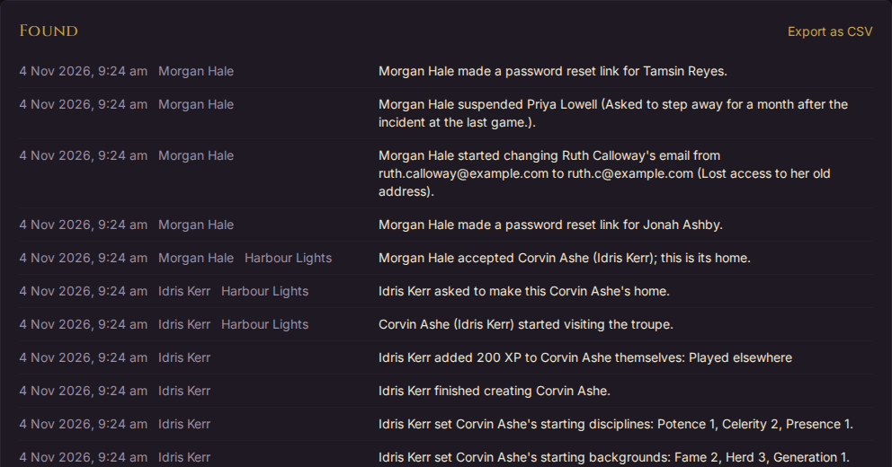

A troupe's running staff see their own troupe's part of this in its log (**See the whole log**, on the troupe's Overview), without debug events. Only you see the whole of it. What it records, and how long it keeps it, is set on the **Audit log** card above the search: see [What the log records and keeps](#what-the-log-records-and-keeps).

### What the log records and keeps

The **Audit log** card at the top of **Custodian › Audit** sets what the log records and how long it keeps it. Each change in the log has a level:

- **Notice**: kept forever. Suspensions, merges, moves, deletions, password resets, changes to the site's settings, your decisions on blog articles, and everything Horatio reads back from the log as history, such as title history, the chronicle and a location's log.
- **Info**: most changes, as each troupe sees them in its log.
- **Debug**: routine events, many a day: signing in and out, failed sign-ins, signing up, and someone turned away again for too many sign-ins or sign-ups from one place. Only you see them, here in the audit log; never a troupe's or a character's log.

The first attempt turned away by a limit on signing in or up, from one place (or at one login, for the limit at one login), is info, so it is always recorded: "Someone was turned away from signing in as Agnes from 203.0.113.7: too many failed sign-ins from where they were." The ones after it, until the limit's window has passed (a quarter of an hour, an hour or a day), are debug, so a flood of them doesn't fill the log.

Tick **Record debug events** to record them, for instance while you look into a question such as "who has been trying to sign in as this player?". Untick it again when you're done; nothing is recorded below info while it's off.

**Record IP addresses with sign-in events**, ticked until you untick it, keeps the IP address each sign-in, failed sign-in, sign-out, sign-up and attempt turned away came from, and the search shows it: "Agnes signed in from 203.0.113.7." Most are debug events, so their addresses are kept only while **Record debug events** is ticked too, and only as long as **Keep debug events for** says: after that the purge deletes them with their events. The first attempt a limit turns away is info, so its address is kept as long as info events are. Unticking it keeps no address from then on; the ones already kept go when their events do. A request for a password reset link keeps its address either way, as it always has, because the limits on asking for links count by it; the search shows that too: "Agnes asked for a password reset link from 203.0.113.7." It is a notice event, so it is kept forever.

**Keep debug events for** and **Keep info events for** say how long each is kept. Once a day Horatio deletes the debug and info events older than that, a little at a time; the card says when it last did and how many it deleted. Notice events are never deleted. A failed sign-in never records what was typed, nor the password.

Saving goes in the audit log, as a notice.

### Throttled now

Horatio limits how often anyone can try to sign in or sign up from one place (one IP address), and a few things at one account:

- **Failed sign-ins**: 20 in a quarter of an hour and 100 a day from one address, and 5 in a quarter of an hour at one email or handle from it.
- **All sign-ins**, right password or not: 60 in a quarter of an hour and 300 a day from one address, so that no one can keep the server busy checking passwords. A troupe signing in together on a venue's Wi-Fi stays well under it.
- **Sign-ups**: 20 an hour and 50 a day from one address.
- **Passkeys alone** ([signing in with no password](getting-started.md#signing-in)) count as sign-ins from the address, under the first two limits, and as tries at a login of their own, "a passkey", under the third: 5 failed in a quarter of an hour from one address hold back passkeys from there, never a password. The **Throttled now** card shows it as **at a passkey**. A passkey that doesn't check out is a failed sign-in ("Someone failed to sign in as Agnes from 203.0.113.7 with a passkey: it didn't check out."), and one that does is "Agnes signed in from 203.0.113.7 with a passkey alone, no password."
- **Signing in with Discord** counts as a sign-in from the address, under the first two limits, and as tries at a login of its own, "Discord", under the third: 5 that didn't sign anyone in (Discord didn't say who it was, Horatio refused them, or the second step was never given) in a quarter of an hour from one address hold back Discord sign-in from there, never a password. The **Throttled now** card shows it as **at Discord**. One that signs in is "Agnes signed in with Discord from 203.0.113.7."; one refused says why, such as "Someone failed to sign in as Agnes from 203.0.113.7 with a Discord account not linked to theirs, though it has their email. Nothing was linked." A new account made with Discord counts under the sign-up limits, and is "Agnes signed up with Discord from 203.0.113.7."
- **Wrong second-step codes** ([two-step sign-in](getting-started.md#two-step-sign-in)): 20 in a quarter of an hour and 100 a day from one address, and 10 in a quarter of an hour and 30 a day at one account from anywhere. Only someone with the account's password gets that far, so the limit at the account can't be used to keep anyone else out. It shows as **Anywhere at @handle**.
- **Password tries** while signed in, right password or not: changing the password, and giving it to add, replace or remove a passkey, set up or turn off an authenticator app or make new recovery codes. An account with no password that confirms it's them with Discord instead counts each try at that, confirmed or not. 10 in a quarter of an hour and 30 a day at one account, from anywhere. Only someone signed in as the account can try, so the limit can't be used to keep anyone else out. Someone who has forgotten their password is better served by a reset link. It shows as the account's **@handle** alone.

The **Throttled now** card, below the **Audit log** card, lists each address or account over a limit now (with the email or handle, for the limit at one login), which limit, and when it clears. It refreshes by itself every half minute while you have it open, and when you come back to the tab. Choose **Unblock** to let it try again at once, for instance when a whole troupe is held back at a game. Unblocking goes in the audit log, as a notice.

An address shows in full only while **Record IP addresses with sign-in events** is ticked; otherwise only its start, such as 198.51.x.x. **Unblock** works either way.

## Setting up Discord and email

Troupes can send downtime results, news and announcements to Discord, and results to players by email (see [Connectors](running-a-troupe.md#connectors-discord-and-email)). Neither works until you set it up for the whole server, once. Until then, a troupe's **Setting up › Connectors** page says it isn't set up, and shows you, as the custodian, the settings it needs.

Both are server settings: environment variables starting `HORATIO_`. On a server deployed with `deploy/deploy.sh` they go in `deploy/production.env`; on your own computer, in `backend/.env`. No troupe ever sees or stores them.

To make `production.env`, copy the blank sample, [deploy/production.env.example](https://github.com/michael-tracey/horatio/blob/main/deploy/production.env.example), and fill it in. It lists every setting, with notes on where to get each value, and repeats the steps below.

The passwords, the client secret and the bot token stay in that file and on the server. Horatio never stores them in its database or shows them on any page.

`HORATIO_PUBLIC_URL` must be the site's address, such as `https://horatio.example.org`: Discord sends people back there, and links in messages point there.

### Discord: the Horatio app and its bot

The server has one Discord bot, which every troupe adds to its own Discord server. You make it once, in Discord's developer portal.

1. Sign in to Discord's developer portal at [discord.com/developers/applications](https://discord.com/developers/applications) and create a new application. Its name is the bot's name in every troupe's server, so "Horatio" or your site's name works well. You can give it an icon under **General Information**.
2. Open **Bot**. Choose **Reset Token** and copy the token it shows: Discord shows it only once. If you lose it, reset it again and change the setting.
   - Leave **Public Bot** on (the default). Switched off, only you could add the bot to a server, and troupes couldn't add it to theirs.
   - Leave the privileged intents off. Horatio needs none of them: it never reads messages, members or presence.
3. Open **OAuth2**. Copy the client ID, and the client secret (you may have to reset it to see it; copy it straight away).
4. Still under **OAuth2**, add a redirect: `https://<your site>/api/discord/callback`, for example `https://horatio.example.org/api/discord/callback`. It must start with `HORATIO_PUBLIC_URL` exactly, `https` and all. Save the change. The same redirect serves troupes adding the bot, players linking their Discord account and everyone signing in with Discord.

You don't need to make an invite link in the portal: Horatio makes its own, asking for every permission the bot uses, and nothing more:

| Permission | Why |
|---|---|
| View Channels | To see the channels it posts in |
| Send Messages | To post results, news and announcements |
| Embed Links | News and announcements are embeds: a headline, the agency's masthead or the byline, and the story |
| Attach Files | A story's picture and an agency's masthead go with the post as files |
| Manage Webhooks | So a news story can post as its agency, under its name and portrait, not as the bot |
| Manage Channels | To make each character's private channel, if the troupe lets Horatio make them |
| Manage Roles | To set who can see each of those channels |
| Read Message History | So a player can read back their own channel; Discord lets the bot give that only if it has it too |
| Create Expressions | To add the clan and discipline symbols to the server as emoji, if the troupe asks |

Discord's screen lets whoever adds the bot untick any of them. Horatio then says, where a feature needs one, that the bot lacks it. It never asks for Administrator or Manage Expressions (which would let it change anyone's emoji, not just its own). **Create Invite**, which lets Horatio invite a player who isn't on a server yet, isn't asked for; a troupe can give it to the bot's role if it wants.

A server that added the bot before Horatio asked for all of these can update it: **Update the bot's permissions** under Discord on the troupe's **Setting up › Connectors** goes through Discord's screen again for that server (see [Adding the Horatio bot](running-a-troupe.md#adding-the-horatio-bot)).

If you set **Installation** in the portal too, choose **Guild Install** only, with the `bot` scope and these permissions.

Then fill in the three settings. All three are needed:

| Setting | Takes |
|---|---|
| `HORATIO_DISCORD_CLIENT_ID` | The client ID, from **OAuth2** |
| `HORATIO_DISCORD_CLIENT_SECRET` | The client secret, from **OAuth2** |
| `HORATIO_DISCORD_BOT_TOKEN` | The token, from **Bot** |

With all three set, the sign-in and sign-up pages offer **Sign in with Discord** and **Sign up with Discord** (see [Signing in](getting-started.md#signing-in)). They ask Discord only who the person is and the email it has verified for them (the `identify` and `email` scopes). A linked account signs in, unless it's suspended or merged; for anyone who must have two-step sign-in, Discord is the first step only, and their passkey or app is still asked for. A Discord account no one here has makes a new account, with that email and no password; without a verified email, none is made. With no password, where Horatio would ask for it (adding, replacing or removing a passkey, setting up or turning off the app, new recovery codes), the person confirms it's them with Discord instead: Discord must say it's the Discord account linked to theirs, and the confirmation works once, within 5 minutes, at that sign-in only. It counts under the limit on password tries. The audit log has "Agnes confirmed it's them with Discord from 203.0.113.7, as they have no password." (debug), and kept for good, "Agnes failed to confirm it's them with Discord from 203.0.113.7: it was a Discord account not linked to theirs." They can still set one from **Forgot your password?**, where the server can send email, or from a reset link you make. An account is never linked by its email: if one already uses it, they're told to sign in with the password and link Discord themselves.

The token and the secret are passwords: anyone who has them can post as your bot. Keep them out of the repository (`production.env` and `.env` aren't committed) and out of chat.

Horatio also uses the client secret to sign the addresses of the pictures it sends to Discord as a message's sender, such as a news agency's portrait: Discord fetches those without signing in, and the signature keeps anyone from making up an address for any other picture. Changing the secret changes those addresses, so pictures on messages already sent may stop showing on Discord.

Each Discord channel a troupe's news stories go to gets one webhook named Horatio, which the bot makes so a story can post as its agency. Horatio keeps the webhook's token in its database, as it must to post through it; disconnecting the troupe's server forgets them (the webhooks stay on Discord, for the server's staff to delete).

### Email: an SMTP service

Horatio sends email through one SMTP service, from one address of its own; replies to downtime results go to each troupe's storytellers. The same service sends password reset links and the links that confirm a new email address. Any mail provider that offers SMTP works.

| Setting | Takes |
|---|---|
| `HORATIO_SMTP_HOST` | The SMTP server's name, such as `smtp.example.org`. Needed |
| `HORATIO_SMTP_PORT` | Its port: 587 unless you set another |
| `HORATIO_SMTP_USERNAME` | The account to sign in as, if the service needs one |
| `HORATIO_SMTP_PASSWORD` | That account's password |
| `HORATIO_SMTP_STARTTLS` | `true` (the default) to secure the connection on port 587 |
| `HORATIO_SMTP_SSL` | `true` instead for a connection secure from the start, usually on port 465 (`HORATIO_SMTP_STARTTLS` then doesn't matter) |
| `HORATIO_MAIL_FROM` | The address it sends from, such as `Horatio <horatio@example.org>`. Needed |

Your mail provider may ask you to show you own the sending address's domain before it sends for it. Follow its instructions, or mail may land in spam.

### Phone notifications: a push key

People can have notifications come to their phones (see [Notifications on your phone](getting-started.md#notifications-on-your-phone)). Horatio sends them through each browser's own push service (Google's for Android, Apple's for an iPhone), signed with a key of the server's own. Until the key is set, phone notifications aren't available, and Account › Notifications says so.

| Setting | Takes |
|---|---|
| `HORATIO_VAPID_PRIVATE_KEY` | The server's push key. Make one with `cd backend && uv run python -m horatio.web_push`, which prints the whole line. Needed |
| `HORATIO_VAPID_SUBJECT` | How the push services can reach you about Horatio's notifications: a `mailto:` address, such as `mailto:custodian@example.org`. Left out, the site's address |

The key is a secret, like the passwords above: keep it in `production.env` only. Make it once and keep it. A new key stops phone notifications on every device until each person turns them on there again. There is nothing to set up with Google or Apple.

Phones only take notifications from a site over HTTPS, which a server deployed with `deploy/deploy.sh` is.

### Putting the settings live

Horatio reads its settings when it starts, so redeploy after changing them: `deploy/deploy.sh --no-build` on the server (see [Updating the server](#updating-the-server)), or restart `./start-local.sh` on your own computer. Then open any troupe's **Setting up › Connectors**: Discord and email no longer say they aren't set up, and the troupe's staff can [add the bot to their server](running-a-troupe.md#adding-the-horatio-bot).

## Updating the server

How to deploy Horatio is in the repository, not here: see [deploy/README.md](https://github.com/michael-tracey/horatio/blob/main/deploy/README.md) for the server, and the [README](https://github.com/michael-tracey/horatio/blob/main/README.md) for running it on your own computer.

In short:

- **New code**, and above all a change that brings a **database migration**, needs the full `deploy/deploy.sh`. It builds a new image, migrates the database before replacing the running app, and leaves the running version up if the migration fails.
- `deploy/deploy.sh --no-build` only redeploys the image already built, for example after changing a setting. It brings no new code.
- On your own computer, `./start-local.sh` migrates the database each time it starts.

Afterwards, check [What is running](#what-is-running) on the Site tab: **Version** should name the commit you deployed, and **Database** should say **Up to date**. Making a backup with **Back up now** before an update is a good habit.
