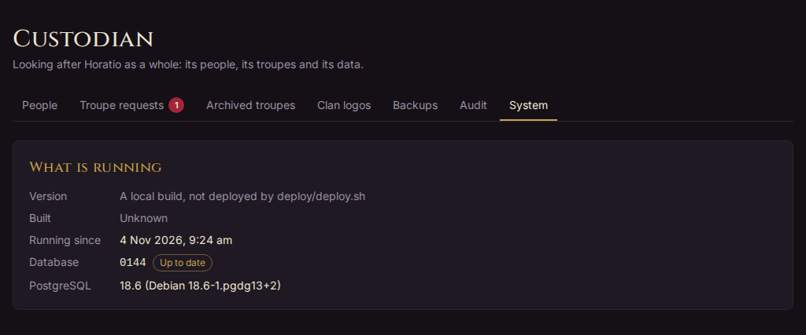

# Custodian

This part is for the **custodian**: the person who runs a Horatio server and looks after it as a whole. That's often also a troupe's lead storyteller. For the work of running a troupe, see [Running a troupe](running-a-troupe.md).

Everything here happens under **Custodian** in the top menu, which only the custodian sees, except where a step says otherwise.

## What the custodian is and isn't

The custodian sits above every troupe (see [the glossary](glossary.md#custodian)). A troupe's staff run that troupe; the custodian runs the server the troupes live on.

Only the custodian can:

- approve or decline requests for new troupes, make a troupe directly, and appoint a troupe's lead storyteller;
- see archived troupes, and reopen them;
- look after anyone's account: view Horatio as them, reset their password, change their email, suspend them, merge two of their accounts, and move a character from one player to another;
- see every account's email address;
- make and download backups of the whole database;
- see the System page, the clan logos and the whole audit log.

The custodian can also do anything a lead storyteller can, in any troupe, even one they have no role in: open its Staff tab, approve its characters, award XP, and so on. Use that sparingly. A troupe's own staff are the ones who run it, and its players expect their storytellers, not the custodian, to judge their characters.

What the custodian isn't:

- **Not a player's stand-in.** Like staff, the custodian can read any character's sheet, but only a character's player edits it. To see exactly what a player sees, use [View as](#viewing-as-someone).
- **Not one of every troupe's staff.** The custodian isn't listed on a troupe's Staff tab, and isn't sent each troupe's approvals and downtimes. Their bell has only the custodian's own work, such as new troupe requests.
- **Not a role you give in the app.** There's no button to make someone the custodian, or to stop being one. See [Becoming the custodian](#becoming-the-custodian).

## Becoming the custodian

Being the custodian is a mark on an account, set by a command run where Horatio runs, never through the app. Anyone who can run commands on the server can make themselves the custodian, and the custodian can do anything, so keep that access to the people who run the server. More than one account can be a custodian.

In every case, sign up in the app first, then make that account the custodian. You'll see **Custodian** in the top menu, and "(custodian)" beside your name, once you reload the page.

### On your own computer

When you run Horatio on your own computer with `./start-local.sh`, add your email: `./start-local.sh --custodian you@example.com`.

If you haven't signed up yet, it says so: sign up, then run it again. You can also run the command it uses, from the `backend` folder: `uv run python -m horatio.custodian you@example.com`.

### On a server

Run the same command inside the running app, for example in its container: `docker exec horatio-api python -m horatio.custodian you@example.com`.

The repository's own deployment has a script for this, `deploy/custodian.sh you@example.com`, which needs the server's SSH key. See [deploy/README.md](https://github.com/michael-tracey/horatio/blob/main/deploy/README.md) for the full steps.

Taking the role away again means changing the account in the database by hand: there's no command for it.

## Troupe requests

Anyone signed in can ask for a troupe of their own, from **Ask for a new troupe** at the foot of the Troupes page. They give its **Troupe name**, and optionally a **Description** and a **Note to the custodian**. Each request waits on **Custodian › Troupe requests**, and the tab shows how many are waiting. It's on your bell too.

### Approving or declining a request

1. Open **Custodian › Troupe requests**. **Waiting** lists the requests, the longest waiting first, with who asked and their note.
2. To say yes, choose **Approve and make the troupe**. Horatio makes the troupe with the name and description they gave, and makes the person who asked its [lead storyteller](glossary.md#lead-storyteller). They're told on their bell.
3. To say no, choose **Decline…**. You can say why under **Why not? (optional)**: they see it. Then choose **Decline**.

**Decided** lists the latest answers, approved or declined, and the requests people withdrew. An approved one links to its troupe.

### Making a troupe yourself

You can also make a troupe without a request. On the **Troupes** page, the custodian has a **New troupe** card: give its **Name**, a **Description** and its **Lead storyteller**, who needs an account already, then choose **Create troupe**.

### Appointing a lead storyteller

Each troupe has one lead storyteller. Only you can change who it is, for example when a lead steps down or is suspended:

1. Open the troupe, then its **Staff** tab.
2. Under **Lead storyteller**, in **Appoint a new lead**, pick the person, or type a name or handle to find them.
3. Choose **Appoint**.

The new lead takes over at once. If they were already on the troupe's staff, their old role gives way to lead. The previous lead keeps no role in the troupe: a storyteller can add them back on the Staff tab if they're staying on. What each role can do is in [Running a troupe](running-a-troupe.md#staff-roles).

## Archived troupes

Archiving is how a troupe ends (see [Archiving a troupe](#archiving-a-troupe)). Troupes are never truly deleted.

### Archiving a troupe

A troupe's lead storyteller archives it, from the **Archive the troupe** card at the foot of the troupe's **Profile** tab. As the custodian you can do the same for any troupe. Horatio first shows what archiving will do, and asks for a reason, which everyone affected sees:

- the characters it's home to are left with no home troupe, and visits to it end, so their players can ask another troupe to accept them;
- an open downtime cycle ends without being answered or delivered, and games under way end;
- titles held there end; status stays;
- its NPCs stay with it.

Once archived, the troupe is closed to everyone but you.

### Reopening a troupe

**Custodian › Archived troupes** lists every archived troupe, the latest first: when and by whom it was archived, why, its lead storyteller, and the characters it had then. **Open** and **Log** take you to its pages, which stay readable to you.

To bring one back:

1. Choose **Reopen…** on its card.
2. Give a **Reason**: those affected see it, and it goes in the troupe's log.
3. Choose **Reopen troupe**.

The troupe goes back to its staff, with its NPCs and history. The characters it let go don't come back: their players are told they can ask it to accept them again.

### Settling an old archived troupe

A troupe archived before Horatio settled characters on archiving may still hold some, marked **Still in it**, with nowhere to ask for approvals or downtimes. Its card says so and has **Settle…**. Settling does what archiving does now, with a reason, and tells their players.

## People

**Custodian › People** lists every account in a table: **Name**, **Handle**, **Email**, **Member since** and **Status**. Status shows **Suspended**, **Reset link out** or **New email waiting** when they apply. Each name opens that person's profile.

Everything you can do with an account is behind the **⋯** at the end of its row:

- to help with the account: **View as…**, **Characters**, **Change email…** and **Reset password…**;
- below a line, to suspend or merge it: **Suspend…** (or **Lift suspension…**) and **Merge…**.

Each opens in a dialog over the list, so you don't lose your place.

### Finding someone

- Type in **Search people** to find someone by their name, handle or email, or by a handle they used to have.
- Use **Active character in** to show only the people with an active character whose home troupe is that troupe.

Accounts closed by a [merge](#merging-two-accounts) aren't listed.

On a phone, each row folds into a card, with the handle, email and badges under the name.

### Viewing as someone

When someone can't find something, or something looks wrong to them, you can see Horatio exactly as they see it, with their permissions (see [the glossary](glossary.md#view-as)):

1. Choose **⋯ › View as…** on their row.
2. Give a **Reason**, such as "Can't find their downtime". They're told, with your reason, and it goes in the audit log.
3. Choose **Start viewing**.

Horatio opens as them. A banner across the top says **Viewing as @handle, read-only**, and until when. Nothing can be changed while you view: every save is refused. Choose **Stop** in the banner to be yourself again. Viewing also ends after 30 minutes, or when you sign out.

They can see each time you viewed as them, and why, on their account's Settings page. View as isn't offered for another custodian.

### Moving a character to another player

Sometimes a character belongs with a different player: it was built on the wrong account, or one player hands it on to another. Only its player changes; the character keeps its sheet, XP, history and troupes.

1. Choose **⋯ › Characters** on the current player's row. The dialog lists their characters, with each one's home troupe.
2. Choose **Move…** beside the character.
3. Under **New player**, pick the person, and give a **Reason**. It's kept in the character's log, and told to both players and its home troupe's lead storyteller.
4. Choose **Continue**. Horatio shows what will happen: the troupes it stays in, that its sheet, XP, history, titles and status go with it, any staff role the new player has in those troupes, and any requests still waiting, which stay open for the new player.
5. Choose **Move *name* to @handle**, or **Back** to change something.

The old player can no longer open the character; the new one can at once. A character in a game on the Play View can't be moved until the game ends with **Reset for next game**, and an NPC can't be moved at all: it belongs to its troupe. To undo a move, move it back.

### Changing someone's email

For a player who has lost their old address:

1. Choose **⋯ › Change email…**.
2. Give the **New email** and a **Reason**, which is for the log: they aren't shown it.
3. Choose **Change email**.

They keep their old address until they open the link sent to the new one, within 7 days; then the old address is told. If Horatio can't send email on your server, you get the link to send them yourself, with **Copy link**.

While a change waits, the same dialog offers **Send the link again** (or **Make a new link**) and **Cancel the change**. An address another account already uses is refused: if both accounts are the same person's, [merge them](#merging-two-accounts) instead.

### Resetting a password

For someone locked out:

1. Choose **⋯ › Reset password…**.
2. If Horatio can send email, choose **Email a reset link** to send it to them, or **Make a link to copy** to send it yourself. Without email, choose **Make a reset link**.
3. Copy the link with **Copy link** and send it to them.

The link works once, for a day, and replaces any earlier link. Setting a new password with it signs them out everywhere else. Choose **Cancel link** to stop a link working. The same **Password** card is on a person's profile when you open it.

People can reset their own password from **Forgot your password?** on the sign-in page, but only on a server that can send email. Otherwise that page tells them to ask you.

### Suspending someone and lifting it

Suspending keeps someone out for a while without deleting anything (see [the glossary](glossary.md#suspended-account)):

1. Choose **⋯ › Suspend…**.
2. Give a **Reason**. Only the custodian sees it.
3. Optionally, set **Until** to end it by itself. Leave it empty to lift it by hand. Times are in your own time zone.
4. Choose **Suspend *name***.

They're signed out everywhere at once, and can't sign in until you lift it or the end date passes. They're emailed to say so, without the reason, and get no other notifications while suspended. Their characters stay in their troupes, but take no new actions: no downtime answers, and no Play View taps. Their staff roles stay, but do nothing while they're away. If they lead a troupe, the Troupes page marks it **Lead suspended**, and you may want to [appoint a new lead](#appointing-a-lead-storyteller).

When they try to sign in, they're told their account is suspended and to contact the custodian. Whoever runs the server can say how, with the `HORATIO_CUSTODIAN_CONTACT` setting (an email address or a web page).

To lift it, choose **⋯ › Lift suspension…**, say **Why lift it** for the log, and choose **Lift suspension**. They're emailed to say they can sign in again.

### Merging two accounts

Someone who signed up twice, say once with Google and once with an email and password, has two accounts. Merging moves everything from one into the other, and closes the one merged away.

1. Choose **⋯ › Merge…** on either account's row.
2. Under **The same person's other account**, pick the other account.
3. Under **Which account stays?**, choose the one to keep.
4. Give a **Reason**. It's kept in the audit log and in the log of each troupe the merge touches, and told to the person and those troupes' lead storytellers.
5. Choose **Continue**, read what will move, then choose **Merge into @handle**.

What moves: the closed account's characters, its staff roles (where both accounts are on one troupe's staff, the higher role is kept), its ways of signing in, and its settings and profile details where the staying account has none of its own. Its handles still find the person. A suspension it's under carries over.

The closed account is signed out everywhere, can't sign in, and isn't listed or found. Its email is freed for use. What it did stays as it was, shown as "*name* (merged into @handle)".

A merge can't be undone. A custodian's account can't be the one closed, and a merge waits while one of the characters is in a game on the Play View.

### The Suspended, Password resets and Email changes cards

Under the table, three cards show what's going on with accounts:

- **Suspended**: who is suspended now, since when, by whom, until when, and why. If a suspended person leads a troupe, it says so, with a link to the troupe's Staff tab to appoint a new lead. **Recently** lists the latest suspensions and lifts.
- **Password resets**: **Links that work now**, each with **Cancel**, and **Recently**: links made, emailed, asked for and used.
- **Email changes**: **Waiting to be confirmed**, each with both addresses and **Cancel**, and **Recently**: changes started, confirmed and cancelled.

## Backups

**Custodian › Backups** lists the database backups the server keeps, newest first, marked **Nightly** or **Made here**.

- A backup is the whole database: every account, character and troupe.
- One is made every night and copied to cloud storage for 30 days. The server keeps a week of backups, nightly or made here.
- Choose **Back up now** to make one, before a big change for example.
- Choose **Download** beside a backup to keep a copy longer than a week. A backup holds everything, including password hashes, so keep downloads somewhere safe.

Making or downloading a backup goes in the audit log.

If the tab says **Backups are not set up here**, the server has no backup directory: the `HORATIO_BACKUP_DIR` setting names it. That's normal on your own computer.

Backups made here hold the database only. On the server, the nightly job also packs up uploaded pictures, such as portraits and clan logos, beside the nightly backup.

### Restoring a backup

There's no restore button: restoring replaces everything in the database, so it's done on the server. In short, you stop the app, recreate the database, load the backup into it, and start the app again; pictures are restored from the night's uploads archive beside it. The exact commands are in the "Backups" section of [deploy/README.md](https://github.com/michael-tracey/horatio/blob/main/deploy/README.md#backups).

Everything since that backup is lost, so make a fresh backup with **Back up now** first if the app still works.

## The System page

**Custodian › System** shows what's running, so you can tell whether a fix has gone live:

- **Version**: the commit the running app was built from, linked to its code on GitHub, and marked "with uncommitted changes" if any went in. A build not made by `deploy/deploy.sh`, such as one on your own computer, says so instead.
- **Built**: when that build was made.
- **Running since**: when the app last started.
- **Database**: the migration the database is on, marked **Up to date**, or **Behind** with the migration this build expects. Behind means the database needs migrating: see [Updating the server](#updating-the-server).
- **PostgreSQL**: the database server's version.

## Clan logos and the Dark Pack import

Game badges show a character's clan logo beside its picture, or in its place when it has none. The official clan symbols belong to the game's publisher, so Horatio ships none. There are two ways to give the clans logos:

- **Import the Dark Pack resources.** Paradox's Dark Pack Agreement lets a free fan app like Horatio use its clan symbols and the Dark Pack logo, but the licence is personal to whoever runs the server. So each server's operator downloads and imports them.
- **Upload your own** for any clan or bloodline, if your troupes have the right to use the images.

An uploaded logo always wins over a Dark Pack symbol. A bloodline without its own logo uses its clan's; a clan without one shows only its name.

### Uploading a clan logo

1. Open **Custodian › Clan logos**. Type in the search box to find a clan or bloodline. The count says how many have a logo.
2. Choose **Upload** beside the clan, and pick an image: PNG, JPEG, WebP or HEIC. A PNG with a transparent background prints best.
3. To change it, choose **Replace**. To remove it, choose **×**.

A clan using its Dark Pack symbol shows it on a light square marked **Dark Pack**. If the tab says **Uploads are not set up here**, the server has no upload directory: the `HORATIO_UPLOAD_DIR` setting names it.

### Importing the Dark Pack resources

1. Download the free assets from the [Dark Pack Agreement](https://www.paradoxinteractive.com/games/world-of-darkness/community/dark-pack-agreement) page: the **World of Darkness Community Assets** zip, and **WoD-Logos-and-Symbols** for the clans the newer kit lacks.
2. From the `backend` folder, import them with `uv run python -m horatio.dark_pack "path/to/World of Darkness Community Assets.zip" path/to/WoD-Logos-and-Symbols.zip`. This reads the zips as they are and writes only what Horatio uses, about a megabyte, into the `dark-pack` folder.
3. Restart Horatio. On a server deployed with `deploy/deploy.sh`, the next deploy copies the folder to the server.

The files must never be committed to the repository. [dark-pack/README.md](https://github.com/michael-tracey/horatio/blob/main/dark-pack/README.md) has the details. Until the logo is imported, the About page reminds you, as the custodian, that the agreement asks for it.

## The audit log

**Custodian › Audit** is the whole audit log: every change in every troupe, and outside them, newest first. Searching it changes nothing in it.

To find something, fill in any of:

- **Who did it**: a person.
- **Character**: any character, whoever's and wherever it is. Type to narrow the list.
- **Troupe**: archived troupes included.
- **Kind of change**: such as Approvals, XP, Sheets, Downtimes, Staff, House rules, Troupes, Accounts or System.
- **From** and **To**: the days, both included.
- **Words**: each word somewhere in what the change says, such as a name, a trait or a reason.

Then choose **Search**, or **Clear** to start again. The search is kept in the page's address, so you can bookmark it or send it to another custodian.

**Found** lists each change with when, who, the troupe and what happened, each linking to its page. Choose **Show older** for more, or **Export as CSV** to download everything the search finds.

A troupe's running staff see their own troupe's part of this on its **Log** tab. Only you see the whole of it.

## Updating the server

How to deploy Horatio is in the repository, not here: see [deploy/README.md](https://github.com/michael-tracey/horatio/blob/main/deploy/README.md) for the server, and the [README](https://github.com/michael-tracey/horatio/blob/main/README.md) for running it on your own computer.

In short:

- **New code**, and above all a change that brings a **database migration**, needs the full `deploy/deploy.sh`. It builds a new image, migrates the database before replacing the running app, and leaves the running version up if the migration fails.
- `deploy/deploy.sh --no-build` only redeploys the image already built, for example after changing a setting. It brings no new code.
- On your own computer, `./start-local.sh` migrates the database each time it starts.

Afterwards, check [the System page](#the-system-page): **Version** should name the commit you deployed, and **Database** should say **Up to date**. Making a backup with **Back up now** before an update is a good habit.
