# Custodian

This part is for the **custodian**: the person who runs a Horatio server and looks after it as a whole. That's often also a troupe's lead storyteller. For the work of running a troupe, see [Running a troupe](running-a-troupe.md).

Everything here happens under **Custodian** in the top menu, which only the custodian sees, except where a step says otherwise.

## What the custodian is and isn't

The custodian sits above every troupe (see [the glossary](glossary.md#custodian)). A troupe's staff run that troupe; the custodian runs the server the troupes live on.

Only the custodian can:

- approve or decline requests for new troupes, make a troupe directly, and appoint a troupe's lead storyteller;
- see archived troupes, and reopen them;
- look after anyone's account: view Horatio as them, reset their password, change their email, suspend them, merge two of their accounts, and move a character from one player to another;
- see every account's email address;
- make and download backups of the whole database;
- choose the loading animation everyone sees;
- see the Site tab, the clan logos and the whole audit log, and use the Tools tab.

The custodian can also do anything a lead storyteller can, in any troupe, even one they have no role in: open its Staff tab, approve its characters, award XP, and so on. Use that sparingly. A troupe's own staff are the ones who run it, and its players expect their storytellers, not the custodian, to judge their characters.

What the custodian isn't:

- **Not a player's stand-in.** Like staff, the custodian can read any character's sheet, but only a character's player edits it. To see exactly what a player sees, use [View as](#viewing-as-someone).
- **Not one of every troupe's staff.** The custodian isn't listed on a troupe's Staff tab, and isn't sent each troupe's approvals and downtimes. Their bell has only the custodian's own work, such as new troupe requests, and a note each time someone signs up, which opens **Custodian › People** with that person found.
- **Not a role you give in the app.** There's no button to make someone the custodian, or to stop being one. See [Becoming the custodian](#becoming-the-custodian) and [Removing a custodian](#removing-a-custodian).

## Becoming the custodian

Being the custodian is a mark on an account, set by a command run where Horatio runs, never through the app. Anyone who can run commands on the server can make themselves the custodian, and the custodian can do anything, so keep that access to the people who run the server. More than one account can be a custodian.

In every case, sign up in the app first, then make that account the custodian. You'll see **Custodian** in the top menu, and "(custodian)" beside your name, once you reload the page.

### On your own computer

When you run Horatio on your own computer with `./start-local.sh`, add your email: `./start-local.sh --custodian you@example.com`.

If you haven't signed up yet, it says so: sign up, then run it again. You can also run the command it uses, from the `backend` folder: `uv run python -m horatio.custodian you@example.com`.

### On a server

Run the same command inside the running app, for example in its container: `docker exec horatio-api python -m horatio.custodian you@example.com`.

The repository's own deployment has a script for this, `deploy/custodian.sh you@example.com`, which needs the server's SSH key. See [deploy/README.md](https://github.com/michael-tracey/horatio/blob/main/deploy/README.md) for the full steps.

### Removing a custodian

The same command takes the role away again, with `--remove` before the email:

- on your own computer, from the `backend` folder: `uv run python -m horatio.custodian --remove someone@example.com`;
- on a server: `docker exec horatio-api python -m horatio.custodian --remove someone@example.com`;
- on the repository's own deployment: `deploy/custodian.sh --remove someone@example.com`.

The account stays as it is, with its characters and any staff roles; only the custodian's powers go, at once. **Custodian** leaves their top menu when they next reload the page. The last custodian can't be removed: make someone else the custodian first.

## Troupe management

**Custodian › Troupe management** holds what you do with troupes as a whole, one section under another: **New troupe**, to [make one yourself](#making-a-troupe-yourself); **Troupes**, every troupe still running, to [appoint a lead storyteller](#appointing-a-lead-storyteller); **Requests**, for [troupe requests](#troupe-requests); and **Archived troupes**, to [reopen one](#reopening-a-troupe). The tab shows how many requests are waiting.

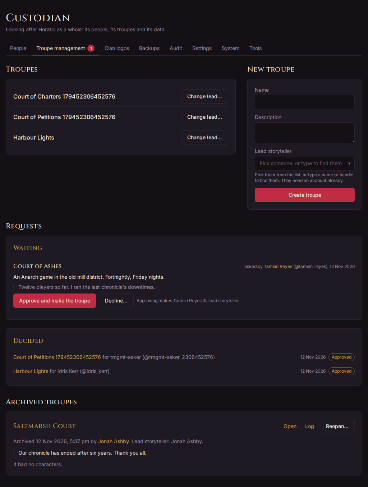

## Troupe requests

Anyone signed in can ask for a troupe of their own, from **Ask for a new troupe** at the foot of the Troupes page. They give its **Troupe name**, and optionally a **Description** and a **Note to the custodian**. Each request waits under **Requests** on **Custodian › Troupe management**, and the tab shows how many are waiting. It's on your bell too.

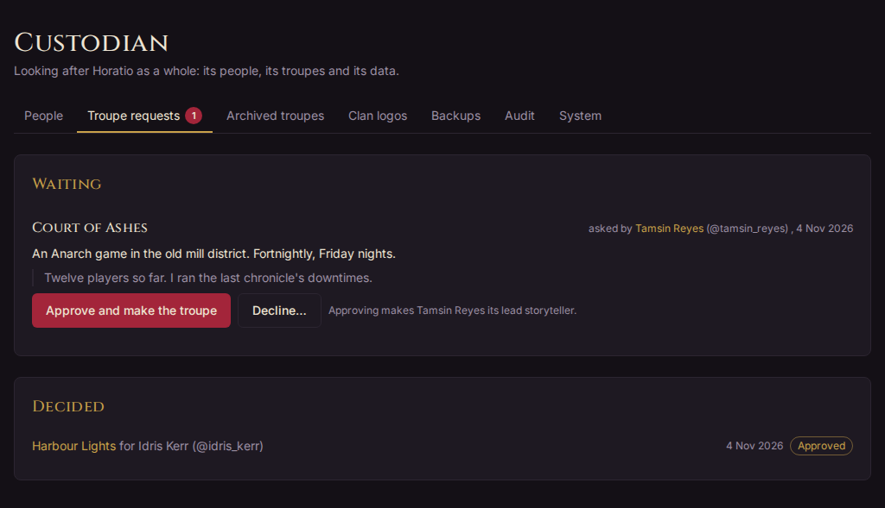

### Approving or declining a request

1. Open **Custodian › Troupe management**. Under **Requests**, **Waiting** lists the requests, the longest waiting first, with who asked and their note.
2. To say yes, choose **Approve and make the troupe**. Horatio makes the troupe with the name and description they gave, and makes the person who asked its [lead storyteller](glossary.md#lead-storyteller). They're told on their bell.
3. To say no, choose **Decline…**. You can say why under **Why not? (optional)**: they see it. Then choose **Decline**.

**Decided** lists the latest answers, approved or declined, and the requests people withdrew. An approved one links to its troupe.

### Making a troupe yourself

You can also make a troupe without a request. On **Custodian › Troupe management**, under **New troupe**, give its **Name**, a **Description** and its **Lead storyteller**, who needs an account already, then choose **Create troupe**. The **Troupes** page points you there too.

### Appointing a lead storyteller

Each troupe has one lead storyteller. Only you can change who it is, for example when a lead steps down or is suspended:

1. On **Custodian › Troupe management**, under **Troupes**, choose **Change lead…** on the troupe's row. (Or open the troupe, then its **Staff** tab, and use **Appoint a new lead** under **Lead storyteller**.)
2. Under **New lead**, pick the person, or type a name or handle to find them. The dialog says who leads it now.
3. Choose **Appoint**.

The new lead takes over at once. If they were already on the troupe's staff, their old role gives way to lead. The previous lead leaves the staff, with no role in the troupe, as the card says before you confirm; the troupe's log records who they were. If they're staying on, add them back under **Add staff** with a role. What each role can do is in [Running a troupe](running-a-troupe.md#staff-roles).

## Archived troupes

Archiving is how a troupe ends (see [Archiving a troupe](#archiving-a-troupe)). Troupes are never truly deleted.

### Archiving a troupe

A troupe's lead storyteller archives it, from the **Archive the troupe** card at the foot of the troupe's **Profile** tab. As the custodian you can do the same for any troupe. Horatio first shows what archiving will do, and asks for a reason, which everyone affected sees:

- the characters it's home to are left with no home troupe, and visits to it end, so their players can ask another troupe to accept them;
- an open downtime cycle ends without being answered or delivered, and games under way end;
- titles held there end; status stays;
- its NPCs stay with it.

Once archived, the troupe is closed to everyone but you.

### Reopening a troupe

**Custodian › Troupe management**, under **Archived troupes**, lists every archived troupe, the latest first: when and by whom it was archived, why, its lead storyteller, and the characters it had then. **Open** and **Log** take you to its pages, which stay readable to you.

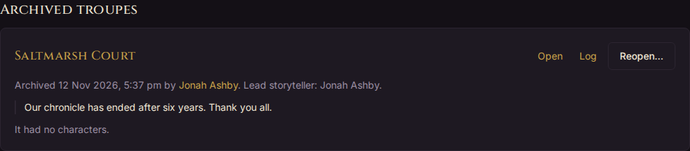

To bring one back:

1. Choose **Reopen…** on its card.
2. Give a **Reason**: those affected see it, and it goes in the troupe's log.
3. Choose **Reopen troupe**.

The troupe goes back to its staff, with its NPCs and history. The characters it let go don't come back: their players are told they can ask it to accept them again.

### Settling an old archived troupe

A troupe archived before Horatio settled characters on archiving may still hold some, marked **Still in it**, with nowhere to ask for approvals or downtimes. Its card says so and has **Settle…**. Settling does what archiving does now, with a reason, and tells their players.

## People

**Custodian › People** lists every account in a table: **Name**, **Handle**, **Email**, **Member since** and **Status**. Status shows **Suspended**, **Reset link out** or **New email waiting** when they apply. Each name opens that person's profile.

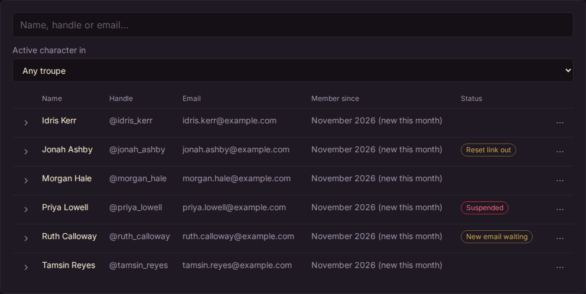

Everything you can do with an account is behind the **⋯** at the end of its row:

- to help with the account: **View as…**, **Characters**, **Change email…** and **Reset password…**;
- below a line, to suspend or merge it: **Suspend…** (or **Lift suspension…**) and **Merge…**.

Each opens in a dialog over the list, so you don't lose your place.

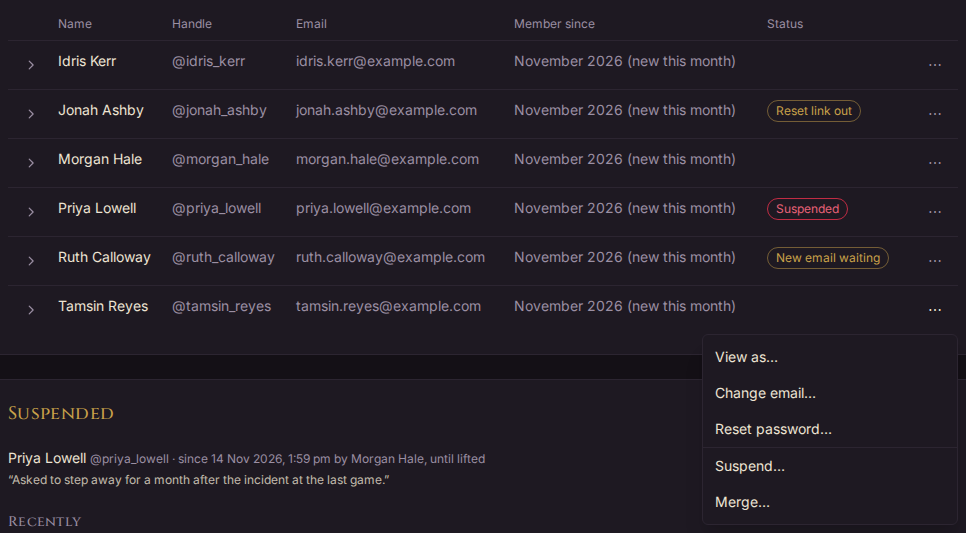

### Finding someone

- Type in **Search people** to find someone by their name, handle or email, or by a handle they used to have.
- Use **Active character in** to show only the people with an active character whose home troupe is that troupe.

Accounts closed by a [merge](#merging-two-accounts) aren't listed.

On a phone, each row folds into a card, with the handle, email and badges under the name.

### Viewing as someone

When someone can't find something, or something looks wrong to them, you can see Horatio exactly as they see it, with their permissions (see [the glossary](glossary.md#view-as)):

1. Choose **⋯ › View as…** on their row.
2. Give a **Reason**, such as "Can't find their downtime". They're told, with your reason, and it goes in the audit log.
3. Choose **Start viewing**.

Horatio opens as them. A banner across the top says **Viewing as @handle, read-only**, and until when. Nothing can be changed while you view: every save is refused. Choose **Stop** in the banner to be yourself again. Viewing also ends after 30 minutes, or when you sign out.

They can see each time you viewed as them, and why, on their account's Settings page. View as isn't offered for another custodian.

### Moving a character to another player

Sometimes a character belongs with a different player: it was built on the wrong account, or one player hands it on to another. Only its player changes; the character keeps its sheet, XP, history and troupes.

1. Choose **⋯ › Characters** on the current player's row. The dialog lists their characters, with each one's home troupe.
2. Choose **Move…** beside the character.
3. Under **New player**, pick the person, and give a **Reason**. It's kept in the character's log, and told to both players and its home troupe's lead storyteller.
4. Choose **Continue**. Horatio shows what will happen: the troupes it stays in, that its sheet, XP, history, titles and status go with it, any staff role the new player has in those troupes, and any requests still waiting, which stay open for the new player.
5. Choose **Move *name* to @handle**, or **Back** to change something.

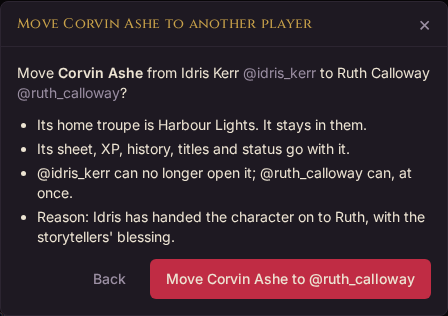

The old player can no longer open the character; the new one can at once. A character in a game on the Play View can't be moved until the game ends with **Reset for next game**, and an NPC can't be moved at all: it belongs to its troupe. To undo a move, move it back.

To hand an NPC to a player, give it instead: from the NPCs on the troupe's **Characters › Characters**, or the NPC's own page, choose **⋯ › Give to a player…** or **⋯ › Claim link…**. You can do this in any troupe, as its storytellers can (see [Giving an NPC to a player](running-a-troupe.md#giving-an-npc-to-a-player)). It becomes the player's character, at home and accepted in its troupe. If it went to the wrong person, move it to the right one as above. It can't be turned back into an NPC.

### Changing someone's email

For a player who has lost their old address:

1. Choose **⋯ › Change email…**.
2. Give the **New email** and a **Reason**, which is for the log: they aren't shown it.
3. Choose **Change email**.

They keep their old address until they open the link sent to the new one, within 7 days; then the old address is told. If Horatio can't send email on your server, you get the link to send them yourself, with **Copy link**.

While a change waits, the same dialog offers **Send the link again** (or **Make a new link**) and **Cancel the change**. An address another account already uses is refused: if both accounts are the same person's, [merge them](#merging-two-accounts) instead.

### Resetting a password

For someone locked out:

1. Choose **⋯ › Reset password…**.
2. If Horatio can send email, choose **Email a reset link** to send it to them, or **Make a link to copy** to send it yourself. Without email, choose **Make a reset link**.
3. Copy the link with **Copy link** and send it to them.

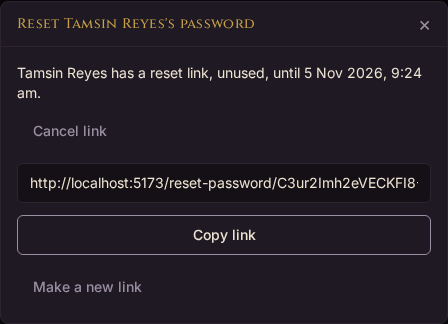

The link works once, for a day, and replaces any earlier link. Setting a new password with it signs them out everywhere else. Choose **Cancel link** to stop a link working. The same **Password** card is on a person's profile when you open it.

People can reset their own password from **Forgot your password?** on the sign-in page, but only on a server that can send email. Otherwise that page tells them to ask you.

### Suspending someone and lifting it

Suspending keeps someone out for a while without deleting anything (see [the glossary](glossary.md#suspended-account)):

1. Choose **⋯ › Suspend…**.
2. Give a **Reason**. Only the custodian sees it.
3. Optionally, set **Until** to end it by itself. Leave it empty to lift it by hand. Times are in your own time zone.
4. Choose **Suspend *name***.

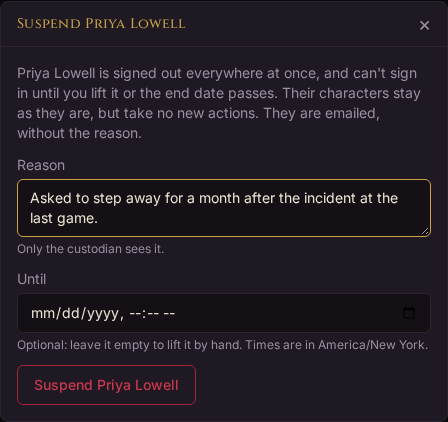

They're signed out everywhere at once, and can't sign in until you lift it or the end date passes. They're emailed to say so, without the reason, and get no other notifications while suspended. Their characters stay in their troupes, but take no new actions: no downtime answers, and no Play View taps. Their staff roles stay, but do nothing while they're away. If they lead a troupe, the Troupes page marks it **Lead suspended**, and you may want to [appoint a new lead](#appointing-a-lead-storyteller).

When they try to sign in, they're told their account is suspended and to contact the custodian. Whoever runs the server can say how, with the `HORATIO_CUSTODIAN_CONTACT` setting (an email address or a web page).

To lift it, choose **⋯ › Lift suspension…**, say **Why lift it** for the log, and choose **Lift suspension**. They're emailed to say they can sign in again.

### Merging two accounts

Someone who signed up twice, say once with Google and once with an email and password, has two accounts. Merging moves everything from one into the other, and closes the one merged away.

1. Choose **⋯ › Merge…** on either account's row.
2. Under **The same person's other account**, pick the other account.
3. Under **Which account stays?**, choose the one to keep.
4. Give a **Reason**. It's kept in the audit log and in the log of each troupe the merge touches, and told to the person and those troupes' lead storytellers.
5. Choose **Continue**, read what will move, then choose **Merge into @handle**.

What moves: the closed account's characters, its staff roles (where both accounts are on one troupe's staff, the higher role is kept), its ways of signing in, and its settings and profile details where the staying account has none of its own. Its handles still find the person. A suspension it's under carries over.

The closed account is signed out everywhere, can't sign in, and isn't listed or found. Its email is freed for use. What it did stays as it was, shown as "*name* (merged into @handle)".

A merge can't be undone. A custodian's account can't be the one closed, and a merge waits while one of the characters is in a game on the Play View.

### The Suspended, Password resets and Email changes cards

Under the table, three cards show what's going on with accounts:

- **Suspended**: who is suspended now, since when, by whom, until when, and why. If a suspended person leads a troupe, it says so, with a link to the troupe's Staff tab to appoint a new lead. **Recently** lists the latest suspensions and lifts.
- **Password resets**: **Links that work now**, each with **Cancel**, and **Recently**: links made, emailed, asked for and used.
- **Email changes**: **Waiting to be confirmed**, each with both addresses and **Cancel**, and **Recently**: changes started, confirmed and cancelled.

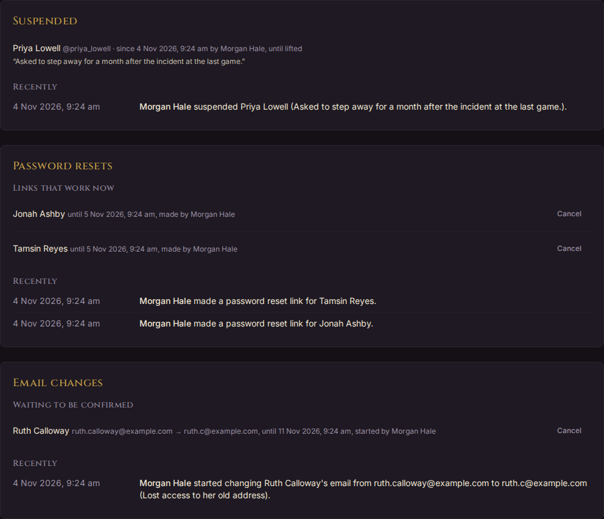

## Backups

**Custodian › Backups** lists the database backups the server keeps, newest first, marked **Nightly** or **Made here**.

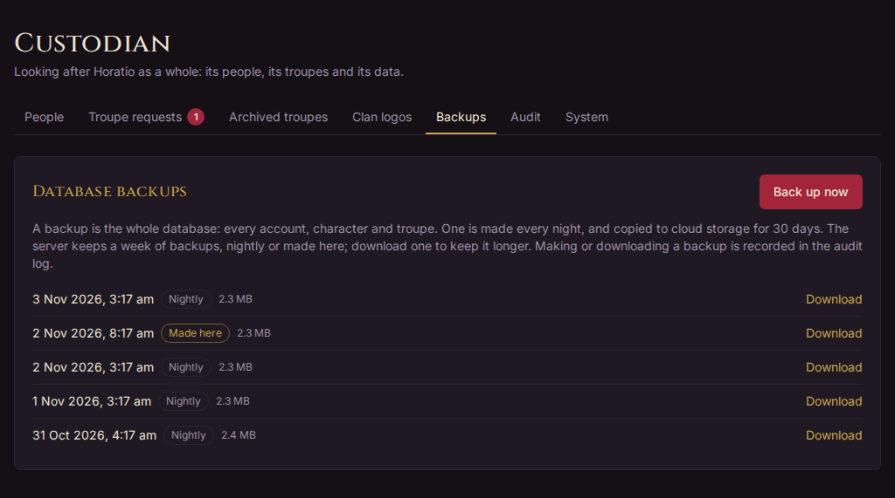

- A backup is the whole database: every account, character and troupe. Uploaded pictures, such as portraits and clan logos, aren't in it.
- Where the server runs a nightly backup, those are listed too. How long backups are kept, and whether they're copied anywhere else, depends on how the server is set up, so the tab doesn't promise either. On the repository's own deployment, the nightly job keeps a week of backups, nightly or made here, and copies each nightly one to cloud storage for 30 days.
- Choose **Back up now** to make one, before a big change for example.
- Choose **Download** beside a backup to keep a copy of your own. A backup holds everything, including password hashes, so keep downloads somewhere safe.

Making or downloading a backup goes in the audit log.

If the tab says **Backups are not set up here**, the server has no backup directory: the `HORATIO_BACKUP_DIR` setting names it. That's normal on your own computer.

Backups made here hold the database only. On the server, the nightly job also packs up the uploaded pictures (portraits and clan logos) and the Dark Pack resources and VTES symbols fetched in [Tools](#tools), beside the nightly backup.

### Restoring a backup

There's no restore button: restoring replaces everything in the database, so it's done on the server. In short, you stop the app, recreate the database, load the backup into it, and start the app again; pictures, the Dark Pack resources and the VTES symbols are restored from the night's archives beside it. The exact commands are in the "Backups" section of [deploy/README.md](https://github.com/michael-tracey/horatio/blob/main/deploy/README.md#backups).

Everything since that backup is lost, so make a fresh backup with **Back up now** first if the app still works.

## Site

**Custodian › Site** holds what's the same for everyone on the server: the loading animation, mail and Discord. It also shows what's running. It used to be two tabs, Settings and System; their old links still land here.

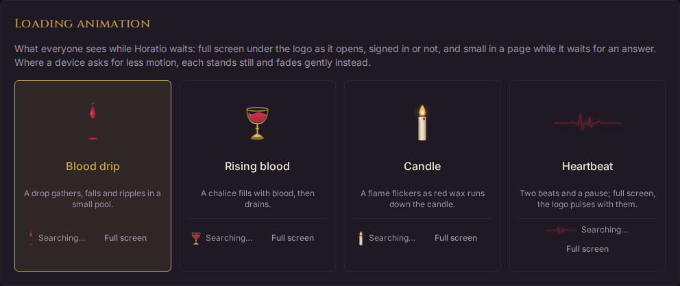

### The loading animation

While Horatio waits, it shows a loading animation: full screen under the logo as the app opens, signed in or not, and small in a page while it waits for an answer. Choose one of four:

- **Blood drip**, the one until you choose: a drop gathers, falls and ripples in a small pool.
- **Rising blood**: a chalice fills with blood, then drains.
- **Candle**: a flame flickers as red wax runs down the candle.
- **Heartbeat**: two beats and a pause. Full screen, the logo pulses with them.

Each is shown moving, with the small one that sits beside a line of text, such as a search's count. **Full screen** shows it as the app opens: choose **Close**, or anywhere, to leave. Choosing one changes it for everyone at once, and goes in the audit log. On a device set to reduce motion, each stands still and fades gently instead.

The very first screen shows before the app has asked the server anything, so it shows the animation last seen on that device. Someone who hasn't opened Horatio since you changed it sees the old one once.

### Mail

The **Mail** card says whether Horatio can send email, and if not, which settings are missing (see [Email: an SMTP service](#email-an-smtp-service)).

- **What it uses:** the mail server and port, the security (STARTTLS, SSL or none), and the username with most of it hidden. The password only shows as **Set** or **Not set**: Horatio never shows it, never keeps it in its database, and never sends it to anyone's browser. A security setting that looks wrong, such as none at all, gets a note in red.
- **Who emails come from:** a **From name**, **From address** and **Reply-To** of your own, over the server's `HORATIO_MAIL_FROM`. Every email Horatio sends uses them from then on. Leave a box blank to use the server's. The From address must be one your mail provider lets Horatio send from, or it refuses the email. A troupe's own Reply-To, for its downtime results, still wins over yours. Saving goes in the audit log.
- **Send a test email:** sends one to your own address straight away. If the mail server refuses, the card says why in plain words, naming the setting to check, with what the server said under it.
- **Mail that failed lately:** downtime results and quests' news sent by email that failed or are being tried again, and notification emails Horatio gave up on. Each says when and why. Open one to see it where it lives, or choose **Retry** for one Horatio gave up on.

The server, username and password stay in `deploy/production.env`: change them there, then redeploy with `deploy/deploy.sh --no-build`.

### Discord

The **Discord** card says whether the Horatio bot can work, and if not, which of the three settings are missing (see [Discord: the Horatio app and its bot](#discord-the-horatio-app-and-its-bot)).

- **What it uses:** the client ID. The client secret and bot token only show as **Set** or **Not set**, never their values.
- **For Discord's developer portal:** the **OAuth2 redirect** to register, made from `HORATIO_PUBLIC_URL`, and an **Invite link for the bot**, each with **Copy**. The invite adds the bot to a server by hand; troupes connect their own servers from **Customise › Connectors**, which tells Horatio which server is theirs.
- **Check the bot:** asks Discord who the bot is, with the server's token, and shows its name and how many servers it's in. A refused token says so, naming the setting.
- **Troupes connected:** each troupe that has connected a Discord server, its server's name, how many characters have a channel for their results, whether it has a test channel, and which posts have a channel.
- **Discord posts that failed lately:** results, quests' news and posts to Discord that failed or are being tried again, each with when and why, and **Retry** for one Horatio gave up on.

The credentials stay in `deploy/production.env`: change them there, then redeploy with `deploy/deploy.sh --no-build`.

### What is running

At the bottom, **What is running** shows the app the server is running, so you can tell whether a fix has gone live:

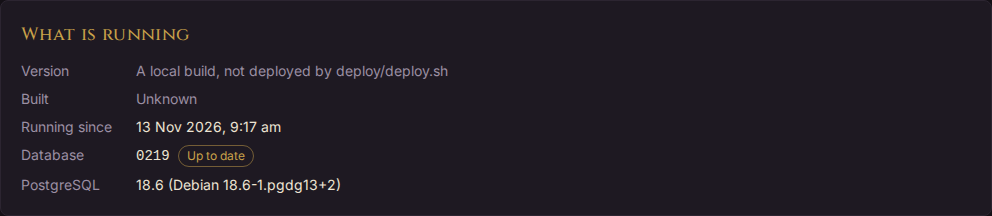

- **Version**: the commit the running app was built from, linked to its code on GitHub, and marked "with uncommitted changes" if any went in. A build not made by `deploy/deploy.sh`, such as one on your own computer, says so instead.
- **Built**: when that build was made.
- **Running since**: when the app last started.
- **Database**: the migration the database is on, marked **Up to date**, or **Behind** with the migration this build expects. Behind means the database needs migrating: see [Updating the server](#updating-the-server).
- **PostgreSQL**: the database server's version.

## Tools

**Custodian › Tools** holds upkeep that would otherwise need a command on the server. Each tool is a card that says what it does, shows what it would change, and changes nothing until you say so. The cards that fetch files from elsewhere say what the server has now. The [import from Yorick](#importing-characters-from-yorick) is here too: its card opens it.

### Fitting NPC creation picks

An NPC built without the wizard (built quickly, made sheeted from Stock, or imported from Yorick) has its creation picks fitted to its sheet, so its starting dots are free as a player character's are, and it isn't worth more XP than a player character with the same sheet. Every change to its sheet fits them again. NPCs no one has changed since that came in need fitting once:

1. Under **Fit NPC creation picks**, choose a troupe. Archived troupes aren't offered.
2. Choose **Preview**. It lists each NPC to fit, with what its sheet is worth in XP now → after fitting, and the total. Nothing changes yet.
3. Choose **Fit**. The troupe's log and the audit log say who did it and how many NPCs changed.

Picks staff placed or took off by hand on an NPC's **Creation picks** card are kept. Fitting again changes nothing, so it's safe to run twice.

Some characters are left as they are, and the preview says why: NPCs built in the wizard, whose picks are the ones placed there; Stock NPCs, which have no sheet; and NPCs already given to players (see [Giving an NPC to a player](running-a-troupe.md#giving-an-npc-to-a-player)), whose picks and XP are their own now.

On the server, `python -m horatio.npc_picks` does the same for every troupe at once.

### The Dark Pack resources

The Dark Pack logo on the About page and the clans' symbols on badges come from Paradox's free Dark Pack kit. Horatio never ships them, as the [Dark Pack Agreement](https://www.paradoxinteractive.com/games/world-of-darkness/community/dark-pack-agreement)'s licence belongs to whoever runs the server. The **Dark Pack resources** card fetches them onto the server:

1. Check the **Address**. It's filled with Paradox's download, the shared Dropbox folder behind **Download Free Content** on the agreement's page. Change it only if Paradox moves the kit; it must start `https://`.
2. Tick **I accept Paradox's Dark Pack Agreement for this server**. The licence is yours to accept, as the server's custodian.
3. Choose **Fetch and import**. The server downloads the kit, about 450 MB, and imports it in the background: the card shows how far it has got, and you can leave the page and come back. The import keeps only what Horatio uses, about a megabyte, and deletes the download.

The card then says when they were imported and from where, whether the Dark Pack logo is there, and which clans have a symbol. The logo and symbols show at once, with no restart. **Fetch and import again** replaces them, for a newer kit.

If a fetch fails (the address has moved, or Dropbox refuses), the card says why, and whatever was imported before stays. If it keeps failing, import the kit on your own computer instead and upload the result:

1. Download the kit from the agreement's page.
2. From Horatio's `backend` folder, run `uv run python -m horatio.dark_pack path/to/the-download.zip`. It takes Paradox's download as it comes, or the two zips inside it, and writes the `dark-pack` folder.
3. Zip that folder, then under **Or upload an import made on your own computer**, tick the agreement and choose **Upload the zip**.

**Remove** takes the logo and symbols off the server, once you've confirmed. Badges then show only the clan logos uploaded in [Clan logos](#uploading-a-clan-logo). Each fetch, upload and removal is in the audit log. [dark-pack/README.md](https://github.com/michael-tracey/horatio/blob/main/dark-pack/README.md) has the details for running Horatio on your own computer.

### VTES symbols

The **VTES symbols** card fetches the symbols of *Vampire: The Eternal Struggle* from [KRCG](https://static.krcg.org/): its clan symbols, its discipline symbols (inferior and superior), its game icons and its two fonts. Characters' Jyhad cards show them, with KRCG's capacity drop: a hidden, just-for-fun card of a vampire in the style of a VTES crypt card, which falls back to three-letter abbreviations and a drawn drop without them. Later they may show beside clans and disciplines, and as Discord emoji. They're free to use under the Dark Pack Agreement too; wherever Horatio shows them, it credits KRCG and gives Paradox's notice.

1. Check the **Address**, `https://static.krcg.org/` unless KRCG moves.
2. Tick **I accept Paradox's Dark Pack Agreement for this server**.
3. Choose **Fetch**. The server fetches a few hundred small files one at a time, with a pause between each to be polite, so it takes a few minutes.

The card then says when they were fetched, how many there are of each kind (SVG, WebP and PNG), which fonts came, and which of Horatio's clans, bloodlines and disciplines have a symbol and which don't. It lists any PNG over 256 KB, the most Discord allows for an emoji. **Fetch again** replaces them all, keeping the last set if it fails; **Remove** takes them off the server, once you've confirmed.

## Clan logos and the Dark Pack import

Game badges show a character's clan logo beside its picture, or in its place when it has none. The official clan symbols belong to the game's publisher, so Horatio ships none. There are two ways to give the clans logos:

- **Fetch the Dark Pack resources.** Paradox's Dark Pack Agreement lets a free fan app like Horatio use its clan symbols and the Dark Pack logo, but the licence is personal to whoever runs the server. So each server fetches them itself, in **Custodian › Tools**.
- **Upload your own** for any clan or bloodline, if your troupes have the right to use the images.

An uploaded logo always wins over a Dark Pack symbol. A bloodline without its own logo uses its clan's; a clan without one shows only its name.

### Uploading a clan logo

1. Open **Custodian › Clan logos**. Type in the search box to find a clan or bloodline. The count says how many have a logo.
2. Choose **Upload** beside the clan, and pick an image: PNG, JPEG, WebP or HEIC. A PNG with a transparent background prints best.
3. To change it, choose **Replace**. To remove it, choose **×**.

A clan using its Dark Pack symbol shows it on a light square marked **Dark Pack**. If the tab says **Uploads are not set up here**, the server has no upload directory: the `HORATIO_UPLOAD_DIR` setting names it.

### Importing the Dark Pack resources

Fetch them in **Custodian › Tools**: see [The Dark Pack resources](#the-dark-pack-resources). The files must never be committed to the repository. Until the logo is on the server, the About page reminds you, as the custodian, that the agreement asks for it.

## Importing characters from Yorick

A troupe moving from Yorick can bring its characters with it, as sheeted NPCs of the troupe. Staff then give each one to its player as they sign up (see [Giving an NPC to a player](running-a-troupe.md#giving-an-npc-to-a-player)). Yorick's printout has no players, XP or history, so none of those come across: a character's XP is set when it's given to its player.

A troupe can come across over months, a few players at a time. Upload a newer page whenever you like: importing it again updates the characters made before, and what you've worked out for the troupe, its names and your choices, stays for the next page.

You'll need:

- the troupe made in Horatio, with its lead storyteller;
- the troupe's **Print Characters** page from Yorick, saved from the browser as a complete web page. That gives an `.html` file and a folder of the same name ending in `_files`, which holds the portraits. Zip the two together. The `.html` alone works too, without portraits.

The page holds real players' names and emails. Horatio keeps it only for the import, where only you can reach it, and deletes it once it's imported, when you choose **Delete the page**, or 30 days after you uploaded it. The report from it is deleted 30 days after it was made. Uploading, importing, deleting and downloading are recorded in the audit log.

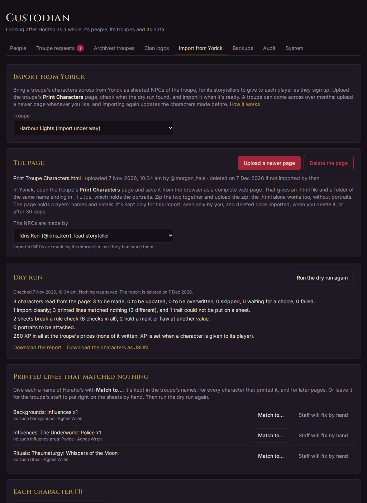

### Upload the page

1. Open **Custodian › Tools**, choose **Open the import** on the **Import from Yorick** card, and choose the **Troupe**.
2. Choose **Upload the page**, and pick the zip or the `.html`. **Upload a newer page** replaces it later.
3. Under **The NPCs are made by**, choose who makes them: the lead storyteller, or one of the troupe's storytellers.

A dry run starts as soon as the page is uploaded. It saves nothing. It runs in the background, a minute or two for a big troupe, and you can leave the page while it does.

### Read the dry run

**Dry run** sums up what the import would do: how many characters it would make or update, how many lines matched nothing, the rule checks the sheets break, and what they're worth in XP at the troupe's prices. **Download the report** has all of it, character by character, and **Download the characters as JSON** has each character as read and as matched. **Each character** lists them, with what became of each; open one to see its unmatched lines, rule checks and portrait.

### Characters already here under the same name

Where a character already in the troupe has the name of one on the page, and isn't one this import made, the dry run lists it under **Already here under the same name**. Names match ignoring capitals and spacing. It looks at the troupe's NPCs and at its players' characters, at home, visiting or being built for it.

Choose what to do with each:

- **Overwrite** the one here: it becomes the imported character, its printed traits set as on a later import, keeping anything else on its sheet. Only a sheeted NPC of the troupe can be overwritten. A player's character changes through the troupe's approvals, and a Stock NPC has no sheet.
- **Skip it**: it isn't imported, now or later, until you change your mind.
- **Import it as a new NPC beside it**.

Until you choose, it isn't imported, and the import waits. Your choice is kept for later pages.

### Put names to what matched nothing

**Printed lines that matched nothing** lists each line once, with the characters that printed it. For each:

- **Match to…** gives it one of Horatio's names, such as an Influence area written another way, or a merit Yorick spells differently. Type to narrow the choices. It's kept in **The troupe's names**, for every character that printed it and for later pages. Remove one there with **×**.
- **Staff will fix by hand** leaves it for the troupe's staff to put right on the sheets afterwards. It's counted apart, and the import goes ahead without it.

Lines the troupe's own lists don't allow (**Specialisations** in the troupe's settings) show here too: add them to the troupe's list, or match them to one on it.

A table of names written for the old command-line import, in the shape of `backend/src/horatio/yorick_names.toml`, can be added with **Add from a table…**.

After changing names or choices, choose **Run the dry run again** to see what the import will do now. Repeat with the troupe's lead storyteller until the list is clean, or holds only what staff will fix by hand.

### Import

Under **Import**, choose **Import into *troupe***, then **Import**. It can't start while names or choices have changed since the dry run, or while a printed character still needs a choice. It:

1. makes a backup first, as **Back up now** does ([Backups](#backups)), and stops if it can't. Where backups aren't set up, as on your own computer, tick **import without one** first;
2. makes each character a sheeted NPC of the troupe, with its portrait where it has one;
3. saves them all at once, or none if any one fails;
4. deletes the page. The report stays, now saying what was done.

Rule checks don't stop a character coming in: what its sheet breaks is flagged on it, as on any sheet. Each NPC's log says it was imported, with its Yorick id.

Yorick's printout doesn't show a character's extra in-clan disciplines: a Caitiff's chosen three, or one a merit such as Additional Common Discipline makes in-clan. The import finds them only where the sheet names them: an **In clan:** line the player wrote in the notes printed with it (such as `In clan: Animalism, Auspex, Presence`), or a merit's detail (`Vestiges of Greatness (3, Vicissitude)`). Each one beyond the clan's own goes under **Extra in-clan disciplines**, except a path that a Thaumaturgic or Necromantic Expertise printed without its path can take: the path becomes that merit's. For the rest, staff add them on the NPC's sheet, under **Extra in-clan disciplines**: the NPC's creation picks are fitted again, and its XP follows.

A merit that gives another merit (Piece That Remains, Auspicious, Old Habits, Shadows of the Past) is printed with the merit it gives as its detail, such as `Piece That Remains (2, (Ventrue Royalty))` or `Auspicious (1, Rugged)`. The import makes that its choice, as a player's would be: the merit given is free, and its own grants apply, so Ventrue Royalty given this way places its 4, 3 and 2 on the NPC's backgrounds. A merit given that matches nothing is listed under **Matched nothing**, where **Match to…** puts it right; one the merit can't give (Auspicious copies only a General merit) is listed under **Could not be put on the sheet**. An NPC imported before this has the merit but not what it gives: import it again from a new printout, or have its staff choose what the merit gives on the NPC's **Sheet** tab (see [Making an NPC](running-a-troupe.md#making-an-npc)). Either way the merit it gives is held that way, and its creation picks are fitted again.

Importing again updates the characters it made before, rather than making them twice. It sets their names and printed traits again, and leaves anything staff added by hand. A character already given to its player is left alone.

If the server restarts during a dry run or an import, the page says so. Nothing was saved: run it again.

## The audit log

**Custodian › Audit** is the whole audit log: every change in every troupe, and outside them, newest first. Searching it changes nothing in it.

To find something, fill in any of:

- **Who did it**: a person.
- **Character**: any character, whoever's and wherever it is. Type to narrow the list.
- **Troupe**: archived troupes included.
- **Kind of change**: such as Approvals, XP, Sheets, Downtimes, Staff, House rules, Troupes, Accounts or System.
- **From** and **To**: the days, both included.
- **Words**: each word somewhere in what the change says, such as a name, a trait or a reason.

Then choose **Search**, or **Clear** to start again. The search is kept in the page's address, so you can bookmark it or send it to another custodian.

**Found** lists each change with when, who, the troupe and what happened, each linking to its page. Choose **Show older** for more, or **Export as CSV** to download everything the search finds.

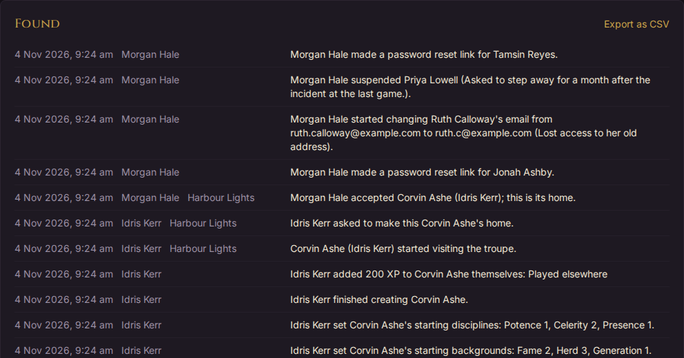

A troupe's running staff see their own troupe's part of this on its **Log** tab. Only you see the whole of it.

## Setting up Discord and email

Troupes can send downtime results, news and announcements to Discord, and results to players by email (see [Connectors](running-a-troupe.md#connectors-discord-and-email)). Neither works until you set it up for the whole server, once. Until then, a troupe's **Customise › Connectors** page says it isn't set up, and shows you, as the custodian, the settings it needs.

Both are server settings: environment variables starting `HORATIO_`. On a server deployed with `deploy/deploy.sh` they go in `deploy/production.env`; on your own computer, in `backend/.env`. No troupe ever sees or stores them.

`HORATIO_PUBLIC_URL` must be the site's address, such as `https://horatio.example.org`: Discord sends people back there, and links in messages point there.

### Discord: the Horatio app and its bot

The server has one Discord bot, which every troupe adds to its own Discord server. You make it once, in Discord's developer portal.

1. Sign in to Discord's developer portal at [discord.com/developers/applications](https://discord.com/developers/applications) and create a new application. Its name is the bot's name in every troupe's server, so "Horatio" or your site's name works well. You can give it an icon under **General Information**.
2. Open **Bot**. Choose **Reset Token** and copy the token it shows: Discord shows it only once. If you lose it, reset it again and change the setting.
   - Leave **Public Bot** on (the default). Switched off, only you could add the bot to a server, and troupes couldn't add it to theirs.
   - Leave the privileged intents off. Horatio needs none of them: the bot only sees channels and sends messages.
3. Open **OAuth2**. Copy the client ID, and the client secret (you may have to reset it to see it; copy it straight away).
4. Still under **OAuth2**, add a redirect: `https://<your site>/api/discord/callback`, for example `https://horatio.example.org/api/discord/callback`. It must start with `HORATIO_PUBLIC_URL` exactly, `https` and all. Save the change.

You don't need to make an invite link in the portal: Horatio makes its own, asking only for the two permissions the bot uses.

Then fill in the three settings. All three are needed:

| Setting | Takes |
|---|---|
| `HORATIO_DISCORD_CLIENT_ID` | The client ID, from **OAuth2** |
| `HORATIO_DISCORD_CLIENT_SECRET` | The client secret, from **OAuth2** |
| `HORATIO_DISCORD_BOT_TOKEN` | The token, from **Bot** |

The token and the secret are passwords: anyone who has them can post as your bot. Keep them out of the repository (`production.env` and `.env` aren't committed) and out of chat.

### Email: an SMTP service

Horatio sends email through one SMTP service, from one address of its own; replies to downtime results go to each troupe's storytellers. The same service sends password reset links and the links that confirm a new email address. Any mail provider that offers SMTP works.

| Setting | Takes |
|---|---|
| `HORATIO_SMTP_HOST` | The SMTP server's name, such as `smtp.example.org`. Needed |
| `HORATIO_SMTP_PORT` | Its port: 587 unless you set another |
| `HORATIO_SMTP_USERNAME` | The account to sign in as, if the service needs one |
| `HORATIO_SMTP_PASSWORD` | That account's password |
| `HORATIO_SMTP_STARTTLS` | `true` (the default) to secure the connection on port 587 |
| `HORATIO_SMTP_SSL` | `true` instead for a connection secure from the start, usually on port 465 (`HORATIO_SMTP_STARTTLS` then doesn't matter) |
| `HORATIO_MAIL_FROM` | The address it sends from, such as `Horatio <horatio@example.org>`. Needed |

Your mail provider may ask you to show you own the sending address's domain before it sends for it. Follow its instructions, or mail may land in spam.

### Putting the settings live

Horatio reads its settings when it starts, so redeploy after changing them: `deploy/deploy.sh --no-build` on the server (see [Updating the server](#updating-the-server)), or restart `./start-local.sh` on your own computer. Then open any troupe's **Customise › Connectors**: Discord and email no longer say they aren't set up, and the troupe's staff can [add the bot to their server](running-a-troupe.md#adding-the-horatio-bot).

## Updating the server

How to deploy Horatio is in the repository, not here: see [deploy/README.md](https://github.com/michael-tracey/horatio/blob/main/deploy/README.md) for the server, and the [README](https://github.com/michael-tracey/horatio/blob/main/README.md) for running it on your own computer.

In short:

- **New code**, and above all a change that brings a **database migration**, needs the full `deploy/deploy.sh`. It builds a new image, migrates the database before replacing the running app, and leaves the running version up if the migration fails.
- `deploy/deploy.sh --no-build` only redeploys the image already built, for example after changing a setting. It brings no new code.
- On your own computer, `./start-local.sh` migrates the database each time it starts.

Afterwards, check [What is running](#what-is-running) on the Site tab: **Version** should name the commit you deployed, and **Database** should say **Up to date**. Making a backup with **Back up now** before an update is a good habit.
