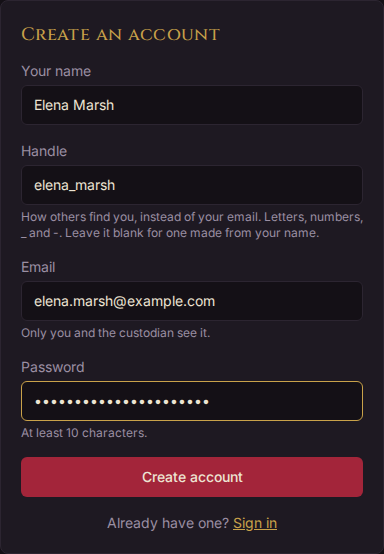
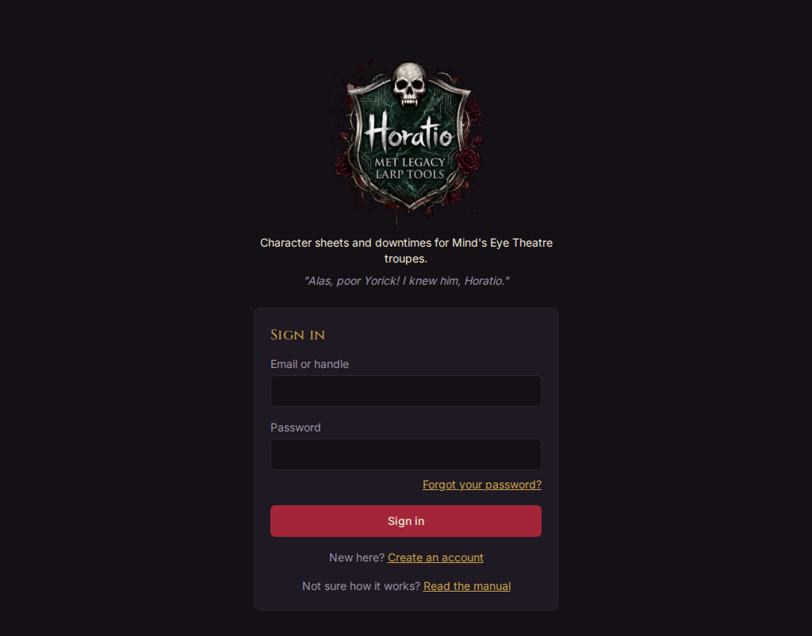
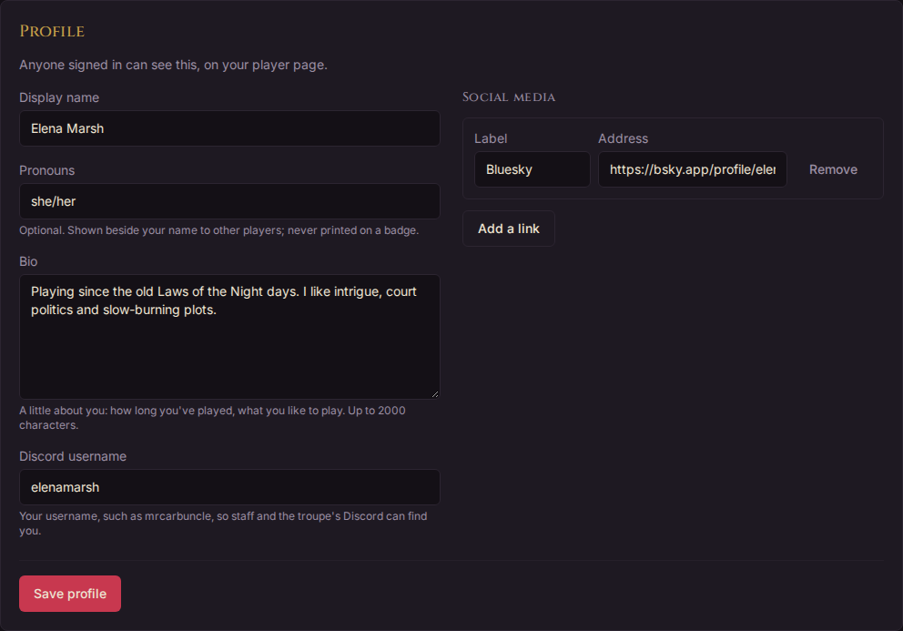
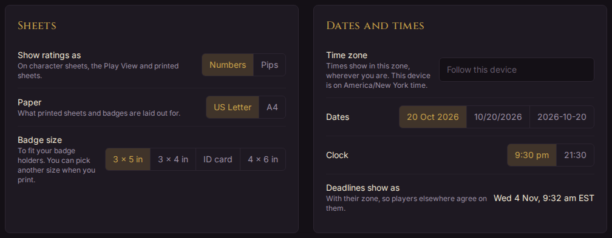
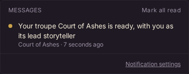
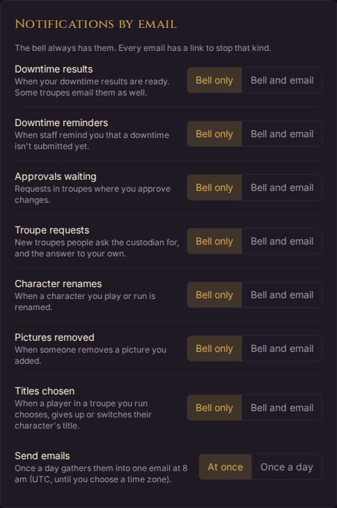
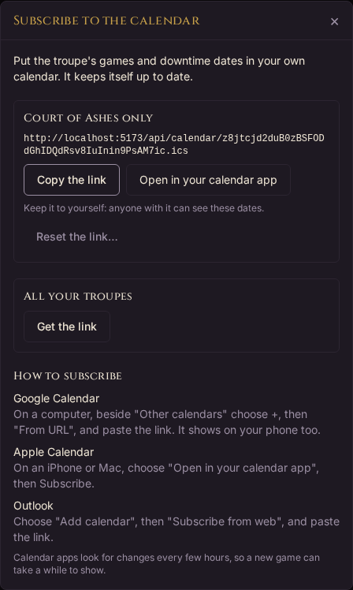

# Getting started

This part is for everyone: players, troupe staff and the custodian. It covers making an account, signing in, your account and settings, notifications, and the calendar link. To build your first character, go on to [Players](players.md) next.

## Creating an account

1. On the sign-in page, choose **Create an account**.
2. Fill in:
   - **Your name**: the name other people see. You can change it later.
   - **Handle**: how others find you, such as `night_owl`, instead of your email. Use letters, numbers, `_` and `-`. Leave it blank and Horatio makes one from your name.
   - **Email**: only you and the [custodian](glossary.md#custodian) ever see it.
   - **Password**: at least 10 characters.
3. Choose **Create account**.

You're signed in straight away, and land on **Characters**. While you have no characters, a welcome card there shows the three steps to your first game: find your troupe, build a character for it, and ask the troupe to accept it.

## Signing in

On the sign-in page, give your **Email or handle** and your **Password**, then choose **Sign in**. If you opened a link to a page in Horatio while signed out, you go on to that page once you're in.

Each page names itself in the browser's tab, its bookmarks and its history, the tab you have open first: "Approvals · ‹troupe› · Horatio", "Sheet · ‹character› · Horatio". With several Horatio tabs open, you can tell them apart.

Horatio keeps you signed in on that browser for about a month. To sign out, choose **Sign out** at the right of the menu. Signing out also clears whatever Horatio kept on that device for you; if taps from the Play View haven't been sent yet, it asks first.

### Forgotten your password

1. On the sign-in page, choose **Forgot your password?**.
2. Give the email you sign in with, and choose **Email me a link**.
3. Open the link in the email, choose a new password, and choose **Set password and sign in**.

The link works for a limited time. If nothing arrives after a few minutes, check your spam folder. Some servers can't send email: the page says so, and the custodian makes you a reset link instead. Setting a new password signs you out everywhere else.

## Your account

Choose your name at the right of the menu to open **Your account**. It has four tabs: **Profile**, **Lines and veils**, **Settings** and **This device**, which keeps your characters on your phone for games with no signal (see [Using Horatio at a game with no signal](players.md#using-horatio-at-a-game-with-no-signal)). **See your profile** at the top shows your [profile](glossary.md#profile) the way other people see it.

### Your profile

Anyone signed in can see your profile, on your player page. On the **Profile** tab you can set:

- **Display name**: your name as everyone sees it.
- **Pronouns**: optional, shown beside your name to other players. Type anything, or pick a common one such as she/her or they/them from the list. Pronouns are never printed on a badge.
- **Bio**: a little about you, up to 2000 characters.
- **Discord username**: so staff and your troupe's Discord can find you.
- **Social media**: up to six links, each with a label such as Bluesky.

Choose **Save profile** when you're done. If you try to leave with changes not saved, Horatio asks first.

### Your handle

The **Handle** card, under your profile, changes your [handle](glossary.md#handle). Others see and find you by it, never by your email, and you can sign in with either. You can change it once in 30 days, and nobody else can take your old one for 90 days.

### Lines and veils

The **Lines and veils** tab is where you tell your storytellers what you don't want in your games:

- a **line** is something that won't happen in play around you at all;
- a **veil** can happen in the story, but off-screen.

Write them in your own words, and choose **Save lines and veils**. The staff of the troupes you play in always see them. Other players see them, on the troupe's Who's Who, only if you tick **Share my lines and veils with other players in my troupes**. They are never public and never printed, and you never have to explain them.

## Settings

The **Settings** tab of your account holds your notification emails, your email address and password, and how Horatio looks for you. Most settings take effect as soon as you choose, and a message says each change is saved. They're kept on your account, so they follow you to your phone at a game.

- **Sheets**: show ratings as **Numbers** or **Pips**; the **Paper** printed sheets and badges are laid out for (US Letter or A4); and your **Badge size**.
- **Dates and times**: your **Time zone** (leave it empty to follow your device), how **Dates** look (such as 20 Oct 2026), and a 12- or 24-hour **Clock**. Deadlines always show with their time zone, so players in other places agree on them.
- **At game**: **Quick notes** (the Play View asks what each use was for), **Keep the screen awake** while the Play View is open, and which tab **The Play View opens on** (only the tabs your troupes have switched on).
- **Appearance**: **Text size**, Normal or Large, everywhere but printed sheets and badges.
- **Troupes**: whether a troupe's Who's Who shows you by your name or by your handle.

### Changing your email

The **Email** card shows the address you sign in with. To change it, choose **Change email**, give the new address and your password, and choose **Send the link**. Your email changes only when you open the link sent to the new address, within 7 days, and your old address is told. Until then you can **Send the link again** or **Cancel the change**. If the server can't send email, ask the custodian to change it for you.

### Changing your password

In the **Password** card, give your **Current password** and a **New password** of at least 10 characters, then choose **Change password**. You stay signed in on this device, and are signed out on every other.

### When the custodian viewed as you

To help with a question, the custodian can see Horatio exactly as you do, read-only, for up to 30 minutes, and must give a reason. If they ever have, a card on the Settings tab lists each time, when, and why.

## Notifications

### The bell

The bell in the menu shows a number when something is waiting for you. Open it to see two lists:

- **Waiting on you**: work for you to do, such as an approval to decide. It goes away once the work is done.
- **Messages**: news, such as downtime results arriving. A message stays until you read it; **Mark all read** clears them all.

Choose any line to go straight to the page it's about. **Notification settings**, at the foot of the list, opens the email settings below.

### Notifications by email

The bell always has every notification. In **Settings**, under **Notifications by email**, you can also have each kind sent by email: choose **Bell only** or **Bell and email** for each of:

| Kind | What it's about |
| --- | --- |
| Downtime results | Your downtime results are ready. Some troupes email the results themselves too. |
| Downtime reminders | Staff remind you that a downtime isn't submitted yet. |
| Approvals waiting | Requests in troupes where you approve changes. |
| Troupe requests | New troupes people ask the custodian for, and the answer to your own request. |
| Character renames | A character you play or run is renamed. |
| Pictures removed | Someone removes a picture you added. |
| Titles chosen | A player in a troupe you run chooses, gives up or switches their character's title. |

**Send emails** chooses **At once** or **Once a day**, which gathers them into one email at 8 am in your time zone. Every email has a link to stop that kind. If the server can't send email, the card says so, and notifications come only to the bell.

## The calendar link

You can put a troupe's games and downtime dates in your own calendar app, and it keeps itself up to date.

1. Open the troupe from **Troupes**. On its **Overview**, the **Games** card lists the games to come.
2. Choose **Subscribe to the calendar**.
3. Choose **Get the link**, either for that troupe only or for **All your troupes**.
4. Choose **Copy the link** and paste it into your calendar app, or choose **Open in your calendar app**. The dialog says how for Google Calendar, Apple Calendar and Outlook.

The calendar has each game, when downtimes are **Due**, and until when late ones are accepted, each at its time. Calendar apps look for changes every few hours, so a new game can take a while to show.

Keep the link to yourself: anyone with it can see those dates. If it gets out, choose **Reset the link…** and then **Reset the link**: the old one stops working, and you subscribe again with the new one. A link stops working by itself if you leave the troupe.

## About Horatio

**About Horatio**, at the foot of every page, says what Horatio is: free, open source, and unofficial fan-made material under Paradox Interactive's Dark Pack Agreement. It links to the project's source code and to the agreement. Anyone can read it, signed in or not.

## Finding help

**Help**, in the menu at the top of every page, opens this manual. You can read it without signing in, and the sign-in page and About page link to it too.

- The Help page lists every part, and marks the one for you: **Custodian** if you're the custodian, **Running a troupe** if you're on a troupe's staff, and **Players** otherwise. Every part is open to everyone.
- **Search the manual**, at the top of the Help page, finds words in every part at once. Each result names the part and section, and opens at that section.
- On a part's page, the list of its sections is at the side on a computer, and under **On this page** at the top on a phone.
- A page of the manual prints cleanly, without the menu.

**Rulebook**, in the same menu, lists every trait, power, ritual, merit and flaw, each with its book page and a short summary. Choose a troupe under **As played in** to see it with that troupe's house rules. It isn't the troupe's own **House rules** tab, which lists only what the troupe changes.

For a word you don't know, see the [Glossary](glossary.md). For a question the manual doesn't answer, ask your troupe's storytellers, or the custodian.
