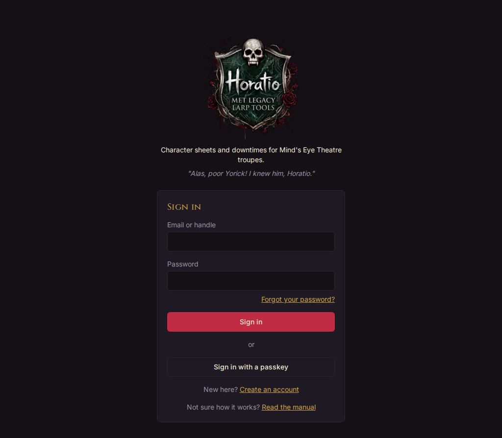
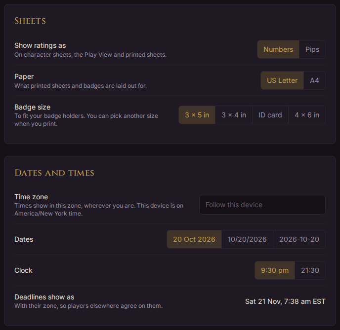
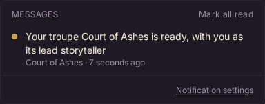
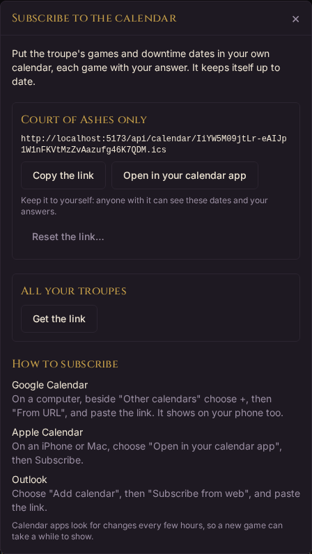

# Getting started

This part is for everyone: players, troupe staff and the custodian. It covers making an account, signing in, your account and preferences, notifications, and the calendar link. To build your first character, go on to [Players](players.md) next.

## Creating an account

1. Choose **Create account** at the top of any page, or **Create an account** on the sign-in page.
2. Fill in:
   - **Your name**: the name other people see. You can change it later.
   - **Handle**: how others find you, such as `night_owl`, instead of your email. Use letters, numbers, `_` and `-`. Leave it blank and Horatio makes one from your name.
   - **Email**: only you and the [custodian](glossary.md#custodian) ever see it.
   - **Password**: at least 10 characters.
3. Choose **Create account**.

If the server has Discord set up, the page also offers **Sign up with Discord**. Discord asks you to confirm, then tells Horatio who you are and the email it has verified for you. If no account here has your Discord account, give **Your name** and **Handle** as above and choose **Create account**: your account uses that email, has no password, and is [linked to your Discord account](#your-discord-account), which signs you in from then on. Horatio never links an account by its email:

- If Discord hasn't verified an email for you, no account is made. Verify it on Discord, then try again.
- If an account here already uses that email, nothing is made or linked. Sign in to it with your password, then link Discord on its Sign-in and email tab.

You're signed in straight away, and land on **Characters**. While you have no characters, a welcome card there shows the three steps to your first game: find your troupe, build a character for it, and ask the troupe to accept it.

## Signing in

Choose **Sign in** at the top of any page. On the sign-in page, give your **Email or handle** and your **Password**, then choose **Sign in**. If you opened a link to a page in Horatio while signed out, or signed in from the top of a page, you go on to that page once you're in.

If you have added a [passkey](#setting-up-two-step-sign-in), you can sign in with it alone, with no password: choose **Sign in with a passkey**, or pick it where your browser offers it from the **Email or handle** box, and confirm with your face, finger or PIN. That counts as both steps, so Horatio asks for nothing more, even if you must have two-step sign-in. Your password still works, and stays: no one is made to sign in without one, and [Forgot your password?](#forgotten-your-password) works as before.

With your [Discord account linked](#your-discord-account), **Sign in with Discord** signs you in too: Discord confirms it's you, and you go on where you were going. It counts as the first step only, as a password does: with [two-step sign-in](#two-step-sign-in) on, Horatio still asks for your passkey or a code from your app afterwards. A Discord account no one here has goes on to [making an account](#creating-an-account) with it.

Each page names itself in the browser's tab, its bookmarks and its history, the tab you have open first: "Approvals · ‹troupe› · Horatio", "Sheet · ‹character› · Horatio". With several Horatio tabs open, you can tell them apart.

Horatio keeps you signed in on that browser for about a month. To sign out, choose **Sign out** at the right of the menu. Signing out also clears whatever Horatio kept on that device for you; if taps from the Play View haven't been sent yet, it asks first.

After several wrong passwords, Horatio stops trying them for a while, and the page says "Too many failed sign-ins from here." Wait a quarter of an hour and try again, or reset your password (below). Only the network you were on is held back, never your account everywhere. Signing in very many times from one network, even with the right password, is held back the same way: "Too many sign-ins from here." Signing in with Discord counts too, and after several tries from one network that Discord didn't sign in, Discord sign-in is held back there for a while; your password still works.

### Forgotten your password

1. On the sign-in page, choose **Forgot your password?**.
2. Give the email you sign in with, and choose **Email me a link**.
3. Open the link in the email, choose a new password, and choose **Set password and sign in**.

The link works for a limited time. If nothing arrives after a few minutes, check your spam folder. Some servers can't send email: the page says so, and the custodian makes you a reset link instead. Setting a new password signs you out everywhere else. With [two-step sign-in](#two-step-sign-in) on, you still give your second step afterwards.

### Two-step sign-in

With two-step sign-in on, your password alone doesn't sign you in. After it, Horatio asks for your second step: choose **Use a passkey** and confirm with your face, finger or PIN, or give the 6-digit code your authenticator app shows. Someone who learns your password still can't get in. Each code works once.

Lost your phone? Use another passkey or your app if you have one, or choose **Use a recovery code instead** and give one of the recovery codes you kept when you set it up. Each works once. Lost those too? Ask the custodian to reset your two-step sign-in: they'll want to be sure it's you.

When a recovery code signs you in, or the custodian resets your two-step sign-in, Horatio tells you in the bell and by email, even if you've turned other emails off. The email says what happened and when. If it wasn't you, someone has your password: change it, make new recovery codes, and contact the custodian if you can't sign in.

Five wrong codes in a row, or ten minutes, and you start again from your password. Many wrong codes at your account, from anywhere, hold back the second step for a while: "Too many wrong codes."

The custodian must have two-step sign-in, and so must the staff of a troupe whose lead storyteller asks it. Horatio sends them to set it up before anything else; only the bell, and **Sign out**, are there meanwhile. Staff are told in the bell when their troupe starts asking, and can read it before they set it up: there, choosing a notice opens it in full where it is and marks it read, rather than going to its page, and **Set up two-step sign-in** at the foot of the bell takes you back to the setup. Once it's set up, the bell works as usual.

## Your account

Choose your name at the right of the menu to open **Your account**. It has seven tabs: **Profile**, **Lines and veils**, **Blog author**, **Preferences**, **Notifications**, **Sign-in and email** and **This device**, which keeps your characters on your phone for games with no signal (see [Using Horatio at a game with no signal](players.md#using-horatio-at-a-game-with-no-signal)). **See your profile** at the top shows your [profile](glossary.md#profile) the way other people see it.

### Your profile

Anyone signed in can see your profile, on your player page. On the **Profile** tab you can set:

- **Display name**: your name as everyone sees it.
- **Pronouns**: optional, shown beside your name to other players. Type anything, or pick a common one such as she/her or they/them from the list. Pronouns are never printed on a badge.
- **Bio**: a little about you, up to 2000 characters.
- **Discord username**: so staff and your troupe's Discord can find you. Or [link your Discord account](#your-discord-account) on the Sign-in and email tab instead.
- **Social media**: up to six links, each with a label such as Bluesky.

Choose **Save** when you're done. If you try to leave with changes not saved, Horatio asks first.

### Lines and veils

The **Lines and veils** tab is where you tell your storytellers what you don't want in your games:

- a **line** is something that won't happen in play around you at all;
- a **veil** can happen in the story, but off-screen.

Write them in your own words, and choose **Save**. The staff of the troupes you play in always see them. Other players see them, on the troupe's Who's Who, only if you tick **Share my lines and veils with other players in my troupes**. They are never public and never printed, and you never have to explain them.

### Your blog author profile

Horatio's blog is written by the staff of its troupes. The **Blog author** tab sets how you show there, under each article you write and on your author page, for anyone to read, signed in or not. It's apart from your profile: it starts from your display name and handle, and nothing else from your profile shows unless you put it here. You can set:

- **Display name**: your name as readers see it.
- **Author handle**: the end of your page's address, such as /blog/authors/night_owl. It starts as your Horatio handle. No other author can have it, and you can't take someone else's Horatio handle.
- **Bio**: a few lines about you and the games you run, up to 1000 characters. Markdown works: `**bold**`, `*italic*` and links.
- **Links**: up to six, each with a label.

**How it shows**, beside the form, is the card readers will see, and changes as you type. Choose **Save**. Once it's saved you can add a **Picture**: choose one, move the square to where you want it, and choose **Save**. **Move the crop** and **Remove** change it later.

While you're on a troupe's staff, or have an article published, **See your author page** opens your page as everyone sees it. Until then, only you can see it.

The custodian can clear an author's bio, links or picture, for example one that breaks the site's rules. You're told in the bell, with their reason if they gave one. The rest of your author profile stays, and you can fill it in again.

## Preferences

The **Preferences** tab of your account holds how Horatio looks and behaves for you. Each takes effect as soon as you choose, and a message says it's saved. They're kept on your account, so they follow you to your phone at a game.

- **Appearance**: the **Theme**, and **Text size**, Normal or Large, everywhere but printed sheets and badges.
- **Sheets**: show ratings as **Numbers** or **Pips**; the **Paper** printed sheets and badges are laid out for (US Letter or A4); and your **Badge size**.
- **Dates and times**: your **Time zone** (leave it empty to follow your device), how **Dates** look (such as 20 Oct 2026), and a 12- or 24-hour **Clock**. Deadlines always show with their time zone, so players in other places agree on them.
- **At game**: **Quick notes** (the Play View asks what each use was for), **Keep the screen awake** while the Play View is open, and which tab **The Play View opens on** (only the tabs your troupes have switched on).
- **Troupes**: whether a troupe's Who's Who shows you by your name or by your handle.

## Sign-in and email

The **Sign-in and email** tab of your account holds how you sign in: your email, your handle, your password and your Discord account. Which notifications come, and how, is on [the Notifications tab](#choosing-your-notifications).

### Changing your email

The **Email** card shows the address you sign in with. To change it, choose **Edit email**, give the new address and your password, and choose **Send the link**. Your email changes only when you open the link sent to the new address, within 7 days, and your old address is told. Until then you can **Send the link again** or **Cancel the change**. If the server can't send email, ask the custodian to change it for you.

### Your handle

The **Handle** card changes your [handle](glossary.md#handle): write the new one and choose **Save handle**. Others see and find you by it, never by your email, and you can sign in with either. You can change it once in 30 days, and nobody else can take your old one for 90 days.

### Changing your password

In the **Password** card, give your **Current password** and a **New password** of at least 10 characters, then choose **Save new password**. You stay signed in on this device, and are signed out on every other.

After many tries at changing it, right or wrong, Horatio stops taking them for a while: "Too many tries at changing your password." Wait a quarter of an hour, or sign out and [reset your password](#forgotten-your-password).

### Setting up two-step sign-in

The **Two-step sign-in** card offers two kinds of second step. You can have both, and several passkeys.

- **A passkey** is kept by your phone, computer or password manager, and unlocked with your face, finger or PIN. Give it a name, such as Phone, give your password, and choose **Add a passkey**; your browser asks you to confirm. A passkey made on your phone can usually sign you in on a computer nearby too. It can also sign you in alone, with no password (see [Signing in](#signing-in)).

  A passkey added while passkeys could only come after the password may not sign you in alone, and the card says so under it: "May not sign you in alone". Once a passkey has signed you in alone, the card stops saying it. A few devices, such as some security keys, keep passkeys only as a second step: the card says "Signs you in only after your password" under those.

  To be sure one signs you in alone, choose **Replace this passkey** under it, on the device that keeps it, give your password and choose **Replace**. Your browser asks you to confirm, as for adding one, and makes a new passkey there, under the same name, that signs you in alone. Only once Horatio has kept the new one does it remove the old, so if you cancel, or the device can't make one, the old one is kept as it was and the card says so. You're never left without a second step, and you keep your recovery codes.
- **An authenticator app**, such as Google Authenticator, Microsoft Authenticator or 1Password, shows a new 6-digit code every 30 seconds. Choose **Set up an authenticator app**, give your password and choose **Show the QR code**. Scan the QR code with the app, or type the key into it, then give the code it shows and choose **Turn on two-step sign-in**.

With your first second step, Horatio shows ten recovery codes, once. Keep them somewhere safe, away from your phone (**Download** or **Copy** help), and choose **I've kept them**. The card says how many are left; **New recovery codes** makes ten more in place of the old. **Remove** takes away a passkey, and **Turn off** the app. Each of these, like adding or replacing a passkey and setting up an app, asks for your password, so no one can change them at a sign-in you left open. Too many tries at your password in a while, right or wrong, here or on the **Password** card, and Horatio asks you to wait: "Too many tries at your password." If you must have two-step sign-in, you can't remove your last second step.

An account made with Discord has no password until you set one, so where the card would ask for your password it offers **Confirm with Discord** instead. Horatio sends you to Discord, which confirms it's you, and back to the same place with what you were doing ready to finish: the passkey's name kept, or the form open, with no password box. Choose **Add a passkey**, **Replace**, **Remove**, **Show the QR code**, **Turn off** or **Make new codes** within 5 minutes; the confirmation works once, for that sign-in only, and then asks again. It must be the Discord account linked to yours: another one confirms nothing. Each try counts towards the same limit as tries at a password. This works on the page that asks you to set up two-step sign-in before anything else too. If you'd rather have a password, ask for one from **Forgot your password?** on the sign-in page.

### Your Discord account

If the server has Discord set up, the **Discord account** card offers **Link my Discord**. Discord asks you to confirm, then tells Horatio your Discord username and nothing else. Your profile then shows that username, marked as confirmed by Discord, where a typed one is marked "typed, not checked". Staff can rely on it when they give you your character's Discord channel. Once it's linked, **Sign in with Discord** on the sign-in page signs you in too.

While it's linked, your Discord username comes from Discord and can't be typed over. **Unlink Discord** forgets the link and keeps the username, unless Discord is your only way to sign in, as it is for an account made with Discord. To have a password too, ask for one from **Forgot your password?** on the sign-in page. A Discord account can be linked to only one Horatio account.

### When the custodian viewed as you

To help with a question, the custodian can see Horatio exactly as you do, read-only, for up to 30 minutes, and must give a reason. If they ever have, a card on the Sign-in and email tab lists each time, when, and why.

## Notifications

### The bell

The bell in the menu shows a number when something is waiting for you. Open it to see two lists:

- **Waiting on you**: work for you to do, such as an approval to decide. It goes away once the work is done.
- **Messages**: news, such as downtime results arriving. A message stays until you read it; **Mark all read** clears them all.

Choose any line to go straight to the page it's about. **Notification settings**, at the foot of the list, opens the Notifications tab below.

### Choosing your notifications

The **Notifications** tab of your account lists every kind of notification Horatio sends, in groups: **Your account**, **Your characters**, **Downtimes**, **Boons** and **Troupe news**, and, if you're on a troupe's staff, **Staff work** (the custodian also sees **Custodian**). Each kind has a tick for each way it can come:

- **Bell**: in the bell. Every kind comes to the bell until you untick it.
- **Email**: by email as well. Every kind is off until you tick it, but troupe announcements, which are on because they're often practical. One the staff mark **Important** is emailed to everyone in the troupe even so.
- **Phone**: as a notification on your phone, on each device where you turn them on (see [Notifications on your phone](#notifications-on-your-phone)). Downtime results, your boons (one you reported accepted or not), powers used on your character, blood bonds and troupe announcements are ticked to begin with; the rest are off until you tick them. Tick it for **Teaching to confirm** to hear on your phone, as it's asked, when another player asks your character to teach theirs: it says who would learn what, and the Willpower it costs, and a tap opens your character's Play View to confirm or refuse.

Untick them all and that kind doesn't come at all. Some always come, and show **Bell, always** or **Email, always** with a lock instead of a tick: work waiting on you, such as an approval to decide or teaching to confirm, stays in the bell until it's done; word that the custodian viewed Horatio as you, merged your accounts, moved a character to or from you or reset your two-step sign-in, that a recovery code signed you in, or that a troupe you run now asks its staff for two-step sign-in, always comes to the bell; and emails to set a new password, confirm a new email, say your account is suspended or let back in, or say your two-step sign-in was reset or a recovery code used, always come, at once.

**Boons players report** goes with a role: staff, the Harpy and Lesser Harpies who approve reported boons choose whether they're told at all, for each troupe. The tab lists your choice in each troupe where you have one, the same switch as in the troupe's Boons settings or on your ledger's **To review** tab, so changing it in either place changes both.

Downtime results and quest news may also go out through your troupe's own connectors, to its Discord or by its own email. That's the troupe's choice, set by its storytellers; the tab says which of your troupes do it.

Where a troupe's Discord gives your character a channel of their own, **Downtime results** has a switch for it: *Troupe: post to Agnes's own Discord channel*. It's on to begin with. Turn it off and Horatio posts nothing more to that channel, neither results nor quest news, while they still come to you here, in the bell or by email as you chose. Anything already waiting to go there is cancelled, not sent. The troupe's own channels, for its news and announcements, are the troupe's to choose and aren't affected. Its staff can see that you turned your channel off.

If email is set up, **Send emails** under **Emails** chooses **At once** or **Once a day**, which gathers them into one email at 8 am in your time zone. Every email has a link to stop that kind by email, which unticks it here. If the server can't send email, the tab says so, and notifications come only to the bell.

### Notifications on your phone

Horatio can tell your phone, so you hear of downtime results or a boon accepted at a game without opening it. You turn this on for each device, at the top of the **Notifications** tab, under **Phone notifications**:

1. On the phone, open Horatio and go to **Your account › Notifications**.
   - **Android**: in Chrome, as it is, or after **Add to Home screen**.
   - **iPhone or iPad**: first add Horatio to your Home Screen. In Safari, tap **Share**, then **Add to Home Screen**, and open Horatio from the new icon. Phone notifications don't work in Safari itself; the tab says so. This needs iOS 16.4 or later.
2. Turn on **On this device**, and allow notifications when the phone asks.

Each kind ticked under **Phone** then comes to that phone, even while Horatio is closed. Tap one to open the page it's about. A notification says no more than the bell's line.

Turn **On this device** off to stop them there. Signing out on a device stops them there too. Every other device where they're on is listed under **Also on**, with **Turn off** for each, so you can stop a phone you no longer have. If the server isn't set up for phone notifications, the tab says so.

## The calendar link

You can put a troupe's games and downtime dates in your own calendar app, and it keeps itself up to date.

1. Open the troupe from **Troupes**. On its **Overview**, the **Games** card lists the games to come.
2. Choose **Subscribe to the calendar**.
3. Choose **Get the link**, either for that troupe only or for **All your troupes**.
4. Choose **Copy the link** and paste it into your calendar app, or choose **Open in your calendar app**. The dialog says how for Google Calendar, Apple Calendar and Outlook.

The calendar has each game, when downtimes are **Due**, and until when late ones are accepted, each at its time. Calendar apps look for changes every few hours, so a new game can take a while to show.

Each game shows your own answer to it, at the start of its title and in its notes: **Coming · Game: *the troupe***, **Maybe · …** or **Not coming · …**. A game you haven't answered is plain **Game: *the troupe***, and its notes say you haven't said. A game you're not coming to stays in your calendar, marked, so you can still see it and change your mind. Changing or taking back your answer changes the calendar too, the next time your calendar app looks.

Keep the link to yourself: anyone with it can see those dates and your answers. If it gets out, choose **Reset the link…** and then **Reset the link**: the old one stops working, and you subscribe again with the new one. A link stops working by itself if you leave the troupe.

## About Horatio

**About Horatio**, at the foot of every page, says what Horatio is: free, open source, and unofficial fan-made material under Paradox Interactive's Dark Pack Agreement. It links to the project's source code and to the agreement. Anyone can read it, signed in or not.

## Reading the blog

Horatio's blog, at **/blog**, has articles on playing and running a game, written by the staff of troupes on Horatio and published by the custodian. Anyone can read it, signed in or not, so you can share a link to an article with anyone.

- The newest articles come first, a page at a time, with any featured ones across the top. **Previous** and **Next** at the foot move between pages.
- The tags above the articles, such as **Storytelling** or **Safety and consent**, show only the articles with that tag. **All** shows every one again. Each article's own tags lead to the same lists.
- An article shows who wrote it and when, and the troupe it comes from. A troupe whose profile is public is a link to that profile.
- Under the article is its author's card, as they set it in [their blog author profile](#your-blog-author-profile). Their name leads to their author page, which lists every article of theirs on the blog, newest first.

Readers can't comment on articles. If you wrote an article, its page has **Change it**, which opens it for writing. For writing one, see [Writing for the blog](blog.md).

## Searching everything

The magnifying glass at the top of every page, or **/** or **Ctrl K** (**⌘K** on a Mac) on any page, opens a search of everything you may see: characters, players, boons, locations, quests, equipment, news, announcements and this manual, and a troupe's settings for its storytellers. Each kind is a group of its own, and each result opens its page; **Enter** opens the first.

Within each group, the troupe you're on comes first: the troupe whose pages you're on, or on a character's pages, that character's home troupe. A result from another troupe carries a small pill with that troupe's abbreviation, such as **CoA** for Court of Ashes; point at it, or listen with a screen reader, for the troupe's full name. Results from the troupe you're on have no pill. With no troupe in view, or on a character with no home troupe, no troupe comes first, and every result has its troupe's pill.

## Finding help

**Help**, in the menu at the top of every page, opens this manual. You can read it without signing in, and the sign-in page and About page link to it too.

- The Help page lists every part, and marks the one for you: **Custodian** if you're the custodian, **Running a troupe** if you're on a troupe's staff, and **Players** otherwise. Every part is open to everyone.
- **Search the manual**, at the top of the Help page, finds words in every part at once. Each result names the part and section, and opens at that section.
- On a part's page, the list of its sections is at the side on a computer, and under **On this page** at the top on a phone.
- A page of the manual prints cleanly, without the menu.

**Rulebook**, in the same menu, lists every trait, power, ritual, merit and flaw, each with its book page and a short summary. Choose a troupe under **As played in** to see it with that troupe's house rules. With a troupe chosen, **Status** shows every status of the sects it takes, what each does and what gives it there. It isn't the troupe's own **House rules** tab, which lists only what the troupe changes.

For a word you don't know, see the [Glossary](glossary.md). For a question the manual doesn't answer, ask your troupe's storytellers, or the custodian.
