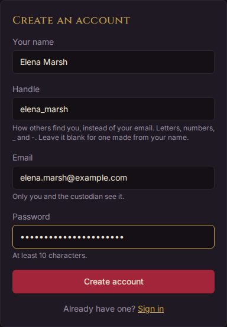
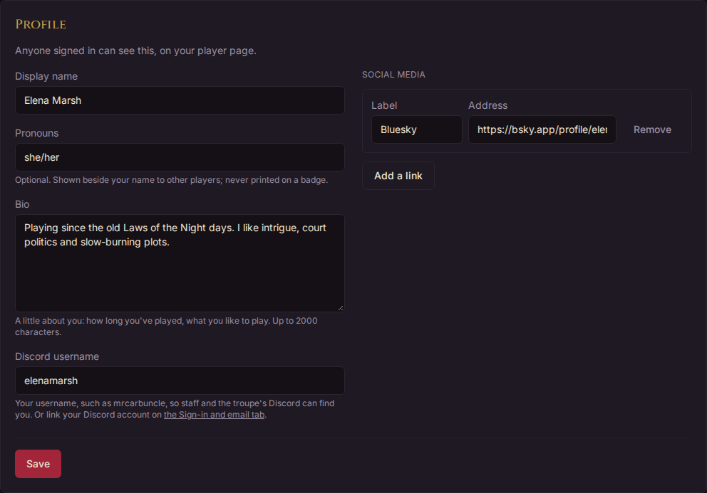
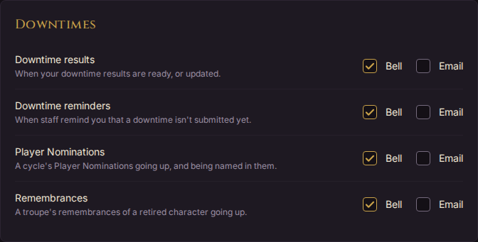

# Getting started

This part is for everyone: players, troupe staff and the custodian. It covers making an account, signing in, your account and preferences, notifications, and the calendar link. To build your first character, go on to [Players](players.md) next.

## Creating an account

1. Choose **Create account** at the top of any page, or **Create an account** on the sign-in page.
2. Fill in:
   - **Your name**: the name other people see. You can change it later.
   - **Handle**: how others find you, such as `night_owl`, instead of your email. Use letters, numbers, `_` and `-`. Leave it blank and Horatio makes one from your name.
   - **Email**: only you and the [custodian](glossary.md#custodian) ever see it.
   - **Password**: at least 10 characters.
3. Choose **Create account**.

You're signed in straight away, and land on **Characters**. While you have no characters, a welcome card there shows the three steps to your first game: find your troupe, build a character for it, and ask the troupe to accept it.

## Signing in

Choose **Sign in** at the top of any page. On the sign-in page, give your **Email or handle** and your **Password**, then choose **Sign in**. If you opened a link to a page in Horatio while signed out, or signed in from the top of a page, you go on to that page once you're in.

Each page names itself in the browser's tab, its bookmarks and its history, the tab you have open first: "Approvals · ‹troupe› · Horatio", "Sheet · ‹character› · Horatio". With several Horatio tabs open, you can tell them apart.

Horatio keeps you signed in on that browser for about a month. To sign out, choose **Sign out** at the right of the menu. Signing out also clears whatever Horatio kept on that device for you; if taps from the Play View haven't been sent yet, it asks first.

After several wrong passwords, Horatio stops trying them for a while, and the page says "Too many failed sign-ins from here." Wait a quarter of an hour and try again, or reset your password (below). Only the network you were on is held back, never your account everywhere.

### Forgotten your password

1. On the sign-in page, choose **Forgot your password?**.
2. Give the email you sign in with, and choose **Email me a link**.
3. Open the link in the email, choose a new password, and choose **Set password and sign in**.

The link works for a limited time. If nothing arrives after a few minutes, check your spam folder. Some servers can't send email: the page says so, and the custodian makes you a reset link instead. Setting a new password signs you out everywhere else.

## Your account

Choose your name at the right of the menu to open **Your account**. It has six tabs: **Profile**, **Lines and veils**, **Preferences**, **Notifications**, **Sign-in and email** and **This device**, which keeps your characters on your phone for games with no signal (see [Using Horatio at a game with no signal](players.md#using-horatio-at-a-game-with-no-signal)). **See your profile** at the top shows your [profile](glossary.md#profile) the way other people see it.

### Your profile

Anyone signed in can see your profile, on your player page. On the **Profile** tab you can set:

- **Display name**: your name as everyone sees it.
- **Pronouns**: optional, shown beside your name to other players. Type anything, or pick a common one such as she/her or they/them from the list. Pronouns are never printed on a badge.
- **Bio**: a little about you, up to 2000 characters.
- **Discord username**: so staff and your troupe's Discord can find you.
- **Social media**: up to six links, each with a label such as Bluesky.

Choose **Save** when you're done. If you try to leave with changes not saved, Horatio asks first.

### Lines and veils

The **Lines and veils** tab is where you tell your storytellers what you don't want in your games:

- a **line** is something that won't happen in play around you at all;
- a **veil** can happen in the story, but off-screen.

Write them in your own words, and choose **Save**. The staff of the troupes you play in always see them. Other players see them, on the troupe's Who's Who, only if you tick **Share my lines and veils with other players in my troupes**. They are never public and never printed, and you never have to explain them.

## Preferences

The **Preferences** tab of your account holds how Horatio looks and behaves for you. Each takes effect as soon as you choose, and a message says it's saved. They're kept on your account, so they follow you to your phone at a game.

- **Appearance**: the **Theme**, and **Text size**, Normal or Large, everywhere but printed sheets and badges.
- **Sheets**: show ratings as **Numbers** or **Pips**; the **Paper** printed sheets and badges are laid out for (US Letter or A4); and your **Badge size**.
- **Dates and times**: your **Time zone** (leave it empty to follow your device), how **Dates** look (such as 20 Oct 2026), and a 12- or 24-hour **Clock**. Deadlines always show with their time zone, so players in other places agree on them.
- **At game**: **Quick notes** (the Play View asks what each use was for), **Keep the screen awake** while the Play View is open, and which tab **The Play View opens on** (only the tabs your troupes have switched on).
- **Troupes**: whether a troupe's Who's Who shows you by your name or by your handle.

## Sign-in and email

The **Sign-in and email** tab of your account holds how you sign in: your email, your handle, your password and your Discord account. Which notifications come, and how, is on [the Notifications tab](#choosing-your-notifications).

### Changing your email

The **Email** card shows the address you sign in with. To change it, choose **Edit email**, give the new address and your password, and choose **Send the link**. Your email changes only when you open the link sent to the new address, within 7 days, and your old address is told. Until then you can **Send the link again** or **Cancel the change**. If the server can't send email, ask the custodian to change it for you.

### Your handle

The **Handle** card changes your [handle](glossary.md#handle): write the new one and choose **Save handle**. Others see and find you by it, never by your email, and you can sign in with either. You can change it once in 30 days, and nobody else can take your old one for 90 days.

### Changing your password

In the **Password** card, give your **Current password** and a **New password** of at least 10 characters, then choose **Save new password**. You stay signed in on this device, and are signed out on every other.

### Your Discord account

If the server has Discord set up, the **Discord account** card offers **Link my Discord**. Discord asks you to confirm, then tells Horatio your Discord username and nothing else. Your profile then shows that username, marked as confirmed by Discord, where a typed one is marked "typed, not checked". Staff can rely on it when they give you your character's Discord channel. Linking doesn't change how you sign in.

While it's linked, your Discord username comes from Discord and can't be typed over. **Unlink Discord** forgets the link and keeps the username, unless Discord is your only way to sign in. A Discord account can be linked to only one Horatio account.

### When the custodian viewed as you

To help with a question, the custodian can see Horatio exactly as you do, read-only, for up to 30 minutes, and must give a reason. If they ever have, a card on the Sign-in and email tab lists each time, when, and why.

## Notifications

### The bell

The bell in the menu shows a number when something is waiting for you. Open it to see two lists:

- **Waiting on you**: work for you to do, such as an approval to decide. It goes away once the work is done.
- **Messages**: news, such as downtime results arriving. A message stays until you read it; **Mark all read** clears them all.

Choose any line to go straight to the page it's about. **Notification settings**, at the foot of the list, opens the Notifications tab below.

### Choosing your notifications

The **Notifications** tab of your account lists every kind of notification Horatio sends, in groups: **Your account**, **Your characters**, **Downtimes**, **Boons** and **Troupe news**, and, if you're on a troupe's staff, **Staff work** (the custodian also sees **Custodian**). Each kind has a tick for each way it can come:

- **Bell**: in the bell. Every kind comes to the bell until you untick it.
- **Email**: by email as well. Every kind is off until you tick it, but troupe announcements, which are on because they're often practical. One the staff mark **Important** is emailed to everyone in the troupe even so.
- **Phone**: as a notification on your phone, on each device where you turn them on (see [Notifications on your phone](#notifications-on-your-phone)). Downtime results, your boons (one you reported accepted or not), powers used on your character, blood bonds and troupe announcements are ticked to begin with; the rest are off until you tick them.

Untick them all and that kind doesn't come at all. Some always come, and show **Bell, always** or **Email, always** with a lock instead of a tick: work waiting on you, such as an approval to decide or teaching to confirm, stays in the bell until it's done; word that the custodian viewed Horatio as you, merged your accounts or moved a character to or from you always comes to the bell; and emails to set a new password, confirm a new email, or say your account is suspended or let back in always come.

**Boons players report** goes with a role: staff, the Harpy and Lesser Harpies who approve reported boons choose whether they're told at all, for each troupe. The tab lists your choice in each troupe where you have one, the same switch as in the troupe's Boons settings or on your ledger's **To review** tab, so changing it in either place changes both.

Downtime results and quest news may also go out through your troupe's own connectors, to its Discord or by its own email. That's the troupe's choice, set by its storytellers; the tab says which of your troupes do it.

Where a troupe's Discord gives your character a channel of their own, **Downtime results** has a switch for it: *Troupe: post to Agnes's own Discord channel*. It's on to begin with. Turn it off and Horatio posts nothing more to that channel, neither results nor quest news, while they still come to you here, in the bell or by email as you chose. The troupe's own channels, for its news and announcements, are the troupe's to choose and aren't affected. Its staff can see that you turned your channel off.

If email is set up, **Send emails** under **Emails** chooses **At once** or **Once a day**, which gathers them into one email at 8 am in your time zone. Every email has a link to stop that kind by email, which unticks it here. If the server can't send email, the tab says so, and notifications come only to the bell.

### Notifications on your phone

Horatio can tell your phone, so you hear of downtime results or a boon accepted at a game without opening it. You turn this on for each device, at the top of the **Notifications** tab, under **Phone notifications**:

1. On the phone, open Horatio and go to **Your account › Notifications**.
   - **Android**: in Chrome, as it is, or after **Add to Home screen**.
   - **iPhone or iPad**: first add Horatio to your Home Screen. In Safari, tap **Share**, then **Add to Home Screen**, and open Horatio from the new icon. Phone notifications don't work in Safari itself; the tab says so. This needs iOS 16.4 or later.
2. Turn on **On this device**, and allow notifications when the phone asks.

Each kind ticked under **Phone** then comes to that phone, even while Horatio is closed. Tap one to open the page it's about. A notification says no more than the bell's line.

Turn **On this device** off to stop them there. Signing out on a device stops them there too. Every other device where they're on is listed under **Also on**, with **Turn off** for each, so you can stop a phone you no longer have. If the server isn't set up for phone notifications, the tab says so.

## The calendar link

You can put a troupe's games and downtime dates in your own calendar app, and it keeps itself up to date.

1. Open the troupe from **Troupes**. On its **Overview**, the **Games** card lists the games to come.
2. Choose **Subscribe to the calendar**.
3. Choose **Get the link**, either for that troupe only or for **All your troupes**.
4. Choose **Copy the link** and paste it into your calendar app, or choose **Open in your calendar app**. The dialog says how for Google Calendar, Apple Calendar and Outlook.

The calendar has each game, when downtimes are **Due**, and until when late ones are accepted, each at its time. Calendar apps look for changes every few hours, so a new game can take a while to show.

Keep the link to yourself: anyone with it can see those dates. If it gets out, choose **Reset the link…** and then **Reset the link**: the old one stops working, and you subscribe again with the new one. A link stops working by itself if you leave the troupe.

## About Horatio

**About Horatio**, at the foot of every page, says what Horatio is: free, open source, and unofficial fan-made material under Paradox Interactive's Dark Pack Agreement. It links to the project's source code and to the agreement. Anyone can read it, signed in or not.

## Finding help

**Help**, in the menu at the top of every page, opens this manual. You can read it without signing in, and the sign-in page and About page link to it too.

- The Help page lists every part, and marks the one for you: **Custodian** if you're the custodian, **Running a troupe** if you're on a troupe's staff, and **Players** otherwise. Every part is open to everyone.
- **Search the manual**, at the top of the Help page, finds words in every part at once. Each result names the part and section, and opens at that section.
- On a part's page, the list of its sections is at the side on a computer, and under **On this page** at the top on a phone.
- A page of the manual prints cleanly, without the menu.

**Rulebook**, in the same menu, lists every trait, power, ritual, merit and flaw, each with its book page and a short summary. Choose a troupe under **As played in** to see it with that troupe's house rules. With a troupe chosen, **Status** shows every status of the sects it takes, what each does and what gives it there. It isn't the troupe's own **House rules** tab, which lists only what the troupe changes.

For a word you don't know, see the [Glossary](glossary.md). For a question the manual doesn't answer, ask your troupe's storytellers, or the custodian.
