# Players

This part is for players: building a character, spending its XP, bringing it to a troupe, writing its backstory, taking downtimes and playing it at game. It assumes you know Mind's Eye Theatre: Vampire, but not Horatio.

For signing up, your account, your settings and notifications, see [Getting started](getting-started.md). Words Horatio uses in its own way, such as *home troupe* and *cycle*, are in [the glossary](glossary.md).

## Your characters

### The Characters page

**Characters** in the top menu opens **Your characters**: every character you play, with its splat and clan, and a line of badges saying where it stands.

- **In creation**: you haven't finished building it.
- **No home troupe yet**: it's finished, but no troupe has accepted it.
- **Built to** a troupe's rules (or **Built to the book's rules**): with no home troupe yet, whose rules it's built to, as you chose under **Which troupe will you play in?** Left out while it waits for that same troupe. Once a troupe accepts it, it plays by its home troupe's rules.
- **Waiting for** a troupe: you've asked that troupe to be its home, and its storytellers haven't decided.
- **Home:** a troupe: it plays there.
- **Downtime due**, with its day and time (or **Downtime overdue**): a downtime is waiting for you to submit.
- **New results**: downtime results have arrived that you haven't opened on this device.
- **Retired**: see [Retiring a character](#retiring-a-character).

Open a character to see its page. On a wide screen its tabs sit in one row; on a phone they're grouped as **Sheet** (Sheet, Status & Titles, Equipment, Experience), **Between games** (Downtime, Results, Quests, Influence) and **About** (Troupes, Backstory, Log). Some appear only once they apply: Experience, Downtime, Results and Influence once creation is finished, Quests only while a troupe it is in runs quests, and Shared backgrounds once it has dots in one.

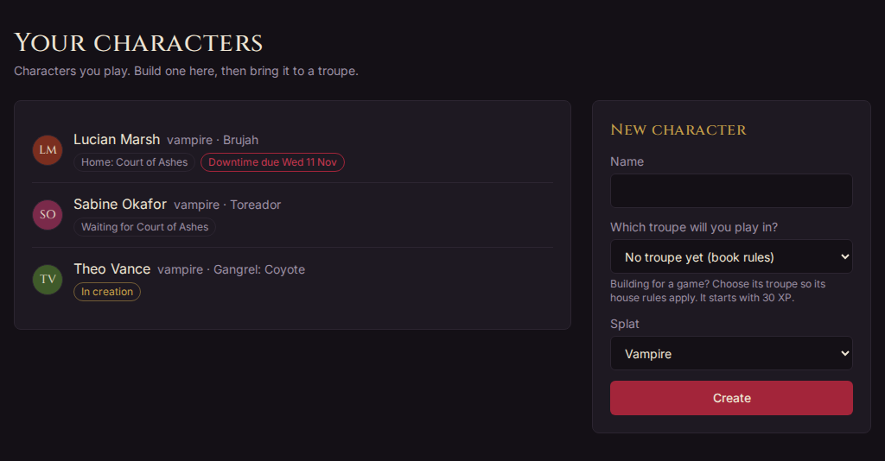

Beside the character's name, the **⋯** button (**More for** the character) holds the less-used actions: **Rename…**, **Pronouns…**, diablerie, **Retire…** and **Delete…**. You can rename a character as often as you like until it joins a troupe; after that, once every three months, and its troupes' staff are told. Tap the picture beside the name to add or change a portrait.

### Making a character

Under **New character**, on the right of the Characters page:

1. Give it a **Name**.
2. Choose **Which troupe will you play in?** Choosing the troupe makes its house rules apply while you build: its prices, starting points, banned traits and specialisation lists. Choose **No troupe yet (book rules)** to build by the book and bring it to a troupe later. You can change this until a troupe accepts the character. The hint under it says what XP the character starts with: 30, or the troupe's XP floor.
3. Choose the **Splat**. A troupe may take only some splats; the list shows only those.
4. Press **Create**.

A troupe's page may also have a **Play here** link that opens this form with the troupe already chosen.

Horatio then opens the creation wizard on the character's **Create** tab. Each step saves itself a moment after your last tap, and again when you leave it, so you can stop at any point and come back with **Continue creating** on the character's page. **Save and continue** goes to the next step; **Back** goes to the last. The list of steps down the side lets you jump about, and a step with a red mark has something that needs a look. You can't go past a step that still needs something essential, such as a vampire's Generation; the locked steps say which one to finish first.

### The creation wizard, step by step

The steps follow the book's order. A troupe's house rules can add a step (for a category of its own) or change what a step offers.

1. **Concept.** Who the character is. **Clan** comes first, because it decides the in-clan disciplines; once chosen, a box under it shows the in-clan disciplines, the clan's weakness with its page, and any merit the clan needs (see [Clans and bloodlines](#clans-and-bloodlines)). A clan with a choice of in-clan disciplines, such as the Caitiff, asks for it here. Then **Archetype**, **Sect** and the other choices. **Other…** in the Archetype list lets you write your own, with a name and what it means for the character. The troupe you're building for can be changed here too. A ghoul's Concept step asks for its **Domitor** instead of a clan: a ghoul takes its domitor's clan, bloodline and in-clan disciplines.
2. **Attributes.** Rank Physical, Social and Mental by tapping 7, 5 or 3 for each. Tapping a rating already taken swaps the two.
3. **Focuses.** One focus for each attribute. Merits that give more show below.
4. **Skills.** Tap the dot for each skill's rating. The counters show what is left to place. Crafts, Performance and Science ask for their field.
5. **Backgrounds.** The same, for Allies, Contacts, Resources and the rest. Generation is a background: a vampire needs at least one dot of it to go on.
6. **Disciplines.** Your starting dots go on in-clan disciplines; the step says how many at each rating. Some merits change this, and say so.
7. **Merits & flaws.** As the book has it (MET: VTM pp. 85, 106), merits are bought with the character's starting XP, up to 7 points of them, and flaws add their points to it, up to 7 XP; both are optional. A line at the top keeps count, such as *30 XP to start, 6 on merits, 7 from flaws: 31 left*, and the rest is yours to spend once creation is finished. Merits the clan needs are already taken from the merit points, and cost their XP too; they're shown as the clan's. Taking a merit back refunds its XP, and taking a flaw back takes back what it gave; if you've already spent that XP, Horatio says so and asks you to undo something first. Flaws can go past 7 points with your Storyteller's OK, but give no more XP (*9 points, 7 XP paid out*); your sheet flags them for staff to see. A troupe can set its own budgets for merits and flaws.
8. **Review.** A summary of the character, with anything left to do: **Picks left** (each with **Go to** the step), **Still to settle** (for example a rule the sheet breaks), and fields still to give. When everything is placed, **Finish creation** is ready.

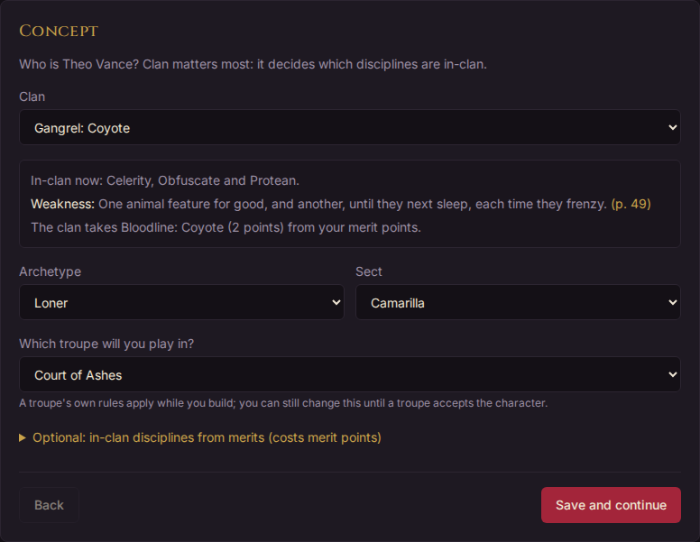

While a character is in creation you can also place picks from its **Sheet** tab, under **Character creation**. Picks placed there wait in the cart until you press **Apply picks**.

### Clans and bloodlines

The **Clan** list includes each clan's bloodlines, written as clan and bloodline: *Gangrel: Coyote*, *Brujah: True Brujah*. Choosing a bloodline makes the character of that bloodline, with its in-clan disciplines.

The book asks a bloodline, or a clan that is uncommon in the setting, to pay for it in merits (MET: VTM pp. 237–238). Horatio does that for you: choosing the clan takes its bloodline merit, and any rarity merit (Uncommon Clan, Rare Clan or Restricted Clan), from the merit points and their XP from the starting XP, and choosing another gives them back. The box under the clan says what it takes. How rare a clan is depends on the setting: the troupe's sect, or the character's own, and the troupe's house rules, which can also make a bloodline the local default so that it needs no bloodline merit. These merits count against the merit limit, and once creation is finished they can't be removed.

A troupe can ban clans or bloodlines, or call the Assamite Banu Haqim; once you've chosen the troupe under **Which troupe will you play in?**, the list follows its house rules.

### Finishing creation

On the Review step, press **Finish creation**. Horatio asks first, because it can't be undone: after it, the starting picks are fixed and new dots cost XP. If the cart still holds changes, it asks whether to **Apply them and finish** or **Drop them and finish**.

Finishing doesn't put the character in a troupe. It is now a finished character in your vault, and the next step is to ask a troupe to be its home: see [Your home troupe](#your-home-troupe).

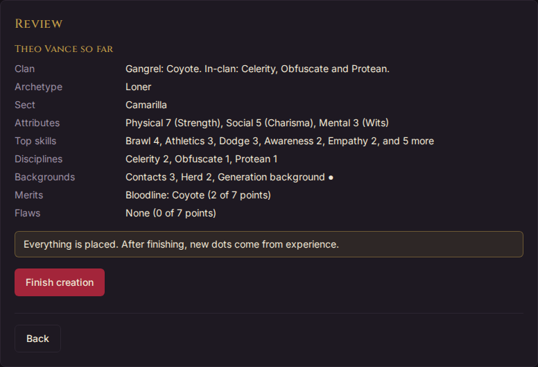

### Your vault and your troupes

Every character you make lives in your [vault](glossary.md#vault), whether or not it is in a troupe. Until a troupe accepts it as its [home troupe](glossary.md#home-troupe), you can change it freely: it takes part in no downtimes and earns no XP. Once accepted, the troupe holds its sheet: it awards its XP, approves some of its purchases, and runs its downtimes. A character has one home troupe at most, and can visit others.

Only unspent creation XP up to 5 carries over when a character's first home troupe accepts it; the rest is lost. Horatio warns you before you ask, so you can spend it first.

You can delete a character only once it has left every troupe. Otherwise retire it.

### Claiming a character from your troupe

A troupe moving to Horatio may already have your character, as one of its NPCs. Its storytellers either give it to you once you've signed up, and you're told *"name is yours now"*, or send you a **claim link**.

Open the link to see the character's name and portrait. If you have no account yet, choose **Sign up to claim it**; after signing up you come back to the same page. Then choose **Claim *name***. The character is yours at once, at home in the troupe and already accepted, with its XP history showing what its sheet cost and any unspent XP carried over. A link works once, for 30 days; if yours has run out, ask the troupe for a new one.

### Backing up a character

A character's **⋯** has **Export (backup)…**. It downloads the character as a file named for it and the day, such as `AgnesdeVries-2026-11-09.horatio-character.json` for Agnes de Vries (accents become plain letters; spaces and other letters are left out). It holds its sheet with the free dots from creation, its XP history, backstory and picture. Tick **Also include** for its equipment, Retainers and Alternate Identities, or titles and status. **Printable sheet (.html)** downloads the printable sheet as a page any browser opens, without Horatio. Retired characters can be exported too. Staff notes are never in the file.

On **Your characters**, **Export all** downloads every character you have, retired ones too, in one `.zip`.

**Import a character** brings one back, as a new character of yours: a backup, or a character from another troupe or another Horatio.

1. **Choose a file…** and, under **Which troupe will you play in?**, the troupe it is for.
2. **Review** what comes in. Each part says **New**; **Differs**, held otherwise here (a merit at this troupe's value); **Can't import**, with why, such as a trait this troupe's rules don't have; or **Shown only**, such as equipment and titles, which a troupe's storytellers give. The XP box shows the file's XP and what the sheet costs at this troupe's prices beside what it cost where it came from.
3. **Import** it. It joins no troupe until you [ask one](#joining-a-troupe) to make it home. The XP it earned comes as self-entered XP (as with [Add XP yourself](#xp-history-and-where-xp-comes-from)), which that troupe keeps or removes, and any difference in price is settled as you join.

A file from a newer Horatio is refused: import it into a Horatio as new as the one that made it.

**Import a character** takes the `.zip` from **Export all** too. Each character in it is reviewed as one file is; untick any you don't want, then **Import** brings in the rest, each as a new character of yours with its picture.

## Reading your sheet

The **Sheet** tab is the character's record, laid out in the rule set's parts: Attributes, Skills, Backgrounds, Disciplines, Merits and Flaws, Morality, Health Levels and so on. Each part lists what the character holds, with its rating as dots or numbers (choose which in your settings). The character's clan, sect and archetype sit beside its name at the top of the page.

On the right:

- **Print** (see [Printing your sheet](#printing-your-sheet)).
- **Experience**: XP **Available**, **Earned** and **Spent**, and the limits that apply, such as *Merits: 3 of 7 points used*. Any XP debt shows here in red: XP the character earns pays it off first, and nothing new can be bought until it has.
- The **Cart** (see [Spending XP](#spending-xp)).
- **Troupes**: the character's home troupe and the troupes it visits, its titles there, and anything waiting for the home troupe to approve.

A card called **Against the rules** lists anything on the sheet the rules no longer allow, for example after the troupe changed a house rule. Your storytellers see the same list.

### Blood bonds

Where a troupe tracks blood bonds, a **Blood bonds** card shows the bonds the character is bound by, with what each does in play, and those bound to it that you've been told of (MET: VTM p. 295). Nobody else's player sees your bonds.

Where the troupe lets players report drinks, **Report a drink** on that card says your character drank someone's blood, or someone drank your character's: pick the other character from the troupe, or type a name, then the night and where it happened. What happens next depends on the troupe:

- **Players report and staff approves**: it waits for the storytellers, and counts once they approve. If they decline, you see why.
- **Players manage**: a drink your character took counts at once. One you record of someone drinking your character's blood waits for their player to **Confirm** or **Decline** it, as one recorded against your character waits for you, on this card. For an NPC or a name, the storytellers decide.

Until it's decided you can **Withdraw** it. The other character's player isn't told of a bond unless they're its regnant and know of it; reporting one as the regnant tells Horatio you know. You can't report a night to come, one before the character was made in Horatio, or a drink from someone else while your character holds a full bond, which makes them immune to other bonds (Errata, p. 295).

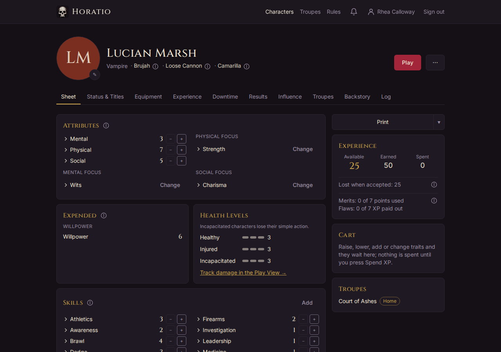

### Trait details

Tap a trait's name to open a short panel under it: what the trait does, in Horatio's own summary, and the book page. A discipline also lists its powers by dot. Several can be open at once. A ⓘ beside a part or category heading explains that part.

Marks you may see beside a trait:

- **★**: the troupe's own merit or flaw.
- **Banned in this troupe** or **Category changed in this troupe**: the troupe plays this book trait differently. Wording the troupe has changed shows, marked as its own, when you open the trait.
- **from** another trait, such as *+1 from Rugged*: dots another trait gives.
- **Exception**: held by an exception (see [Asking for an exception](#asking-for-an-exception)).
- **Awaiting approval**: bought, and waiting for the home troupe.

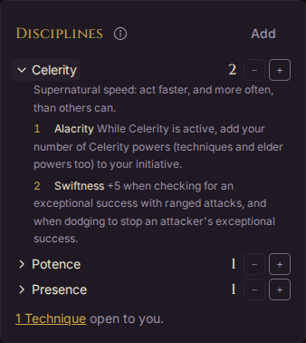

### Specialisations

Some skills and backgrounds take specialisations: Lore, Academics, Drive, Linguistics (languages), Contacts, Allies, Haven and the Influences. They show under their trait with a count, such as *Contacts Specialisations 1 of 3*: gold while there's room for more, red if there are too many. Press **+ Add** to choose one from the list, or name your own where the trait allows. Your troupe can set its own list of options. A specialisation goes on the sheet straight away; it isn't bought through the cart. Where the troupe's teacher rules cover it, Horatio asks for the teacher first.

Crafts, Performance and Science need their field before the sheet is complete: a red line under the skill asks for it, with **Set**.

### Your Haven

If your character has the Haven background, its row on the sheet shows your Haven. Press **Name your Haven and choose its advantages** to put it on your home troupe's list of locations, then **Edit your Haven** to change it. You set its name, a description, its address and a map link, and choose its advantages: one for each dot of Haven, plus Security free if you have the Security skill (MET: VTM p. 102). Your storytellers see each change. If they have made one of the troupe's locations your Haven, you see it here, but they change it.

### Printing your sheet

**Print**, at the top right of the sheet, opens the character laid out for paper, in the order of the official sheet, sized to fit one page. Press **Print** on that page to print it. The little arrow beside Print prints it once with numbers or pips, whichever your settings don't use. The paper size (A4 or US Letter) is in your settings.

## Spending XP

### The cart

Changes to a finished character don't happen one tap at a time: they wait in the **Cart**, on the right of the Sheet tab, until you press **Spend XP**. Nothing is spent before that.

Each line in the cart says what it costs, or why it can't be made. Under the lines, **Spends**, **Refunds** and **Left** add it up, and the Experience card shows what would be **Available** after these changes. **Spend XP** makes every change in the cart, or none of them: if one is refused, nothing is spent and the refused line is marked. Take a line out with **×**, or empty the cart with **Clear**.

The cart lives on this device: if you leave the page with changes in it, your browser asks first.

### Raising and lowering traits

- **+** and **−** beside a rating raise or lower it, into the cart.
- **Add**, at the top right of a part, opens a list of what you can add to it, with a search and a filter (for example only what the character can take now). Choose a trait, its rating and any detail it needs, then **Add to cart**. The panel says what it costs.
- **Change**, beside a focus, swaps it for another, for the XP the rules charge.
- **×** beside a merit or flaw removes it.

Before a home troupe accepts the character, you can lower or remove anything you bought, for the XP back. After acceptance, only dots bought since come back. The **−** button explains when it can't help: free dots (from creation, or given by another trait) are for storytellers to take away, and so are dots the home troupe accepted.

Once a home troupe has accepted the character, some purchases also cost downtime actions to learn, as the book has it (for example gaining a merit). They come off the current downtime if you haven't submitted it yet, or else the next one.

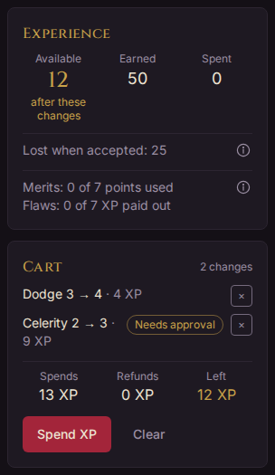

### Changes that wait for your home troupe

Once a home troupe has accepted the character, some changes go to its storytellers to approve. The cart marks them **Needs approval**, and after **Spend XP** the sheet marks them **Awaiting approval**.

- **Discipline dots.** Each dot bought waits for approval. It is on the sheet while it waits, and the XP is held; if the storytellers decline it, the dots come off and the XP comes back. When you add a discipline after acceptance, the Add panel asks for a **Teacher**: out-of-clan powers need a teacher who has them in-clan.
- **Teachers for other traits.** *If your troupe uses this:* its storytellers can ask for a teacher for other traits too. The cart line then asks **Choose a teacher…**: one of the troupe's characters who holds the trait at the rating needed, or **An NPC: name them**. If the troupe's rule asks Willpower of the teacher, the teacher's player is asked to confirm, and the storytellers can't approve until they have.
- **Merits and flaws.** Adding or removing a merit or flaw is asked of the storytellers. Unlike a discipline dot, it isn't on the sheet until they approve. A merit's cost, or a flaw's buy-off (twice its points), is held while you wait and refunded if they decline. Removing a merit gives no XP back. Taking on a flaw gives its XP once approved. Merits and flaws that stand for the character's clan or bloodline can't be removed. The storytellers may answer with a quest instead of a yes or no: finishing the quest approves it.
- **Changes held for review.** A change that breaks one of the troupe's checks set to review goes through, but waits for the storytellers.

What's waiting is listed on the **Troupes** card on the right of the sheet, with what each holds. **Withdraw** takes one back and refunds its XP.

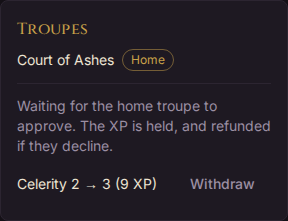

### Asking for an exception

Sometimes a character should have something the rules refuse, or have it free: a reward for a plot, a storyteller's ruling, a mistake put right. That's an [exception](glossary.md#exception). When a cart line is refused and an exception could help, it offers **Ask staff**. Say **Why** in one line, tick **Ask for it at no XP cost** if you want it free, and press **Put it in the cart**. The line is marked **Exception**.

When you spend the cart, the trait goes on the sheet at once and waits for the home troupe's approval. If the storytellers approve, it stays; they can approve a free request at the normal cost instead. If they decline, it comes off and the XP comes back. Where an exception wouldn't help (the rules refuse it for another reason), the line says so.

Storytellers can also give a trait by exception themselves; it shows **given by staff** on the sheet and you are told.

### Free changes for new characters

> **If your troupe uses this:** for a while after the troupe accepts a new character, you can still lower or remove traits for their full XP back, as during creation.

The troupe sets how long under its house rules: a number of days from acceptance, or a number of games attended. While they last, the Sheet tab shows **Free changes until** a date, or **Free changes:** so many **games left**. Each change still goes to the home troupe to review, and every rule still applies: picks chosen only in creation stay as they are, and so do free dots. A troupe can leave some traits out, and the notice names them.

Free changes come only with a character's first acceptance. Moving home brings none, and leaving the home troupe ends them.

### XP history and where XP comes from

The **Experience** tab lists every XP entry: **Date**, **What**, **XP** and the running **Balance**. Purchases show what was bought and from what rating to what. A mistaken award is put right by a correction, shown under it, rather than changed.

XP comes from:

- **Starting XP**: 30, or the XP floor of the troupe the character was built for. Merits taken in creation cost from it and flaws add to it, each a line of its own, such as *Iron Will 0 → 3, taken in creation*.
- **Games**: after a game, the storytellers award XP to the characters who came, recorded at check-in. A troupe may give different amounts by how much XP a character has earned, or allow absentee games (see [Calendar and RSVPs](#calendar-and-rsvps)). The tab also lists the **Games attended**.
- **Downtimes**: a cycle may give XP for completing it, once, when you submit it. The downtime form says how much.
- **Awards**: the home troupe's storytellers can award XP at any time, with a reason.
- **Joining a troupe**: a character below the troupe's XP floor can be topped up to it when accepted.

A character with no home troupe has **Add XP yourself** on this tab, for a character played somewhere else first. That XP is marked self-entered, and the troupe it joins sees it apart and accepts or removes it.

## Your home troupe

A character's [home troupe](glossary.md#home-troupe) holds its sheet: it accepts the character, awards its XP, approves its discipline dots and merit changes, prices its traits with its house rules, and runs its downtimes. A [visiting troupe](glossary.md#visiting-troupe) can see the sheet, but approves nothing and awards no XP. All of this is on the character's **Troupes** tab.

Until a troupe accepts it, the character is built to the rules of the troupe you chose under **Which troupe will you play in?**, or to the book's. The **Troupes** tab and the **Troupes** card on the sheet say which: "Built to *the troupe*'s house rules. Not accepted there yet.", or "Built to the book's rules (no troupe chosen yet)." The troupe's name links to its house rules. A printed sheet says it in its header too.

### Joining a troupe

1. Finish creating the character.
2. On its **Troupes** tab, under **Home troupe**, choose the **Troupe**. **House rules** beside it shows what the troupe plays differently from the book.
3. Horatio compares the sheet with the troupe's rules, and shows the troupe's XP floor and ceiling against the XP the character has been given. Below the floor, **Top up to the floor** asks for the difference. Above the ceiling, the storytellers decide whether the extra stays.
4. Settle any differences (below), and add **A note for the storytellers** if you like.
5. Press **Ask to join as home troupe**.

Asking also makes the character visit the troupe, so its staff can see the sheet. The card then says it's waiting for the troupe's storytellers. There's nothing more to do until they decide, but you can **Withdraw the request**. While a request waits, the sheet is locked, so the differences you settled stay as they were. Many troupes also want the backstory approved before they accept a character (see [Backstory](#your-backstory)).

A troupe's page may have a **Play here** link that opens this form with the troupe chosen.

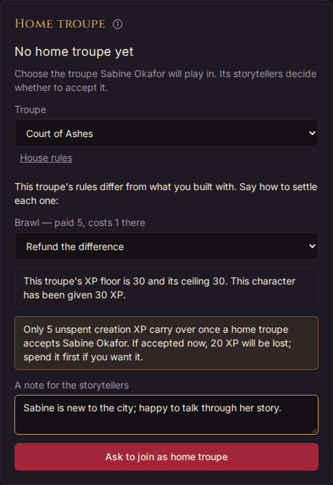

### Settling price differences

When the troupe's rules differ from those the character was built with, each difference is listed with a choice of how to settle it:

- a trait that costs more there: **Pay the difference** or **Keep the price paid**;
- a trait that costs less there: **Refund the difference** or **Keep the price paid**;
- a trait the troupe doesn't allow: **Remove it and refund the XP**, or **Keep it at the price paid**;
- free dots from creation the troupe doesn't give: **Pay** the XP **to keep these dots**, **Remove the trait**, or **Keep the free dots**;
- a troupe that gives more starting dots: **Take them (place them in character creation)**, or **Don't take them**.

The troupe only offers the choices its house rules allow. The storytellers see what you chose when they decide.

### Visiting other troupes

Under **Visiting troupes**, choose a troupe from **Visit a troupe…** and press **Visit**. The character is in that troupe at once: its staff can see the sheet, and the character can play at its games. A troupe that takes only some splats or one sect turns away a character that doesn't fit. **Leave** takes it out again; that troupe's storytellers see that it left.

### Moving to another troupe

On the **Troupes** tab, press **Move or leave…**, choose the **New home troupe**, settle the differences and press **Ask to join as home troupe**, as for joining. The character stays at home in the old troupe until the new one accepts it. Moving brings no new free changes.

### Leaving your home troupe

Press **Move or leave…**, then **Leave** *the troupe* **and have no home troupe** (the button names your troupe). Horatio says first, by name, what ends there: its titles in that troupe, any requests still waiting there (withdrawn, with their XP back), and any free changes. The sheet, XP and history stay as they are, and so do its visits. The troupe's storytellers are told. The character has no home troupe until a troupe accepts it again.

### What staff approve

The home troupe's storytellers and assistant storytellers decide:

- whether to accept the character, with the differences you settled and any self-entered or extra XP;
- the backstory, if the troupe reads backstories;
- discipline dots, and purchases that need a teacher;
- merits and flaws added or removed after acceptance;
- changes held for review, including those made with free changes;
- exceptions;
- diablerie you say the character committed (from the **⋯** menu, which asks staff about it).
- drinks of vampire blood you report, where the troupe has players report them and staff approve (see [Blood bonds](#blood-bonds)).

You're told when they decide. Narrators never see character sheets, and a visiting troupe's staff can see the sheet but decide nothing on it. The staff's side is in [Running a troupe](running-a-troupe.md).

## Your backstory

The **Backstory** tab holds the character's story. Only you, the custodian, and the storytellers and assistant storytellers of its home troupe (or of a troupe it's asking to join) can read it. Never narrators, other players or visiting troupes.

At the top, a badge says where it stands, such as **Not written**, **Waiting**, **Changes asked for** or **Approved**, and whether there's anything for you to do.

### Writing your backstory

Press **Write the backstory**. The editor has two views: **Formatted**, with buttons for headings, bold and lists, and **Markdown**, where you type the marks yourself (`#` for a heading, `**bold**`, `-` for a list). Headings are worth using: the storytellers can give feedback on one section at a time. A counter appears as you near the length limit.

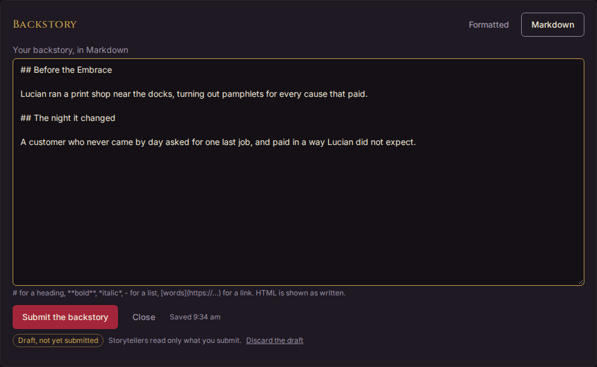

### Autosave and drafts

Your writing saves itself as a draft a moment after you stop typing, and when you leave the editor, so a long story is never lost and you can carry on from another device. The line beside the buttons says **Saving…**, **Saved** with the time, or **Couldn't save** with **try again**. While a save has failed, going to another page asks first.

A draft isn't what the storytellers read: they read only what you submit. While you have a draft, the tab marks it **Draft, not yet submitted**, and **Carry on writing** opens it again. **Discard the draft** throws away the changes since the last version you submitted. If a newer version was submitted after you started the draft (on another device, say), Horatio shows both and lets you choose which to go on with, with **Compare them** to see the difference.

### The troupe's questions

> **If your troupe uses this:** a troupe can ask its own backstory questions, and let players answer them instead of writing freely, or as well, or ask for its questions only.

When the troupe offers both, the tab asks whether to **Write freely** or **Answer the troupe's questions**. The questions come in sets, and some show only for some characters (by social age, sect or a trait it holds). Each answer saves as you leave it. **Build the backstory from** a set writes your answers into the backstory as sections, one for each question. You can then edit the text as you like. Answering again and building again replaces only the sections built from that set, and asks first if you've edited them since.

### Submitting it and staff feedback

Press **Submit the backstory** when it's ready. Building from the troupe's questions submits too. The troupe's storytellers then read it. They can:

- **approve** it, perhaps with a note; or
- send it back with feedback, on the whole backstory or on one section.

Feedback and replies are kept under **Feedback**. When it comes back to you, the badge says **Changes asked for**: revise the backstory, submit the new version, then press **Resubmit the backstory** with an optional **Reply to the storytellers**.

A troupe can require the backstory approved before it accepts a character; most do, as it's on by default. Changing an approved backstory shows the storytellers what changed, and they approve it again.

## Downtimes

Downtimes come from the character's home troupe, one [cycle](glossary.md#downtime-cycle) at a time. While one is open for your character, its **Downtime** tab shows **1 due**, and the Characters page shows **Downtime due**. A character with no home troupe takes no downtimes.

### The downtime form

The form is the troupe's own. On the right, the cycle's card gives its due date and status (**Draft** or **Submitted**), and **Your actions** counts the actions you have of each kind, how many you've used, and where they come from: those everyone gets, those from the character's traits, and any adjustment the storytellers made. Actions the character owes for learning are taken off, and a red line says if it's short.

Each line names its source, as the book has it:

- **Traits that give actions:** Computer (one, spent as any other or on cancelling or observing another character's action), each Science field (one, only for work in that field), the ritual Soul of the Homunculi (two) and Mytherceria's Ay Befriend (one no one can trace or observe). Your troupe can change any of these in its house rules.
- **Status spent at a game:** spending Veteran on the Play View adds an action to the next downtime, such as "Veteran spent at the 3 Nov game". Undoing the tap takes it back.
- **What others did to you:** staff take off what Call of the Hungry Dead or an indirect influence attack costs the character, such as "Call of the Hungry Dead against you".

An action only for one thing, such as a Science action, says so on its question: "Of these, 1 Science action (Chemistry only)". A Science action goes only on a [keyword](#keywords-what-kind-of-action) that fits a Science, such as Investigate, Craft or Narrative; staff judge what fits its field.

The questions follow. A question marked with a red asterisk must be answered.

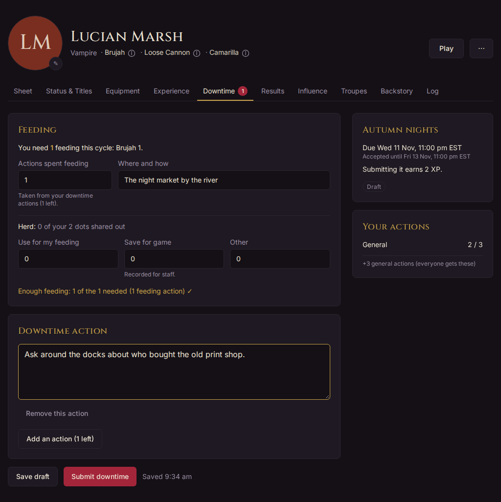

### Feeding

> **If your troupe uses this:** feeding is tracked in downtimes as the core book has it unless the troupe has switched it off.

The **Feeding** section says how much feeding the character needs this cycle, and why. To feed, give one of your actions the **Feed** [keyword](#keywords-what-kind-of-action): each Feed action is a feeding action, and the section counts them ("1 feeding action, from your Feed actions below"). Say **Where and how** here. Where the troupe has no Feed keyword, spend **Actions spent feeding** here instead, taken from your general actions. If the character has Herd, share its dots out: **Use for my feeding**, **Save for game**, **Other**, or **Give Herd to another character** in the cycle. A line at the foot tallies whether it's enough; the storytellers decide. A character that feeds short comes to the next game at half Blood.

The troupe's optional rules add more: **Resonance you hunt for** (Blood Resonance), feeding territories, or the Rack, where you take a vessel instead of spending actions and Herd. With feeding territories, a Feed action's **Feed in a territory** names one: once a cycle, feeding there stands in for a feeding action without spending one. A **Patrol** action patrols a territory the character holds; the section lists the patrols. Once a storyteller has answered your feeding, it can't change.

A character holding the status Triumphant needs one feeding action fewer, and may feed in any territory without poaching. The Feeding section shows it as "Triumphant −1".

### Quick Hands, Quick Work

A character with the technique Quick Hands, Quick Work gets a choice at the top of its form each cycle: **Use Quick Hands, Quick Work this cycle (+2 actions; no feeding; start next game at half Blood)**. It's off until you tick it, and you can change it until you submit.

While it's on, the character has two more general actions, shown as "Quick Hands, Quick Work" in **Your actions**. It can't spend actions feeding, use its own Herd or take Herd from others, so the Feeding section is closed, but it can still give its Herd to others. Its next game starts at half Blood.

### Actions, influence and quests

Each action question has **Add an action** with how many are left of that kind, and **Remove this action** (with **Undo**) under each one. Where the troupe uses the optional rule, learning a dot of a rare discipline from a teacher costs two actions, not one.

#### Keywords: what kind of action

A new action asks **What kind of action is it?** first, with each of its **keywords** explained: Feed, Patrol, Investigate, Learn, Narrative and so on. Choose one, then fill in what it asks for, then describe the action in a sentence or two. Only the keywords that action can be are offered; with just one, it's chosen for you.

| Keyword | It asks for | What follows |
|---|---|---|
| **Feed** | Optionally, a feeding territory | It's a feeding action, counted in the Feeding section. |
| **Patrol** | A territory the character holds | It patrols it against poachers. Only with feeding territories. |
| **Investigate** | Who or what: a character, or something else in words | Staff find out what they can. |
| **Beyond Your Means** | The item wanted | One item with one quality, given with your results if it works. |
| **Learn** | What to learn, and the teacher if any | See below. |
| **Craft**, **Perform** | Just the description | Two in a month can raise Resources or Fame by one for the month. |
| **Narrative** | Just the description | Anything else: an NPC, a ritual. |
| **Rhetorical** | Just the description | Colour, with no effect on the game. |
| **Observe**, **Cancel** | One character | With the Computer skill only: see [Aiming an action at someone](#aiming-an-action-at-someone). |

The Quest action is the form's own **Quest** question. Your troupe may rename these, add its own or retire some, so its list can differ; the troupe's **House rules** tab lists its changes.

- **Changing the keyword.** **Change** beside it offers the others. What you wrote stays; if the new one doesn't ask for something you filled in, such as the territory, it warns you first, and **Keep** leaves it as it was.
- **Ready-made actions.** What the character is learning, such as a discipline dot whose action came off this downtime, shows ready-made at the top of the question: **Confirm** makes it a Learn action, which costs nothing more. A keyword your troupe asks of your character each cycle, such as Eternal Struggle for an elder, shows there too, with **Add it**; the form won't submit without it.
- **Before submitting,** each action needs its description, and what its keyword asks for, such as who or what an Investigate is aimed at. Until then it saves as a draft as you go.
- **Old actions,** from before keywords, count as Narrative.

- **Influence.** An action of an influence kind also asks for the **Specialisation** and the **Action**, offering the actions the character can reach with its influence.
- **Quests.** *If your troupe runs quests:* the **Quest action** asks **Which quest** it's for: one the character is in or leads, or one shared with it or posted to the troupe, which it joins by choosing it.

### Aiming an action at someone

Under an action, **Aimed at…** names a character of the troupe it's aimed at, such as one you're spying on, investigating or working against. Choose more than one if the action names several, and **×** takes one off. It's optional, and the characters aimed at never learn who aimed at them: only the storytellers and assistant storytellers see it.

- **This costs 2 actions.** Some characters are harder to act against: aimed at one of them, the action costs two of your actions, and **Your actions** counts it so. The storytellers can count it as one if it isn't against them, such as a friendly visit.
- **Cancel or observe.** A character with the Computer skill can cancel or observe one action of another character's each month (MET: VTM p. 93): choose the **Cancel** or **Observe** keyword, and the one character it's aimed at. A Cancel stops one of their actions; they learn it was cancelled, but not by whom. An Observe tells you of one of their actions, and they never learn of it. The storytellers decide which of their actions it works on, and whether it works.

### Projects

Some work takes more than one downtime, such as changing your character's Path. The **Projects** card at the foot of the Downtime tab shows each of the character's projects: its kind, how many actions it has had of how many it needs, and any rule about a least number each month. It shows even when no downtime is open.

A project is a count of actions. A goal with things to gather and tests to pass, such as finding someone, is a quest instead: while your troupe runs quests, the form says so, with a link to ask for one on the [Quests tab](#quests). A Path change stays a project.

- **Propose a project** to start one: choose its **Kind** (**Path change**, **Research** or **Other**), and give it a name, the **Actions it takes** and, if you like, **At least this many a month**. The storytellers confirm it before actions count toward it. **Withdraw** takes back one they haven't confirmed yet. They can also start one for you.
- **Spending on it.** Under an action, **Counts toward** names the project it's for. When the storytellers mark the cycle complete, the project goes up by the actions spent on it in your submitted downtime.
- **Starting over.** A project with a least number a month starts over, back to none, after a cycle with fewer actions on it than that.
- **A Path change** needs 9 actions with a teacher who follows the new Path, or 18 without, and at least 1 every month, or it starts over (MET: VTM p. 306). When it's finished, the storytellers change your character's Morality to the new Path on the sheet; it goes down by 1 as it does.

### Player Nominations

> **If your troupe uses this:** the form has a **Player Nominations** section.

Write a line or two praising someone's roleplaying in **New nomination**, choose who it's **About** if you like (a character in the troupe, a storyteller, or no one in particular), and choose **Add nomination**. Add as many as you like; they don't use any actions. Each saves as you add it. Until it's published, **Change** edits it and **Take out** removes it.

The storytellers read them once you submit your downtime, and may take out any that aren't kind or lightly edit one. Once the cycle is past Due, they publish them to the troupe's players without your name.

### Remembrances

> **If your troupe uses this:** when a character has left play, the downtime after may have a **Remembrances** section.

It lists each character the troupe is remembering, with their portrait and why they left. Write a memory of them in **Your memory of** their name and choose **Save memory**; one each, which you can change or **Take out** until it's published. They don't use actions, and the storytellers read them first. Published, they appear without your name on the troupe's month page, on the character's own page for its player, and from its entry under "No longer with us" on the Who's Who.

### Saving and submitting

The form saves itself a couple of seconds after you stop typing, and when you switch away; the line by the buttons says **Saving…**, **Saved** or **Not saved yet**. If a save fails, it says **Couldn't save**, and going to another page asks first. **Save draft** saves at once. **Submit downtime** saves and submits. You can keep editing after submitting: the button becomes **Save and resubmit**.

If the cycle gives XP for completing it, the card says **Submitting it earns** so much, and once you have, **You earned** it. That XP is given once, however often you resubmit.

### The due date and the grace period

The card says when the downtime is **Due** and when it is **Accepted until** (the end of the grace period), each with its day and time in your time zone, such as "Due Sat 14 Nov, 6:00 pm EST". Set your time zone in [Settings](getting-started.md#settings) if it isn't your device's. A downtime submitted after the due date is accepted, but marked late (**Submitted (late)**). After the grace period ends, only a storyteller can let one in. You can edit a submitted downtime until the grace period ends.

*If your troupe uses this:* with absentee downtimes, only a character that came to a game recently can submit; the form says so.

### Results

When the storytellers deliver the cycle's results, the **Results** tab shows how many are new, and the Characters page says **New results**. Each cycle's results are under its name and date, newest first and open: each answer sits under the action it answers. If the storytellers gave your character equipment with an answer, it says **You received**, and the item, or its new quality, is on the Equipment tab. Older cycles fold away. A cycle re-delivered after a change says **Updated**. Your troupe may also send results by email or Discord.

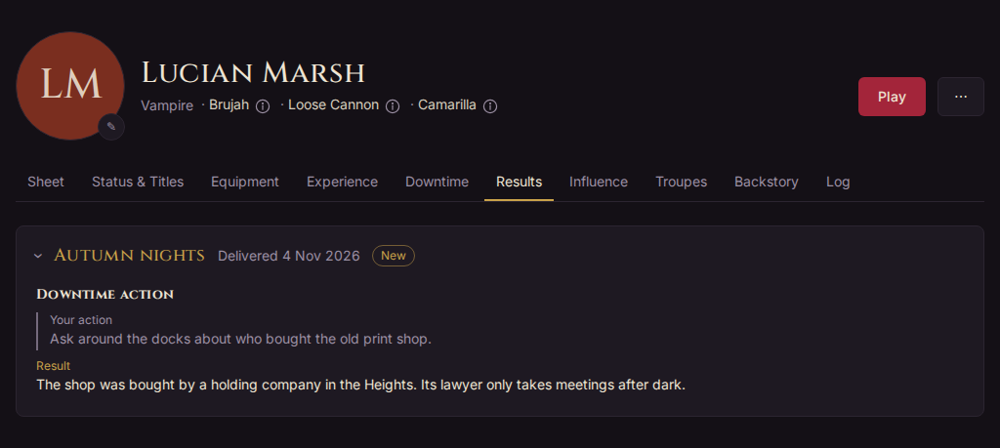

A result can also change a background for a while. Two actions of Crafts (making something and selling it) raise Resources by 1, and two of Performance raise Fame by 1, until the troupe's next cycle opens. Overtaxed Resources are 2 lower for six games or three months, whichever is later, and three actions spent recovering halve that. The sheet's **Backgrounds changed for now** card and the Play View's Sheet tab show it, such as "Resources 3 (+1 this month, Crafts)".

### Reading the nominations

> **If your troupe uses this:** a troupe with Player Nominations has a **Nominations** tab, for its players and staff.

The troupe's **Nominations** tab lists each month's published nominations, newest month first, with any [remembrances](#remembrances) above them. Each month's are in an order shuffled once when they were published, without names; one linked to someone says **About** them, and a ★ marks those the storytellers starred. Starred ones also rotate in a quiet line at the foot of the troupe's pages: **Pause** stops it, **Next** moves on, and it never moves by itself if your device asks for less motion.

On your character's page, **Nominations about** your character gathers those linked to it, newest first. A player whose character only visits the troupe can write nominations there but doesn't read its Nominations tab.

## At game

### Checking in

At the door there's usually a QR code. Scan it with your phone to open **Check in** for that game; sign in first if you need to. Or open the troupe's page: while check-in is open, the game's row under **Games** has a **Check in** button.

1. Choose **Who are you playing tonight?**
2. Leave **A full day's rest since the last game** ticked if the character rested. Willpower then starts full; untick it and Willpower starts where the last game left it.
3. *If your troupe uses this:* choose **Which status do you carry tonight?**, the character's one source of abiding status for the game (MET: VTM p. 311). It's fixed for the game: only the storytellers can change it.
4. Press **Check in** and the character's name.

The Play View opens, and the night has begun. Check-in also records that the character came, for the game's XP. If you have no character in the troupe, ask the storytellers at the door to check you in.

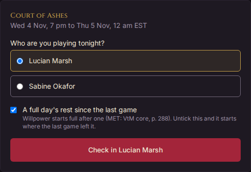

### The Play View

The [Play View](glossary.md#play-view) is the character sheet for a game, laid out for a phone in one hand. Open it with **Play** on the character's page, or by checking in.

Along the top: the way back to the character, **Keep the screen awake**, **Undo** for your last tap, and whether your taps are saved. Every tap is kept on the phone when there's no signal and sent when it comes back; to open the Play View with no signal at all, see [Using Horatio at a game with no signal](#using-horatio-at-a-game-with-no-signal).

The tabs are **Sheet** (to look things up), **Tracker**, **Pools**, **Status** (for a character with sect status), **Equipment** and **Throws** (rock, paper, scissors), as many of them as your character's home troupe has switched on. On every tab but the Tracker, a strip under the tabs shows Blood, Willpower and health, with **−** to spend. Your settings choose which tab it opens on; where your troupe has switched that one off, it opens on the first tab on. A troupe whose players keep their sheets in Horatio but don't play from it switches the Play View off for players, and their characters have no **Play**.

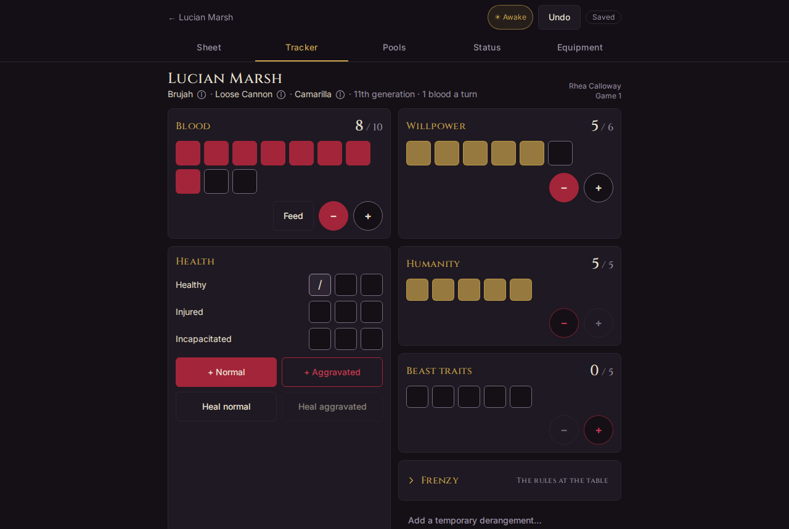

#### The Tracker

- **Blood** and **Willpower**: boxes, with big buttons to spend and restore. A character that fed short last downtime starts at half Blood, and the box says so.
- **Feed**, beside Blood: shows what feeding will give, then runs a countdown. When it ends, the Blood is added, with Undo.
- **Health**: each level's boxes, with **+ Normal**, **+ Aggravated**, **Heal normal** and **Heal aggravated**.
- **Morality** and **Beast traits**, the frenzy numbers, and derangements. A lost Morality dot goes on the sheet through your storytellers.
- **Uses this game**: backgrounds, merits and powers limited to so many uses a game, each with **Use** and restore. **+ Add a counter** adds one of your own. **Quick notes**, when on, asks what each spend was for.
- **This game**: every tap, newest first. **A note for this game…** with **Add note** adds a line of your own.
- **Reset for next game…** puts every tracker back where the sheet starts it, ready for the next game, and keeps this game's log. The storytellers can also reset the whole troupe.
- **Past games**: earlier games and their logs, for writing your next downtime.
- **Report a drink of vampire blood**, where your troupe lets players report drinks: the same form as on the sheet's **Blood bonds** card, set to tonight at a game. A drink waiting for you to confirm shows here too. Reporting needs a signal. See [Blood bonds](#blood-bonds).

Every tap shows briefly with **Undo**, and **Undo** in the header always takes back the last one.

#### Pools and powers

The **Pools** tab works out the character's test pools from its sheet: attacks, defences and other tests, with what changes them. Under **Powers**, each discipline lists its powers, and a power with a plain cost has a **Use** button that spends it (for example **Use · 1 Blood**), and turns the power on where it lasts.

**Forms, powers and modifiers**, at the foot of the screen, opens a drawer of switches: the forms and powers in use, the equipment the character has equipped, and modifiers of your own. The pools count whatever is switched on.

#### Equipment at game

The **Equipment** tab shows what the character carries, weapons first, each with what its qualities do in play. You can give an item to another character or discard it from here; it's listed under what was given or discarded this game, with **Undo**.

### Others at this game

On the Play View's **Status** tab, **Others at this game** lets you find any of the troupe's characters by name. For one of the character's own sect, it shows the status they carry into the game, and their negative status, which is public. Leadership lets the character learn where a fleeting status came from, one a game for each dot. For a character of another sect, it shows only the name and sect.

### Using Horatio at a game with no signal

Venues are often basements with no signal. Horatio can keep your own characters on your phone so they still work there: open the app, read the sheet, check a power on the Pools tab, and track Blood, Willpower and health. Your taps wait on the phone and are sent, in the order you made them, when the signal comes back.

**Turning it on.** The first time you sign in on a device, Horatio asks once: *Is this your own phone?* Choose **Yes, keep them here** on your own phone, or **No, online only** on a borrowed or shared one. Until you answer, nothing is kept. You can change it at any time in **Your account › This device**, under **Keep my characters on this device**:

- **Off: online only.** Nothing is kept on the device.
- **On: my characters work offline.** The sheets, Play Views and powers of every character you have in play, in every troupe, are kept on the device and brought up to date whenever there's signal, with their home troupe's news and announcements from the last 30 days.

The same tab shows what's kept now (the characters, when they were last updated and roughly how much space it takes), with **Update now**, worth pressing before you leave for a game, and **Remove from this device**. **Updated** is the last time everything kept came through. If the last try couldn't refresh some screens, it says how many and when; those screens show what was kept before, so press **Update now** again while you still have signal.

**With no signal.** A line under the menu says you're offline and how old what you're seeing is: *Offline · your characters as of 7:42 pm*. On the Play View, the saved pill says **Offline** with the taps waiting, and *Your sheet as of…* under it. Other screens, such as downtimes, Spend XP, other characters and every staff screen (but for the scenes staff keep; see [Scenes at a game with no signal](running-a-troupe.md#scenes-at-a-game-with-no-signal)), say they need a connection, with a link back to your character. Nothing but Play View taps waits to be sent: anything else you try offline says **Needs a connection.**

**Signing out** clears everything kept for you on the device, taps not yet sent included. If any are waiting, Horatio asks first. If your session ends while you're offline, your sheet still shows and your taps still wait; they're sent once you sign in again.

**Installing it on your phone.** Horatio works best from your home screen, where it opens like an app. On Android, Chrome offers to install it, or choose **Add to Home screen** from its menu. On an iPhone there's no install prompt: open Horatio in Safari, then choose **Share › Add to Home Screen**.

**iPhone storage.** Safari may clear what a home-screen app has stored if it hasn't been opened for a few weeks. If that happens, the first game after a long gap needs signal once, so open Horatio somewhere with signal before you go.

When a new version of Horatio is ready, a small **Update ready · Reload** shows at the foot of the screen. It never reloads by itself, so press **Reload** when you're between taps.

## Status and titles

The character's **Status & Titles** tab shows its sect status and its titles in its home troupe.

**Status** lists what the character holds now: Accepted by its sect, the abiding and innate status its active title, social age and merits give, and the fleeting and negative status it holds, each with who gave it. Tap a status to see what it does. The count of fleeting status against its cap is shown. Who adds and removes fleeting and negative status is the troupe's choice: either players add their own, naming who gave it (**Add status**), or only staff do.

**Titles** lists the titles the character holds, and **Choose a title** (or **Choose another title**) the ones it can take: the troupe's titles of its sect, and titles of any sect. **Take** takes one. The first title held is active at once; another asks whether to make it active. Only the active title gives status, and **Make active** switches. **Give up** gives one up. A title says who else holds it; several characters may hold one, unless your troupe holds it to one holder at a time, when you ask your storytellers for it. *If your troupe uses this:* the troupe can keep titles to its staff, who give them; you still choose which is active.

At game, the Play View's **Status** tab shows the status the character carries into the game, with a tap to spend it.

## Equipment

The character's **Equipment** tab lists what it owns: weapons, protective gear, other gear and Vampiric Texts, each with its qualities and what they do, its facts and where it came from. Your storytellers give equipment, at any time or with your downtime results. You can **Give** an item to another character or **Discard** it.

## Quests

> **If your troupe uses this:** the **Quests** tab shows while a troupe the character is in runs quests.

- **Ask for a quest** (with how many you have left) asks the storytellers for one: a quest of your own, or one about a location (acquire one, add a quality to one of yours, undermine or repair one, or learn whose locations are whose, with Contacts). **Your requests** lists what you've asked, with **Withdraw**.
- **Quests** lists the quests under way, and **Past quests** the rest. Open one to see its objective, party and **Requirements**, and its **Results** as the storytellers post them. **Join this quest** joins its party; **Share it** shows it to another character, who can then join.
- **Telling the Tale**: once it's done, write what happened together with the party; the storytellers approve it as the official account.

A downtime's **Quest action** spends an action on a quest (see [Actions, influence and quests](#actions-influence-and-quests)).

## Influence

The character's **Influence** tab lists every influence action it has taken, wherever it was logged, newest first: in a downtime, or spent at a game. **This month** shows how much of its Elite and Underworld influence it has used; each dot is one action a month. Filters narrow the list by type, specialisation and date.

At game, influence spent from **Uses this game** on the Play View asks for the details the troupe's influence log needs.

## Calendar and RSVPs

The troupe's page (its **About** tab) shows its upcoming **Games** to its members. For each, say whether you're **Coming**, **Maybe** or **Not coming**; tap your answer again to take it back. Everyone sees how many said each; the storytellers see who.

**Subscribe to the calendar** gives you a link that puts the troupe's games and downtime dates in your own calendar app, and keeps itself up to date. [Getting started](getting-started.md) has more about it.

> **If your troupe uses this:** under **Missed a game?**, you can mark a character absentee for a game it missed, until the game's XP is awarded. An absentee game never counts as attended, and gets the troupe's absentee XP.

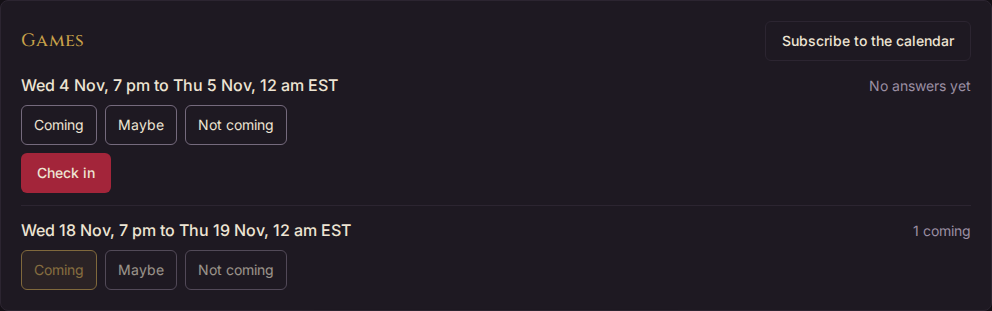

## Reading the troupe's news

A troupe's **News** tab, in its Troupe group, has the in-world news its storytellers write: stories from its news agencies, such as a newspaper or a rumour sheet, newest first, each under its agency's masthead. Every player with a character in the troupe, home or visiting, gets every story. **From** shows one agency's stories only. The troupe's **About** tab shows the latest headline.

A dot marks each story you haven't read, and the News tab shows how many there are. Opening a story reads it; **Mark all as read** clears the lot. Stories from the last 30 days show first; **Show older stories** brings back the rest.

Each new story also comes to the bell, as "New from *agency*: headline". To stop that, choose **Not in the bell** for **Troupe news in the bell** under Account › Settings, in **Troupes**. News doesn't come by email unless you turn on **Troupe news** under **Notifications by email**, so a busy week of news doesn't fill your inbox.

If your characters are kept on your phone (see [Using Horatio at a game with no signal](#using-horatio-at-a-game-with-no-signal)), their home troupe's news from the last 30 days is kept too, to read at a game with no signal.

Many troupes also post their news to a channel on their Discord server.

## Troupe announcements

A troupe's **Announcements** tab, beside News, has out-of-character messages from its staff: a game moved, new parking at the venue, downtimes due on Friday. Each is signed by the staff member who wrote it and their role. Everyone in the troupe gets every announcement. They're never mixed with the in-world news, and have their own unread dots and count on the tab.

**Banners.** Staff can pin an announcement to the troupe's front page for a while. It shows as a banner at the top of the troupe's **About** tab, and first on the Announcements tab. **Dismiss** hides the banner for you alone; the announcement stays on the Announcements tab.

**Bell and email.** Each announcement comes to the bell as "Announcement: *title*" and, unlike news, by email too, since they're often practical. Turn either off under Account › Settings: **Troupe announcements in the bell** in **Troupes**, and **Troupe announcements** under **Notifications by email**. One the staff mark **Important** is emailed to everyone in the troupe even so.

If your characters are kept on your phone, their home troupe's announcements from the last 30 days, and any pinned, are kept too.

## The character log

The character's **Log** tab lists everything that happened to it, newest first, with when and who did it: purchases, requests and what the storytellers decided, renames, troupes joined and left, retiring. You see all of it; a troupe's staff see the sheet's history and what happened in their troupe.

## Retiring a character

When you stop playing a character, retire it: open **⋯** beside its name and choose **Retire…**. Say why it left:

- **Final Death**: the character is dead.
- **Off-field**: alive, but away from the domain.
- **Inactive**: you stopped playing it. It says nothing in game.

Whatever the reason, retiring gives up every title the character holds, in each of its troupes, and the status they gave. The dialog names them first, such as "Ursula holds Prince in Lords of the Night. Retiring gives it up.", and the storytellers are told.

Add a **Note** for the character's log if you like, and choose whether to list it under **No longer with us** on the Who's Who of its troupes, where their players and staff see its name, clan, social age, player and why it left. It's listed by default, except when Inactive. Then press **Retire** and the character's name.

> **If your troupe uses this:** with Remembrances, tick **Ask the storytellers to open remembrances in the next downtime**, and the troupe is asked for memories of the character once they confirm. The retired character's page keeps a **Remembrances** card with what the troupe wrote, newest month first, without names.

A retired character is hidden from everyday lists and out of all downtimes, and its sheet can no longer change, but it's kept with its full history, and stays on your Characters page marked **Retired**. Its page shows why it left; you, or its home troupe's storytellers, can **Change…** that, or whether it's listed, later. There's no way to bring a retired character back into play from the app.

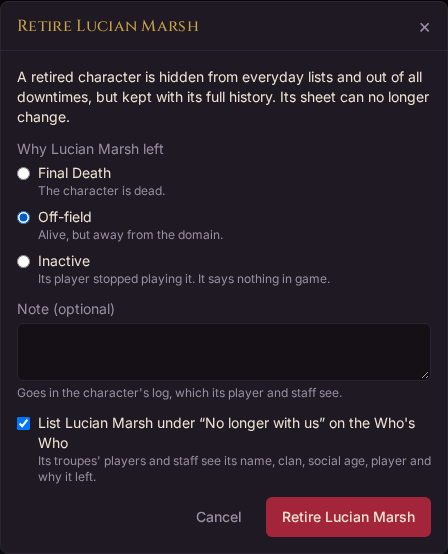
