# Running a troupe

This part is for the people who run a Mind's Eye Theatre: Vampire troupe in Horatio: its lead storyteller, storytellers, assistant storytellers and narrators. It covers getting a troupe, setting its house rules, approving characters and their changes, running downtime cycles and game nights, and giving XP.

What a player sees and does is in [Players](players.md). Words such as [home troupe](glossary.md#home-troupe), [Play View](glossary.md#play-view) or [exception](glossary.md#exception) are explained in [the glossary](glossary.md).

## Staff roles

Every troupe has exactly one **lead storyteller**, and as many **storytellers**, **assistant storytellers** and **narrators** as it needs. Together they are the troupe's staff. The custodian, who runs the whole site, can do anything in any troupe (see [Custodian](custodian.md)).

| What | Lead storyteller | Storyteller | Assistant storyteller | Narrator |
| --- | --- | --- | --- | --- |
| Rename the troupe, change its description, archive it | Yes | No | No | No |
| Rename or remove any staff member's scene, clear old scenes | Yes | No | No | No |
| Add, change and remove staff | Yes | Yes | No | No |
| Change the house rules and troupe settings (Customise) | Yes | Yes | No (can read them) | No |
| Set up connectors (Discord, email) and choose the Discord channels for news and announcements | Yes | Yes | No (can read them) | No |
| Edit the troupe's profile, add games to the schedule | Yes | Yes | No | No |
| See character sheets, the Characters list and the Players list | Yes | Yes | Yes | No |
| Decide approvals, give exceptions, read backstories | Yes | Yes | Yes | No |
| Award XP, correct it, run check-in at a game | Yes | Yes | Yes | No |
| Run downtime cycles: open, assign, deliver, close | Yes | Yes | Yes | No |
| Make and play NPCs, run scenes, reset the Play Views | Yes | Yes | Yes | No |
| Give an NPC to a player, or make a claim link for it | Yes | Yes | No | No |
| Give titles, status and equipment; keep locations, quests, shared backgrounds and the influence log | Yes | Yes | Yes | No |
| Read the troupe log | Yes | Yes | Yes | No |
| Write, schedule, publish and edit the troupe's news; keep its news agencies | Yes | Yes | Yes | No (can propose a story) |
| Write, schedule, publish, pin and edit the troupe's announcements | Yes | Yes | Yes | No |
| Answer downtime actions assigned to them, or to any narrator | Yes | Yes | Yes | Yes |
| See the staff list, the players' lines and veils, and who is coming to each game | Yes | Yes | Yes | Yes |
| Keep the troupe's fill tables | Yes | Yes | Yes | No (can use them) |

A narrator can do whatever a player in the troupe can, and also answers the downtime actions given to them. A narrator never sees character sheets, not even for the actions they answer.

The Staff tab lists each role in a line, under **Roles**, if you need a reminder.

## Getting a troupe

### Asking the custodian for one

Only the custodian makes troupes. To ask for one:

1. Open **Troupes** in the top menu.
2. Under the list, choose **Ask for a new troupe**.
3. Fill in **Troupe name**, and if you like a **Description** and a **Note to the custodian**.
4. Choose **Send request**.

Your request shows under **Your requests**, as Waiting, Approved or Declined, with the custodian's reason if they gave one. You can **Withdraw** it while it waits. If the custodian approves it, the troupe is made and you are its lead storyteller. How the custodian handles requests is in [Custodian](custodian.md#troupe-requests).

### The troupe profile and public page

The troupe's **Profile** tab is what it tells players and people thinking of joining. Storytellers and the lead edit it.

1. Open the troupe, then **Profile**.
2. Choose **Edit profile**.
3. Fill in what you want to show: a portrait and banner, **Links**, **When it plays** (how often games run, and the upcoming games), **Where it plays** (city, venue, address, accessibility), **The setting** (chronicle, city, era, tone), **New players** (whether you are taking them, and a contact on the staff) and **Age and content** (a minimum age and content notes).
4. Choose **Save profile**.

To add a game to the schedule, fill in **Game starts** and **Game ends** under Upcoming games and choose **Add game**. Times are in your time zone; everyone sees them in their own.

The **Public** switch at the top of the Profile tab decides who can see the profile:

- **Signed-in only**, the default: only people signed in to Horatio.
- **Public**: anyone with the link, even people not signed in. Use **Copy the link** to share it when recruiting. The venue's street address still shows only to people signed in.

The profile never shows emails, characters, or anything only members see.

### Adding staff

Storytellers and the lead add staff on the **Staff** tab:

1. Under **Add staff**, pick the **Person** (they need an account already; type a name or handle to find them).
2. Choose their **Role**. The hint under it says what that role can do.
3. Choose **Add to staff**.

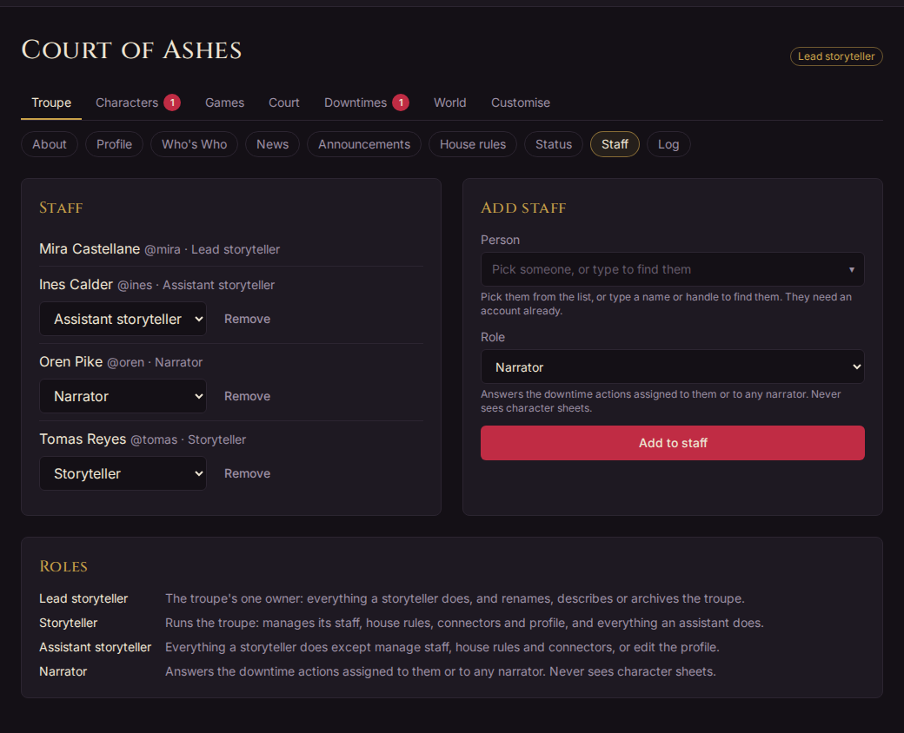

To change someone's role, choose another in the list beside their name. **Remove** takes them off the staff. Only the custodian appoints a new lead storyteller.

### Renaming or archiving the troupe

Only the lead storyteller (and the custodian) can do these, on the **Profile** tab:

- **Name and description**: change them and choose **Save**. The first lines of the description show on the troupe list.
- **Archive the troupe**: choose **Archive troupe…**. Horatio first lists what archiving settles: the characters it is home to are left with no home troupe, visits end, an open downtime cycle ends without being answered, and games under way end. Give a **Reason**: everyone affected sees it. The troupe's history is kept, and the custodian can reopen it (see [Custodian](custodian.md#archived-troupes)).

## Finding your way around a troupe

A troupe's page has its tabs in groups. Which ones you see depends on your role.

| Group | Tabs |
| --- | --- |
| Troupe | About, Profile, News, Announcements, Who's Who, Nominations, House rules, Status, Staff, Log |
| Characters | Approvals, Characters, At game, Award XP, Titles |
| World | Locations, Equipment, Shared backgrounds |
| Players | Players, Lines and veils |
| Downtimes | Cycles, My work, Fill tables, Influence log, Quests |
| Customise | Overview, Troupe settings, Rules, Specialisations, News, Connectors, Share settings |

A number on a tab is how much waits on you there, such as approvals to decide.

## The About tab and what's waiting on you

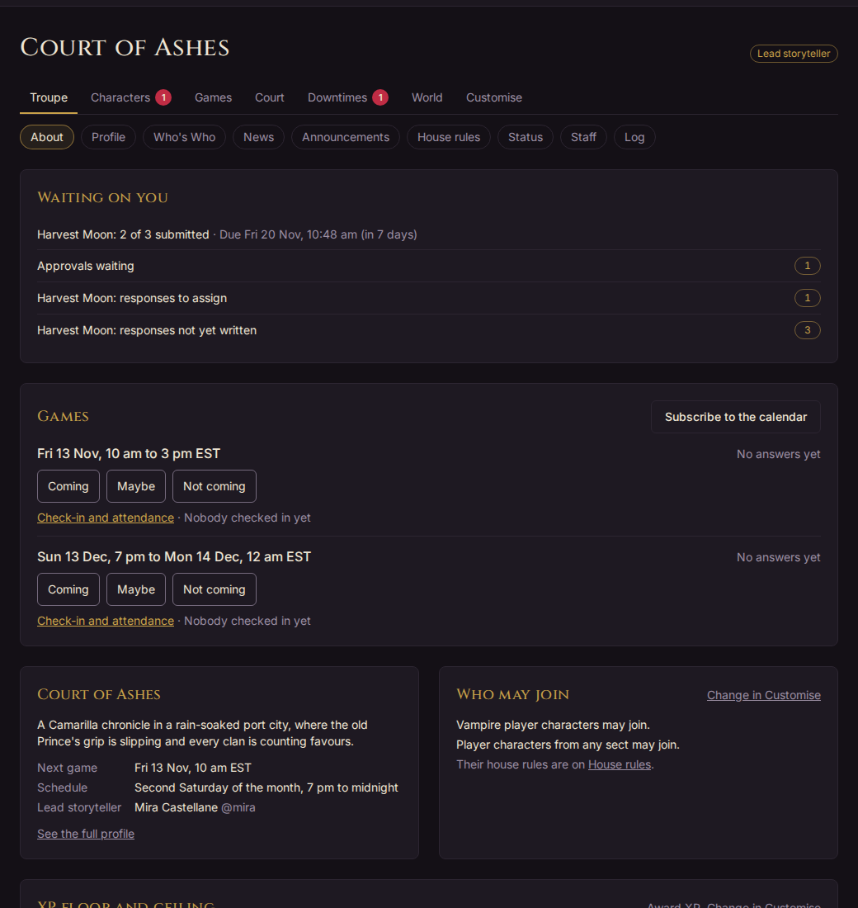

The **About** tab is the troupe at a glance. For staff it starts with **Waiting on you**: one line for each kind of work, each a link straight to it. The lines you may see are:

- **Approvals waiting** and **Backstories to read**;
- the open cycle, with how many have submitted and when it is **Due**, its day and time, such as "Due Sat 14 Nov, 6:00 pm (in 7 days)";
- late downtimes to accept, responses to assign, responses not yet written, responses for you to write, and results ready to deliver;
- allowance shortfalls in a cycle;
- **Quest requests to answer**;
- **Influence entries that need details** and **Influence effects ending this week**;
- **Characters with old status to resolve**.

Members see any pinned announcements first, as banners (see [Announcements](#announcements)). Below it are the **Latest news** headline, once there is news (see [News](#news)), the **Games** to come (see [Game nights](#game-nights)), the troupe's description and next game, **Who may join**, the **XP floor and ceiling**, and for storytellers and assistant storytellers the **Latest in the log**.

### My work

**Downtimes › My work** is every staff member's own list of downtimes to answer, one cycle at a time. In a cycle it shows what is **Assigned to you**, and for narrators what is **Open to any narrator**:

- **Take it** makes an any-narrator action yours.
- **Decline** sends an action back to the storytellers and assistant storytellers to give to someone else.
- Write the answer and choose **Save response**.

Narrators see the player's answer and the question, never the character's sheet.

## The Characters list

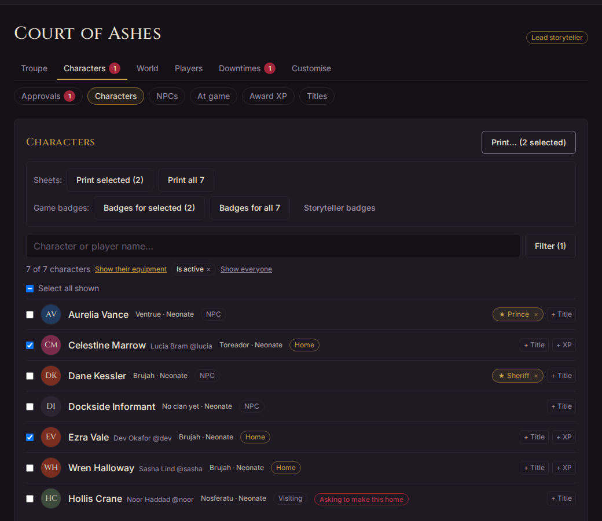

**Characters › Characters** lists the troupe's characters, those whose home it is first, for storytellers and assistant storytellers. Choose what it shows at the top:

- **Player characters**, which it opens on;
- **NPCs**, the troupe's own characters (see [NPCs](#npcs));
- **Everyone**, both together.

Your choice is kept in the page's address, so you can bookmark it or share it with other staff.

With player characters, or everyone, it's a table: the character (with the titles it holds here), its player, its clan, its social age, whether it is **Home**, **Visiting** or an **NPC**, and its flags. Red flags show what needs you: **Asking to make this home**, **Backstory to read**, disciplines to approve, or **Player suspended**. Each player's lines and veils show under their character. On a phone, each character folds into a card, with the same details under its name.

- A clan without a seat at court shows who represents it, under the clan.
- An NPC that isn't a vampire, such as a mortal or a werewolf, shows its kind where a social age would be, and no clan. A ghoul shows its domitor's clan and **Ghoul**.
- Choose a heading (Character, Player, Clan or Age) to sort by it; choose it again to reverse the order, and a third time to go back to home characters first. Only the columns shown sort the list.

### Searching and filtering

- Type a character's or player's name in the search box. It searches whatever the list shows.
- The list opens on active characters only: the button reads **Filter: active**, and the **Is active** chip shows. Remove the chip to see retired characters too. With more conditions, the button counts them all, such as **Filter (2)**.
- Choose **Filter** to narrow the list by what the sheets hold. Each condition is one of: status (such as home here, visiting, still in creation, or has approvals waiting), a trait and its rating, a clan, sect or other choice, a title, a player, experience, how many of something, a character, or equipment. Choose whether characters must match all of them or any.
- A condition that compares a number, such as a trait's rating or XP, adds a column with each character's number, so you can compare them; its heading sorts by it too.
- Each condition shows as a chip you can remove with ×; **Clear all** clears them. The filter is kept in the page's address, so you can bookmark or share it with other staff.
- **Show their equipment** opens the Equipment tab on the items the characters shown hold.

### Printing sheets and badges

Tick characters, or **Select all shown**, then choose **Print…**:

- **Sheets**: **Print selected** or **Print all**, for the printable sheets.
- **Game badges**: **Badges for selected** or **Badges for all**, and **Storyteller badges** for the staff. What badges print is set under [Troupe settings](#customise-troupe-settings).

Printing opens in a new tab, so what you ticked stays.

### Exporting characters and NPCs

The **⋯** beside **Print…** has **Export characters and NPCs…**. It downloads a `.zip` of the troupe's own characters, those at home here and its NPCs (never visitors): every one, the player characters or the NPCs only, or those you ticked. Each is a file Horatio can import, named for the character and the day as a single export is, with its picture and its printable sheet as a page any browser opens, and a `manifest.json` saying what is in it. Tick **Also include** for equipment, Retainers and Alternate Identities, or titles and status.

Each player character names its player by handle. Storytellers and the lead can tick **Include players' emails** too, to match characters to their players on another server; leave it off unless you need it. Staff notes are never in the file.

### Importing characters and NPCs

The same **⋯** has **Import characters and NPCs…**, for a troupe's export from this Horatio or another (a `.zip`), or character files. **Choose files…**, then review what happens to each before anything is saved:

- **An NPC** comes in as one of the troupe's, its sheet as the file has it, free dots too. One whose creation picks were fitted, or that has none, has them fitted again at this troupe's prices.
- **A player character** goes to its player, found by the email in the file (if it was exported with emails) or else by its handle. Check each match: under **Give to**, type another handle, or clear it to hold the character as an NPC and [give it](#giving-an-npc-to-a-player) later. Given, it is at home here and accepted, its sheet bought at this troupe's prices, as giving an NPC does. Its XP history isn't carried over: under **Unspent XP to carry over**, award what you choose of the unspent XP the file shows. Only the lead and storytellers give characters to players; for an assistant storyteller, every player character is held.
- **One with the name of a character here** (an NPC of the troupe, or one of its player's) waits for you to choose: **Skip it**, **Replace it** (an NPC only: the NPC stays, with its sheet, Retainers, backstory and picture as the file has them) or **Add a copy**. A player's character here is never replaced.
- **A retired character** comes in retired.
- **What can't come in** says why: a file that isn't a Horatio character, one from a newer Horatio, or a trait this troupe's rules don't have. The rest still come in.

Equipment, titles and status in the files are shown, not imported: give them here as usual. **Import** brings everything in at once, and lists each character with a link to it.

### Each character's actions

Each character's **⋯**, at the end of its row, holds what you can do for it, player character or NPC alike. Only what applies to it shows:

- **Play** (NPCs): opens its Play View at a game.
- **Award XP…** (home player characters only): gives it XP, with a reason, in one go. To give a whole game's XP, use [Award XP](#awarding-a-games-xp) instead.
- **Give equipment…** (characters whose home troupe this is, and NPCs): the Equipment tab's form, given to it.
- **Status…** (the same): its status here.
- **Titles…**: the titles it holds here, each with × to take it away, and the troupe's titles to give it another, or a new one you type.
- **List on the Who's Who** or **Take off the Who's Who** (NPCs): for an NPC without a title (one with a title is listed anyway).
- **Give to a player…** and **Claim link…** (NPCs, for storytellers): on a finished sheeted vampire or ghoul (see [Giving an NPC to a player](#giving-an-npc-to-a-player)).
- **Print sheet**: its sheet, in a new tab. A Stock NPC has no sheet to print.
- **Badge…**: shows what others can see of it, takes a note for its badge, and prints it.
- **Show Jyhad card**: its card, for a vampire with a picture.

## Players and their lines and veils

**Players › Players** lists everyone with an active character in the troupe, home or visiting, with the characters they bring and any staff role they hold here. Search it by player or character name.

**Players › Lines and veils** gathers every line and veil the troupe's players have given, on one screen, so staff can plan games. All staff, narrators too, see it. Whose each one is shows only for players who share theirs with other players; open a player's profile to see the rest. How players set them is in [Getting started](getting-started.md).

## NPCs

NPCs belong to the troupe, need no approval and take no part in downtimes. Choose **NPCs** on the [Characters list](#the-characters-list) to see them; the old **NPCs** tab's address opens it there. Each row shows the NPC's kind, its form (sheeted or stock), a Stock NPC's rating, and whether it is listed on the Who's Who; choose a heading to sort by it. On a phone these fold in under the name. Filter the NPCs by kind and by form, or open an NPC by its name. The search, the filter, printing and each NPC's [**⋯**](#each-characters-actions) work as for player characters.

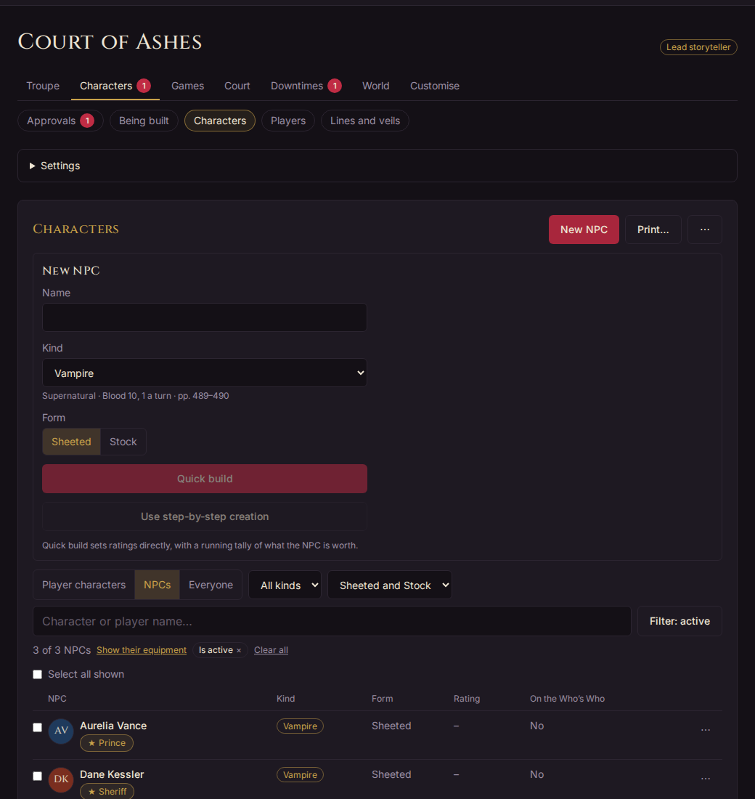

### Making an NPC

With **NPCs** or **Everyone** shown, choose **New NPC**:

1. Give it a **Name** and choose its **Kind** (a vampire, a ghoul, a mortal and others, or a custom kind you describe).
2. Choose its **Form**:
   - **Sheeted**: a full sheet. **Quick build** sets ratings directly, with a running tally of what the NPC is worth (its merits at what they'd cost a player character, and its flaws giving up to the troupe's budget for them); **Use step-by-step creation** builds it as a player would.
   - **Stock**: no sheet, only a rating and a few specialisations, as the book's Stock NPCs have.
3. Choose **Quick build**, **Use step-by-step creation** or **Make Stock NPC**.

In the quick build, a trait the NPC holds can carry a detail, as a player's can:
- **A merit that applies to something:** a merit like Thaumaturgic Expertise needs its choice, here which path it makes in-clan. Until that's made, it shows **Choose what it applies to** under the merit, and the NPC's sheet lists it under **Against the rules**. Choose from its list (the NPC's own paths come first) and choose **Set**.
- **A field or a name:** a skill taken once per field, such as Crafts, needs its field, and a Retainer needs its name. Each is asked for in the same way.
- **Any other detail:** **Detail** beside a skill, background, merit or flaw adds one, and **Change** alters one already there.
- **What stays:** a changed detail keeps the trait's rating and its creation pick.
- **More than one:** where a trait can be held more than once, such as Crafts in a second field or another Retainer, use **Add another field** or **Add another Retainer**.
- **A merit that gives another:** Piece That Remains, Auspicious, Old Habits and Shadows of the Past show what they give under the merit, in the quick build and on the NPC's **Sheet** tab. **Choose** (or **Change**) picks it from what the merit can give. The merit given is free, its own grants apply (Ventrue Royalty's 4, 3 and 2 are fitted onto the NPC's backgrounds), and the NPC's worth follows. Ventrue Royalty's own dots aren't chosen this way: they're placed on the **Creation picks** card.

### Stock NPCs

A Stock NPC's page shows its **Stat block** worked out from its kind and rating, and a rules card for its kind. Change its name, kind or rating, add up to as many **Specialisations** as its rating, and keep **Notes**; each change saves as you make it. **Make this a full sheet…** turns it into a sheeted NPC. That cannot be undone.

### Giving an NPC to a player

A troupe moving to Horatio can load its existing characters as NPCs, then give each one to its player as that person signs up. The lead storyteller and storytellers can give an NPC (the custodian can too); assistant storytellers can't. Only a finished, sheeted vampire or ghoul can be given: a Stock NPC has no sheet to play, so make it a full sheet first.

Giving it makes it the player's character, at home in your troupe and already accepted:

- its sheet as it stands becomes its accepted sheet, so later changes go through your approvals and [free changes](#free-changes) as any new character's do;
- its XP balances: each trait's dots are bought at your troupe's prices, and an **Imported** award gives that much, so nothing is left unspent. A trait your costs don't price is kept as free dots;
- XP the player had banked elsewhere goes in **Unspent XP to carry over**, as its own entry with your reason. Neither is checked against your [XP floor and ceiling](#xp-settings);
- it leaves the NPCs and shows among the player characters, and on the Who's Who as a player's character. A Retainer linked to it is unlinked, with a line in its owner's log;
- the player is told *"name is yours now"*, and it's in the troupe log.

To give it to someone who has signed up:

1. Choose **⋯ › Give to a player…** on its row of the Characters list, or **⋯ › Give to a player…** on its own page.
2. Pick the **Player**, and fill in any **Unspent XP to carry over** and **Why**.
3. Choose **Continue** to see what will happen, then **Give *name* to @handle**.

For someone who hasn't signed up yet, send a **claim link** instead:

1. Choose **⋯ › Claim link…**, fill in any XP to carry over, and choose **Make a claim link**.
2. Copy the link and send it to them. It shows only now, works once, and lasts 30 days.
3. Whoever opens it sees the character's name and portrait, signs up or signs in, and chooses **Claim *name***. The character is given to them as above, and whoever made the link is told.

While a link is out, the NPC's row says **Claim link out**. **Claim link…** shows when it expires and who made it; **Cancel the link** stops it working, and **Make a new link** replaces it. Giving the NPC directly also ends its link.

A character given to the wrong person is put right by the custodian [moving it to the right player](custodian.md#moving-a-character-to-another-player). It can't be turned back into an NPC.

## Titles and status

**Characters › Titles** lists the titles the troupe gives in tables: those held first, with who holds them, then the vacant ones by sect, folded away under **Show vacant**. Each row has the title, its sect, the status it gives, whether it is a **House rule** (a title the troupe added), and its **One holder at a time** switch. On a phone each row folds into a short card, with the switch under it.

- **One holder at a time** is a house rule you set title by title, for the book's titles and your own alike. It's off for every title until you switch it on, so several characters may hold a Prince, say, where your game runs two domains. Switched on, players can't choose the title while someone holds it, though staff can still give it. For a title with other names (a Baron is also an Advocate), it is for them all. Each change goes in the troupe's log.
- **Add a title** makes a title of the troupe's own: its name, its sect (or any sect), the status it gives, and whether it is one holder at a time.
- The **⋯** at the end of a row holds **Give…** (a vacant title, or one more than one character may hold), **Move to another holder…**, **Take from** each holder, and, for a title the troupe added, **Change…** and **Remove…**. Give and Move offer only characters of the title's sect. A change is for everyone who holds it, from their next game.
- **Court order of our titles** sets where the troupe's own titles come in the Who's Who's court, after the rule set's.
- **Seats at court** chooses which clans have a seat. Until you choose, the clans whose Primogen is held here have one. Characters of other clans are listed under Other on the Who's Who, each with who represents them.

You can also give a title from **Titles…** on a character's ⋯ on the [Characters list](#each-characters-actions), or from the character's Status & Titles tab. Whether players choose their own titles, and keep their own status, is set under [Troupe settings](#customise-troupe-settings).

The **Status** tab in the Troupe group is a reference for everyone in the troupe: every status of the sects the troupe takes, what it does and where it comes from. There is nothing to set there.

## Boons

A boon is a debt one character owes another, registered with the Harpy (MET: VTM pp. 395-397): trivial, minor, major, blood or life. When the troupe keeps a boon ledger (switch it on under [Troupe settings](#at-game)), storytellers and assistant storytellers keep it under **Characters › Boons**. A boon made off the record isn't in the ledger, and isn't enforced.

- **Register boons** takes one boon or a whole game's: a row for each, with its debtor and creditor (a character of the troupe, retired ones too, or a name only for someone not in Horatio), its kind, the in-game date, the reason and any conditions ("Cannot be traded"). **How many** makes that many alike, for "1 of 3, 2 of 3…". **Where they come from** goes in each boon's log. They all register together, or none do.
- The ledger's tabs are **Open** (standing, with everyone on it in play), **Departed** (standing, but someone on it has met Final Death or is off-field), **Settled**, **Void** and **All**. Narrow them to a character or a name, a kind, or the nights the boons were made.
- **Open** on a boon shows its log and what you can do with it: **Edit** (with why: what changed shows only to storytellers and assistant storytellers), **Trade** (a new creditor holds it; tick **Tell the debtor's player if it's traded** on a boon whose conditions ask for that), **Pass on** (either side, to a broodmate after a death, say), **Settle** (called in, forgiven, or formally ignored by the debtor), **Make void** (entered by mistake) and **Reopen**. Each goes in the boon's own log and the troupe's log.
- On a character's sheet, staff see a **Boons** card: what they owe and are owed, by kind, with a link to the ledger narrowed to them.
- **Characters › Boon standings** shows where everyone stands, live. Each kind of boon has a weight (Trivial 0.5, Minor 1, Major 3, Blood 5, Life 10 to begin with; **Change** sets the troupe's own), and a character's **net** is the weight owed to them less the weight they owe. It shows open boons by kind, each character's standing, the court (each title holder, and who owes them and whom they owe most), clans, ages and sects, how long open debts have stood, how boons get settled and who calls theirs in, boons across clan and sect lines, and characters who owe each other. **Active** leaves out boons that involve someone dead or off-field; **Everyone** keeps them.
- **Players** report boons in the Play View's **Boons** tab: who, which way, the kind, the night, the reason, any conditions, and how many. A report goes straight into the ledger, marked in its log as done as their character. Under **Boons** in the troupe's settings, choose what else they see there: **the form to report a boon only** (the default), **also what they owe**, or **also what they're owed**. With the last, you can let **players mark boons owed to them settled**: only the creditor's player, as called in or forgiven, never the debtor's. Players never see a boon's log, its staff note, or who registered it. The tab shows only while the ledger is on, and can be switched off under **Play View tabs**.

Switched off, the ledger and its entries in the log are hidden; what was registered is kept, and comes back if it is switched on again.

## The Who's Who

The **Who's Who** tab shows the troupe's active characters as cards, for its players and staff. It is never public. The court comes first, in rank order, then a section for each clan with a seat, then **Other** for the clans without one, then those no longer with us. Search it by character, player or title, or filter it by clan and sect.

What it shows of sect status is set under [Troupe settings](#customise-troupe-settings).

## News

The troupe's in-world news: stories its storytellers write as the troupe's own **news agencies**, such as a newspaper, a TV station or a Kindred rumour sheet. Everyone in the troupe gets every story: its home and visiting players, and its staff. A story goes out when you publish it, or at a time you schedule, to the **News** tab in the Troupe group and, if the troupe has one, to a Discord channel. How players read it is in [Players](players.md#reading-the-troupes-news).

Each story is one-off: there are no repeating stories. For a regular bulletin, **Duplicate** last week's and change it.

### News agencies

**Customise › News** lists the troupe's agencies. Storytellers and assistant storytellers keep them. **Add an agency** asks for:

- its **Name**, and a line of **Description** for staff;
- its **Masthead colour**, shown behind its name, beside its stories and down the side of its Discord posts;
- its own **Discord channel**, if it should post somewhere other than the troupe's news channel (storytellers only).

Its **⋯** has **Edit…**, **Masthead picture…** (a nameplate or logo shown in place of its name) and **Retire**. A retired agency is no longer offered for new stories; its old stories stay, and **Bring back** returns it.

### The news channel on Discord

Under **News on Discord** on the same tab, a storyteller picks **The troupe's news channel** from the connected server's text channels. Stories from agencies without a channel of their own go there. With no Discord server connected, or no channel chosen, news is in the app only, and the desk says so beside each story. The server is connected under [Connectors](#connectors-discord-and-email); the switches there for downtime results (on or off, test mode, alert or full) don't apply to news.

### Writing a story

On the **News** tab, **News desk** opens the desk; **Write a story** starts one. A story has:

- its **Agency** (required);
- its **Headline** (required);
- an optional **Dateline**: an in-world date or place, as text, shown above it;
- the story itself, in the same editor as backstories;
- an optional **Picture**. Adding a picture to a new story saves it as a draft first.

**Preview** shows it as players will read it, and roughly as it will look on Discord.

### Saving, scheduling and publishing

- **Save draft** keeps it on the desk under **Drafts**, for staff only.
- **Publish now** puts it on everyone's News tab at once, with a bell notification, and sends it to Discord within a minute.
- **Schedule…** asks for a date and time, entered and shown on your own clock (your time zone under Account › Settings, or your device's). It goes out within a minute of then.

The desk's **Scheduled** list shows what goes out next and when. Each story's **⋯** has **Change**, **Publish now** and **Cancel**, which turns it back into a draft.

### Editing, unpublishing and duplicating

A published story's **⋯** on the desk has:

- **Edit**: saving changes it in the app at once, and edits its Discord post.
- **Duplicate**: a new draft with the same agency, words and picture.
- **Unpublish…**: after you confirm, it goes from everyone's News tab and its Discord post is deleted. It comes back to your drafts.

A draft that was never published, or has been unpublished, can be deleted.

On Discord, a story is an embed in its agency's colour, with the agency's name and masthead picture, the headline, the dateline and story, the picture, and a **Read in Horatio** link. A long story is split over several posts. If Discord refuses it, Horatio tries again for a while; if it still can't, the desk shows why, with **Retry** and **Mark as sent** (for when you've posted it yourself).

### Narrators' proposals

A narrator can propose a story but not publish one. From **Your proposals** on the News tab they write it as above and press **Send the proposal**. They see and change only their own proposals, and only until a storyteller or assistant storyteller takes them up or declines them. They read published stories as players do.

Proposals wait on the desk under **Proposed by narrators**. Open one to edit it, then **Take it up as a draft**, **Schedule…**, **Publish now** or **Decline…**. A **Note** is sent to the narrator with Publish now or Decline; they're told either way.

Publishing, scheduling, editing a published story, unpublishing, declining and changes to agencies and the news channel all go in the [troupe log](#the-troupe-log).

## Announcements

Announcements are out-of-character messages from the troupe's staff to everyone in it: "Game moved to Saturday", "New venue parking", "Downtimes due Friday". They work like [news](#news), with the same desk, editor, scheduling, Duplicate, Unpublish and Discord retries, but they're kept apart everywhere: their own **Announcements** tab beside News, their own unread count, their own email setting and their own Discord channel. Announcements never appear under News, and news never appears under Announcements.

Storytellers and assistant storytellers write them. Narrators can't write or propose them; they read them as players do. There are no repeating announcements: **Duplicate** last week's reminder.

### Writing an announcement

On the **Announcements** tab, **Announcements desk** opens the desk; **Write an announcement** starts one. An announcement has a **Title**, the message itself in the rich text editor, and an optional **Picture**. It has no agency: its byline is the writer and their role, such as "Mara Quinn, Lead storyteller", set when it's published. **Save draft**, **Publish now** and **Schedule…** work as they do for news, and **Preview** shows it as players and Discord will.

### Pinning to the front page

**Pin to the front page until** takes a day. Until the end of that day, the announcement is a banner at the top of the troupe's **About** tab for everyone in the troupe, and first on the Announcements tab. Each person can dismiss the banner for themselves; it stays pinned on the Announcements tab. It unpins itself after the day. To unpin it sooner, clear the day in the editor, or choose **Unpin** from its **⋯** on the desk.

### Important

Tick **Important** for what can't wait, such as a game moved or cancelled. As it's published, an important announcement is emailed to everyone in the troupe, even players who've turned announcement emails off. The editor says so beside the tick. Use it sparingly: the troupe log records who used it. Ticking it on an announcement already published sends nothing.

### Announcements on Discord

Under **Customise › News**, **Announcements on Discord** picks the troupe's announcements channel, separately from the news channel. An announcement goes there as a plain embed with its title, byline, message (split over several posts if it's long), picture and a **Read in Horatio** link. Editing it edits the post, and unpublishing deletes it. With no Discord server connected, or no announcements channel chosen, it's in the app only, and the desk says so.

Publishing, editing a published announcement, pinning and unpinning, unpublishing and using Important go in the [troupe log](#the-troupe-log).

## Equipment

**World › Equipment** lists every item the troupe's home characters hold, PCs and NPCs, for storytellers and assistant storytellers. Only a character's home troupe gives it equipment, and an item goes with its character if it moves to another home troupe.

- **Give equipment** gives an item: weapons, protective gear and other gear with the book's qualities, or a Vampiric Text. Start from the book's items or the troupe's own templates; **Save as a template** keeps one for next time.
- An item can be made special, with any number of qualities and effects of the troupe's own. A special item shows **Special, by** its troupe on its row.
- The list is a table: each item, who holds it, its kind, qualities and grade, and when and by whom it was given. On a phone, each item folds into a card. Choose an item's name to read what it does.
- Each item's **⋯**, at the end of its row, holds **History** (an item given from a downtime response says so there, linking to the response), and, while it's held, **Change…**, **Move…** (to another home character), **Discard…** and **Take back…** (with a reason; its player is told). A discarded item's **⋯** offers **Restore to** its last holder instead.
- **Find items** searches by words, holder, kind, quality, grade, who gave it and when, held or discarded.
- **Export CSV** downloads the list; **Find these characters** opens the Characters list on the holders.

> **If your troupe uses this:** with **Items that expire** switched on in Troupe settings, you can give an item an expiry: on a day, after a number of the holder's games, or at the end of the downtime cycle. An expired item is taken back, and its history kept.

## Locations and quests

### Locations

**World › Locations** is the troupe's record of the places that matter in its chronicle, and its characters' havens, with who controls each. Storytellers and assistant storytellers keep it; players and narrators never see it, except that a player keeps part of their own Haven from their sheet (see below).

- **Add a location** adds one.
- The list is a table of each location's name, type, controller, qualities (negative ones in red), influence area and whether it is locked. On a phone each row folds into a short card.
- Filter the list by controller, type, quality, influence, feeding block, locked or not, and negative qualities.
- The **⋯** at the end of a row holds **Open**, **Edit…** (the form opens over the list), **Build a quest for it** (when quests are on) and **Remove…**.
- Open a location to change it, forfeit it, remove a negative quality, add subsidiaries, and read its log.
- **Havens players keep.** A player whose character has the Haven background can put their Haven on the list from their sheet, and change its name, description, address, map link and advantages (one for each dot of Haven, with Security free for a character with the Security skill). Each change goes in the Haven's log under their name. Your notes, a lock, joint control and heirs, quests and secret negative qualities stay yours: the player never sees them, and sees other negative qualities only as their effect. If you mark one of the troupe's locations as a character's Haven, the player sees it but can't change it.

The troupe's house options for locations are under [Location rules](#location-rules).

### Quests

> **If your troupe uses this:** quests are off until a storyteller switches them on under [Quest settings](#quest-settings).

**Downtimes › Quests** has two tabs:

- **Requests**: players' quest requests, shown by **To answer**, **Unassigned**, **Assigned to me**, **Any narrator**, **Waiting to send** and **Answered**. Assign a request to a staff member or any narrator, then answer it, for example with **Build a quest** or **Build a location quest**.
- **Quests**: the quests themselves, being built and under way. A quest has requirements and scenarios, and Horatio keeps track as the party meets them.

Narrators see the requests and quests assigned to them; storytellers and assistant storytellers see them all. A merit or flaw request can also be answered with a quest (see [Merit and flaw requests](#merit-and-flaw-requests)).

On a character's page, its home troupe's storytellers and assistant storytellers, and the custodian, also have a **Quests** tab, beside **Projects**, while the troupe runs quests. It shows the quests the character leads or has joined, those still being built too, with how many of each one's requirements are met, and the character's quest requests and how they were answered. Open a quest for its objective, party, each requirement (met or not, and by whom) and its results so far, including any not yet sent. Nothing changes there: **Manage it in the troupe's Quests** opens it under **Downtimes › Quests**.

## Shared backgrounds

**World › Shared backgrounds** keeps the Havens, Herds, Allies and Contacts that a coterie pools together. Storytellers and assistant storytellers set one up, with who shares it and the dots each puts in, and keep its log. The players of the characters sharing it see it too. It is a record only: it changes no rating on any sheet.

## The influence log

**Downtimes › Influence log** records every influence action taken in the troupe: those spent at a game log themselves, and downtime ones are logged by staff. Storytellers and assistant storytellers keep it. Players never see it, only their own characters' actions.

- Filter it by type (Elite or Underworld), specialisation, character and more. Entries marked **Needs details** are missing something.
- **Log influence** adds an entry by hand, for a PC, an NPC or a name only. **Add another** keeps the date, cycle and character for the next one.
- **Effects and blocks** lists the effects targeted actions have made, and when they end.

### Logging influence from a downtime

When you write a response to an influence action, **Log it** puts it in the log. Trim the **Purpose** to one line: lookups show it, never who took the action. **Take it off the log** undoes it. On the cycle's Participants tab, a character's ⋯ also has **Log influence** for actions a player reported outside the form.

### Lookups and discovery blocks

- For a Gossip and Insider Trading or Word on the Street action, **Fill from the log** writes the answer from the influence log. If the character took the lookup more than once in the cycle, the result goes on the last answer, and the others say they are combined with it. You can change any of them before saving.
- For a discovery block, choose the **Entry to block** and accept it, which adds one to that entry's blocks; or refuse it with a reason.

How far back lookups look is set under [Downtime actions](#downtime-actions).

## The troupe log

The **Log** tab in the Troupe group shows what has happened in the troupe, newest first, for storytellers and assistant storytellers. Changes to house rules, approvals, awards and much else go in it.

## Customise: the overview

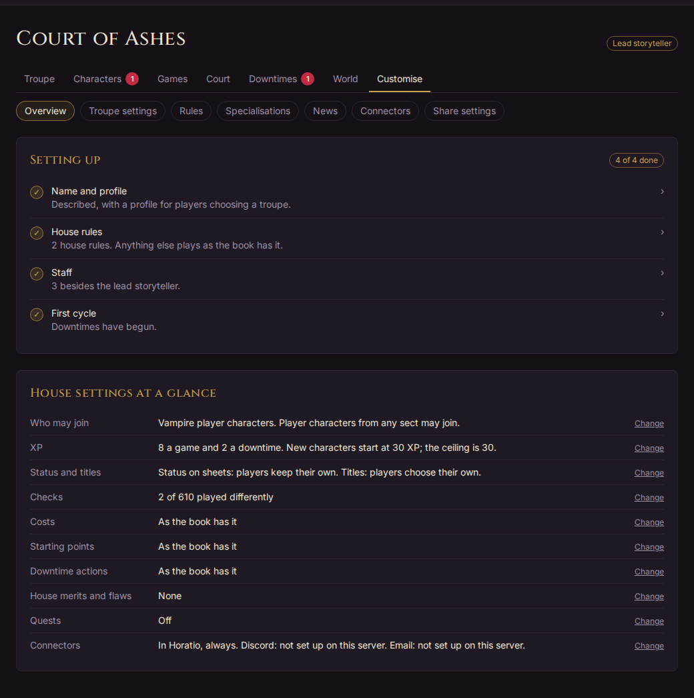

Everything under **Customise** can stay as the book has it. Storytellers and the lead change it; assistant storytellers can read it all. Each change saves straight away.

**Customise › Overview** starts with **Setting up**, the four things a new troupe does first, each ticked when done and linked to where you do it:

1. **Name and profile**.
2. **House rules**.
3. **Staff**.
4. **First cycle**.

Below it, **House settings at a glance** sums up who may join, XP, status and titles, checks, costs, starting points, downtime actions, house merits and flaws, quests and connectors, each with a link to change (or, for assistants, see) it.

## Customise: troupe settings

**Customise › Troupe settings** holds the settings for the whole troupe, in groups.

### Who may join

- **Splats**: which splats player characters may be (Vampire, Ghoul). Tick at least one. New characters built for the troupe, and those joining it, must be one of these.
- **Sects**: which sects player characters may join from. Leave all unticked to take any sect.

NPCs are never limited by either.

### XP settings

- **Experience**: what the troupe usually gives, **To start**, **For a game session** and **For completing a downtime**. Awarding XP starts at the session amount, and each new cycle at the completion amount.
- **XP floor and ceiling**: see [The XP floor and ceiling](#the-xp-floor-and-ceiling).
- **Game XP chart**: see [The game XP chart](#the-game-xp-chart).

### Status and titles settings

- **Status on sheets**: **Players keep their own** (a player adds and removes fleeting and negative status on their own character, naming who gave it) or **Staff only**. Storytellers and assistant storytellers can always change status, with a reason for the character's log.
- **Titles on sheets**: **Players choose their own** (from the troupe's titles of the character's sect; staff are told) or **Staff only**. A title the troupe holds to [one holder at a time](#titles-and-status) is staff's to give while someone holds it.
- **The night's status**: tick **Choose the night's status at check-in** so players choose their one source of abiding status as they check in, fixed for the game. Off, they choose it on the Play View as the game begins.
- **Who's Who**: whether it also shows the negative status each character carries into a game here, and whether players see its sire lines.
- **Golconda and Enlightened**: a house option for a sect that recognises the pursuit of Golconda.
- **Status bans on clans**: which clans each sect's status bans name here: the Camarilla's pillar clans (a character of none of them is under a lesser ban) and its known Caitiff (a greater ban), and the Sabbat's antitribu under a lesser or a greater ban. The pillar clans start as Volume II has them (Assamite, Malkavian, Nosferatu, Toreador, Tremere and Ventrue); **As the core book (2013)** adds the Brujah back, or tick the clans by hand (the Gangrel, say). A bloodline goes with its clan, and a character staff have marked keeps the mark.

### At game

- **Play View tabs**: a switch for each of the Play View's tabs (Sheet, Tracker, Pools, Status, Equipment, Throws, and Boons while the troupe keeps a boon ledger), all on to begin with. A tab switched off doesn't show on your players' Play Views; with the Tracker off, the strip of Blood, Willpower and health on the other tabs goes too. Staff always see every tab on NPCs. A visiting character keeps its home troupe's tabs. Switch every tab off if your players keep their sheets in Horatio but don't play from it: the card says what that does before it's saved. Its player characters then have no **Play**, check-in doesn't open the Play View, and phones don't keep the Play View for a game with no signal. Staff still run NPCs, the At game tab and scenes as before, with every tab on an NPC; a player character with no Play View can't be put in a scene.
- **Throw pictures**: your troupe's own rock, paper and scissors for the Throws tab, instead of Horatio's. Upload a picture for each (JPEG, PNG, WebP or HEIC, up to 10 MB); Horatio keeps it whole on a square, transparency and all, and strips anything else the file carries. Give the set a name if you like. The preview shows them as the Throws tab will, in Dark or Ultra goth, so you can check they read at arm's length. The set is offered to your players only once all three are there. Replace any one, or remove the set to go back to Horatio's. Each change goes in the troupe log.
- **Badges**: whether game badges print titles, character pronouns, and all status, negative status only, or none.
- **Blood at the start of a game**: what resetting a character's Play View puts their Blood back to: full, or a number you choose.
- **Diablerie and Lesser Generation**: what recording a diablerie does to a Lesser Generation or Thin Blooded flaw: leave it, remove it and the XP it gave, or remove it and keep the XP.
- **Items that expire**: let staff give items with an expiry (see [Equipment](#equipment)).
- **Boons**: keep a boon ledger (see [Boons](#boons)). Off to begin with. On, choose what players see of it in the Play View's Boons tab, and whether a boon's creditor's player may mark it settled.

### Downtimes

- **Player Nominations**: let players praise each other's roleplaying in their downtimes, for you to review and publish each month (see [Player Nominations](#player-nominations)). Off by default. Switched off, none of it shows anywhere; what was written and published is kept for when it's on again.
- **Remembrances**: ask the troupe for memories of a character who leaves play (see [Remembrances](#remembrances)). Off by default, and independent of Player Nominations. Switched off, none can be opened or written and nothing of them shows, except those already published: they stay on the characters' pages and the Who's Who, because they belong to the people remembered.

### Feeding

**Feeding** sets how far Horatio handles feeding between games:

- **Don't track feeding**: no Feeding section on the downtime form, no Feeding tab on a cycle, nothing in the results, and no half Blood at the next game.
- **Book feeding**, the default: each clan needs a number of feeding actions a cycle, Herd and some traits change it, and staff answer full or half Blood for the next game.

> **If your troupe uses this:** with feeding tracked, you can switch on the optional Vol. 2 rules, each on its own:
>
> - **Blood Resonance**: players name the humor they hunt for; staff answer with the Resonance fed on and any Dyscrasia.
> - **Feeding territories**: areas only the characters the domain's Authority names may feed in. A **Feeding territories** card then appears here, where storytellers and assistant storytellers keep the list as the Authority proclaims it.
> - **The Rack (advanced feeding)**: each character takes one vessel, a Feeding Card, from the cycle's Rack. It needs Blood Resonance.

Switching feeding off only hides it. What was recorded is kept and comes back if you switch it on again.

### Names

**Banu Haqim or Assamite** chooses what the troupe calls that clan: **Banu Haqim** (the default for a new troupe) or **Assamite**. Only the name shown changes, on every screen in the troupe; the rules and sheets stay as they are.

## Customise: house rules

**Customise › Rules** holds the troupe's changes to the rule set, one page each. A house rule applies to characters whose home troupe this is, and those being built for it. Players read them all on the troupe's **House rules** tab.

Some pages (Costs, Starting points, Downtime actions, Book traits) have a picker for the splat they apply to, such as Vampire or Ghoul.

### Checks

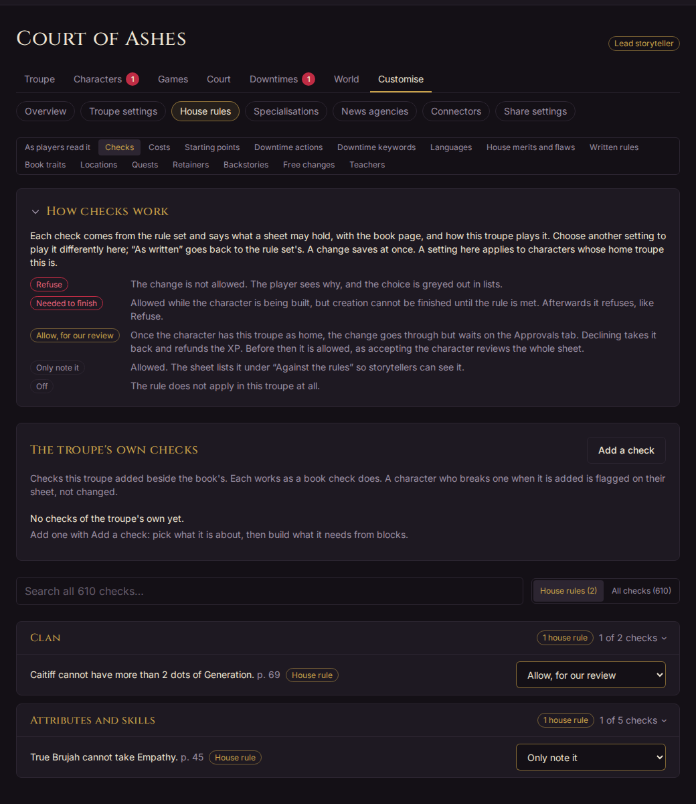

A check is a rule about what a sheet may hold, such as a clan-only merit or two flaws that cannot go together. The page opens on the troupe's **House rules**; choose **All checks** to see every one, folded in groups by kind, or search them all.

Choose how the troupe plays each check:

- **Refuse**: the change is not allowed; the player sees why.
- **Needed to finish**: allowed while the character is being built, but creation cannot be finished until it is met.
- **Allow, for our review**: once the character has this troupe as home, the change goes through but waits on the Approvals tab.
- **Only note it**: allowed, and listed on the sheet under "Against the rules" for staff to see.
- **Off**: the rule does not apply here.
- **As written** goes back to the rule set's.

Each change saves at once, with a toast that can undo it.

### The troupe's own checks

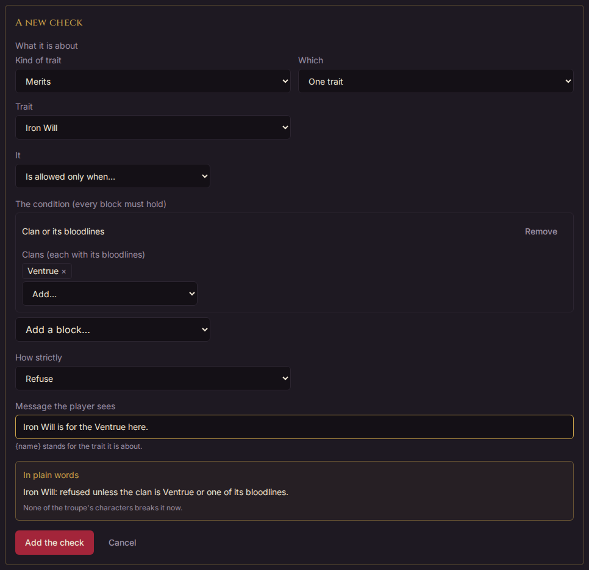

**The troupe's own checks**, at the top of the Checks page, are checks you write yourself. To add one:

1. Choose **Add a check**.
2. Under **What it is about**, choose the splat (if the troupe takes more than one), the **Kind of trait**, and **Which**: one trait, names starting with some words, one type, or all of them.
3. Choose whether it **Is not allowed when…** or **Is allowed only when…**, then build the condition from blocks: clan, clan or its bloodlines, holds a trait at a rating, Generation, creation finished, holds the trait more than once, and *Not*, *Any of* and *All of* to combine them.
4. Choose **How strictly** it holds, and if you like the **Creation step it holds**.
5. Write the **Message the player sees**.

The preview says the check **In plain words**, and lists the characters it would flag now. Removing a check stops it applying at once; nothing on any sheet changes. Every change goes in the troupe's log.

### Costs

**Costs** lists the rule set's prices and the troupe's own. When several prices could apply, the most specific wins: one for a single trait beats one for its category, and one with more conditions beats one with fewer.

To change a price, choose a category and (optionally) one trait, then **How it's priced**: the same for each dot, rising, one price whatever the rating, a price for each dot in turn, free, or cannot be bought. Add a **Note for players** if you like. The preview shows the price as written beside the price with the change.

A price can be **Only for…** some characters. Choose **Add a condition** and build it from lines: the **Generation background** is, is at most, or is at least a rating; **In-clan** is yes or no; or the **Clan or bloodline**, or the **Clan and its bloodlines**, is one you choose. A price is for characters who meet every line, so two Generation lines make a range. For example, skills rising at 1 XP for Generation background 2 lets Generation ●● characters buy skills at 1×, as the book lets Generation ● do. A price with the same condition as one of the rule set's replaces it; changing such a price keeps that condition.

Two of the troupe's prices can't tie: if a character could meet both conditions and neither price is more specific, Horatio refuses to save the second and names the first. Give one a narrower condition, or change the other.

A new or changed price applies from a character's next purchase. What it has already bought keeps what it cost: nothing is refunded or charged. To put an earlier purchase right, award the difference by hand with **Award XP…** on the character. Before a home troupe accepts a character, changing its Generation reprices its earlier buys at the troupe's prices, conditions included.

### Starting points

**Starting points** sets what new characters get free in each category: picks at a rating, or a budget of points. Choose **Change** beside a category to play it differently; going back uses the rule set's again.

Merits and flaws work as the book has it (MET: VTM pp. 85, 106): merits taken in creation are bought with the character's starting XP, and flaws add their points to it. Their budgets here are the most points of merits a new character takes (its clan's rarity and bloodline merits among them), and the most XP its flaws give; flaws past that need your OK and give nothing more. Changing a budget applies at once to characters being built here. Characters finished before Horatio worked this way (November 2026) keep the numbers they had, when merits and flaws came from free budgets and gave and cost no XP.

The same page has:

- **Clan rarity**: how rare each clan is in the troupe's setting. A character built here takes the rarity merit its clan's rarity names. By default each clan goes by the book for the setting's sect.
- **Default bloodlines**: the bloodline each clan plays as by default, or the plain clan. By default, the book's for the setting.

Starting XP, the XP floor and ceiling, and blood at the start of a game are under [Troupe settings](#customise-troupe-settings).

### Downtime actions

**Downtime actions** sets how many actions of each kind characters get each cycle, and which traits add or take away actions (once at any rating, for each dot, or for each field held, from a rating). A cycle keeps the allowances it was opened with.

The book's own list includes Computer, each Science field, Soul of the Homunculi and Ay Befriend (Mytherceria 3). Choose **Change** on any of them to replace it with the troupe's own. Science counts **For each field held**: to give one for the first field, a second at 3 dots and a third at 5, set **Rating each field needs** to "1, 3, 5". The character's best Science counts.

**Rare disciplines**, on the same page, is an optional rule (MET: VtM core p. 113), off until you switch it on: a dot of a rare discipline learned from a teacher, out of clan, takes two downtime actions instead of one. Every discipline but Animalism, Auspex, Celerity, Dominate, Fortitude, Obfuscate, Potence and Presence is rare.

**Influence lookups**, on the same page, sets how many **Days to look back** Gossip and Insider Trading and Word on the Street look in the influence log, counted from when their cycle closes.

### Downtime keywords

**Downtime keywords** lists the keywords a player chooses first for each downtime action: what kind of action it is. Horatio's follow the book where it has a rule (MET: VTM pp. 93, 97, 111–113, 307–308) and the troupes' downtime primers for the rest: Feed, Patrol, Investigate, Beyond Your Means, Quest, Learn, Craft, Perform, Narrative, Rhetorical, Observe and Cancel. What follows from them on their own:

- **Feed** actions are the character's feeding actions, which the Feeding section counts and the [Feeding tab](#feeding-in-a-cycle) answers as before. A Feed in a feeding territory stands in for one without spending an action, once a cycle.
- **Patrol** actions are its patrols of the territories it holds.
- **Learn** stands for what the character is learning: a discipline dot whose action came off the cycle shows on its form ready-made, and confirming it costs nothing more. Efficient Learner still waives the action, and teachers never spend one.
- **Observe** and **Cancel** are the Computer skill's one action a cycle, aimed at one character: see [Actions aimed at characters](#actions-aimed-at-characters).
- **Craft** and **Perform**: on their responses, **Effects on allowances and backgrounds** starts with the boost chosen, and says how many the character took.
- **Beyond Your Means** asks for the item wanted, and **Give an item** on its response starts from it.
- **Quest** is the form's Quest action.

Each row says what the keyword asks for, what it's spent from and its step in the resolution order. The **⋯** at the end of a row holds:

- **Edit…**: its **Name**, **What it is for** (one line, shown on the form), what **It asks for** (one character; who or what it's aimed at; a feeding territory; what to learn; the teacher; the item wanted), what it's **Spent from** (the action kinds, or **Only the Computer skill's action**), whether it **Fits a Science**, the **Actions it costs**, its **Step of the resolution order**, and whether it's **Required each cycle of** Neonates, Ancillae or Elders, such as an Eternal Struggle for Elders. Renamed, a keyword of Horatio's keeps what follows from it.
- **Move up** and **Move down**: the order the form offers them in, and their order within a step.
- **Retire**: no longer offered. Past downtimes keep it. **Offer it again** brings it back.

**Add a keyword** adds one of your own. **Back to Horatio's keywords…** puts every one back as Horatio has it, and retires your own. The changes show on the troupe's **House rules** tab. Influence actions take no keyword: their influence action says what they are.

The resolution order, under the list, is Land of the Sky's: influence Defends, Blocks, Boosts and Attacks; indirect influence attacks; other influence actions, highest first, with Word on the Street last; Cancels; the other downtime actions; and Observes last.

### Languages

**Languages from Linguistics** sets how many languages each rating of Linguistics gives: **Book** (one a dot), **Accelerated chart**, or **Custom**, and whether Natural Linguist doubles it. Characters already holding more than a new chart allows keep them, and are listed under **Holding more than the chart allows** for you to settle with their players.

### House merits and flaws

**House merits and flaws** are the troupe's own, marked ★ wherever they show. Only characters whose home troupe this is, or that are being built for it, and its NPCs can hold one.

The list is a table of each one's name and description, whether it is a merit or a flaw, its points, who can take it (**Staff only** or **Players**), whether it is for creation only, whether it is archived, and how many characters hold it. On a phone each row folds into a short card.

Choose **Add a merit or flaw** (the form opens over the list), then give it a **Name**, choose **Merit or flaw**, its **Points**, its **Type** and a **Requirement** in your words, and **Who can take it**: **Given by staff only**, or **Available when building for the troupe**. Write its **Description**, which players see.

Under **What it does**, add effect blocks: free dots, raising a maximum, changing an XP price, an extra in-clan discipline, health levels, requirements, pool bonuses, uses per game, extra downtime actions or a change to feeding. One with no effects does what its description says, for you to rule on at the table. The preview tries it on a sheet.

The **⋯** at the end of a row holds **Change…**, **Archive** (or **Bring back**) and **Delete…**. Changing one changes it for everyone who holds it (Horatio asks first). **Archive** stops anyone new taking it; **Delete…** is only for one nobody holds, and says so when someone does.

### Written rules

**Written rules** are rules in words alone, which players read on the House rules tab, by section, and in the rules browser.

Choose **Add a written rule**, then give it a **Title**, a **Section** (such as Disciplines or FAQ), and the rule in Markdown. Link it to a trait with **About a trait** and **Which one**, and to a **Book page**, if you like. Move rules up and down within a section. A tick chooses whether the troupe's profile shows them too, for people thinking of joining.

### Book traits

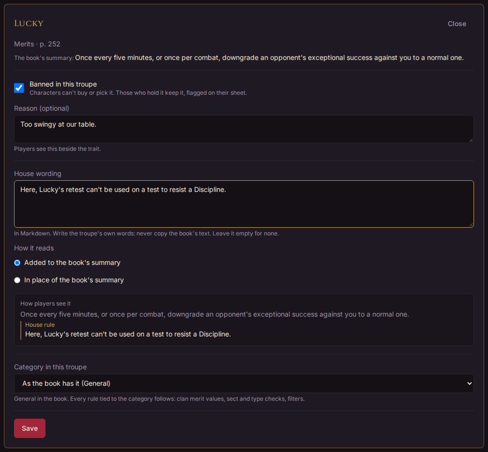

**Book traits** changes traits from the book. Search or browse under **Find a book trait**, open one, and in one panel:

- **Ban** it, with an optional **Reason** players see beside it. Characters can't buy or pick it. Those who already hold it keep it, flagged on their sheet, and are listed under **Characters holding a banned trait** for you to talk over with each player, or to give an exception.
- Give it **House wording**, in Markdown, **Added to the book's summary** or **In place of the book's summary**. Write the troupe's own words: never copy the book's text. The panel shows how players see it.
- Move a merit or flaw to another **Category in this troupe**. Every rule tied to the category follows.

**Changed in this troupe** lists every book trait you have changed.

### Location rules

**Locations** (under Rules) holds the troupe's **House options** for the book's Stock Locations (each on unless you switch it off), what going over the **Control limit** does (**Refuse** or **Only note it**), the troupe's own location qualities, and **The catalogue** as played here.

### Quest settings

> **If your troupe uses this:** quests are off by default.

Under **Quests**, tick **Run quests in this troupe** and set the **Requests per character per cycle**. While quests are off, players see nothing of them.

### Retainers

> **If your troupe uses this:** both rules are off unless switched on.

**Retainers** sets house rules the book doesn't have: **Upkeep**, in Blood or Willpower, each game or each month; and **Growth**, XP a month for each Retainer.

### Backstories

**Backstories** sets **How backstories are written**:

- **Free text only**, the default;
- **Free text or the questions**: each player chooses;
- **The questions only**: players answer the troupe's questions, then can edit what they build.

Tick **Need an approved backstory before accepting a character** to make approval a step in joining (it is on for a new troupe). Under **Questions**, make question sets (such as a Short Form) and their questions: a long or short answer, a year, a choice, a scale between two poles, or a heading only, each shown always or only by social age, sect or a trait on the sheet.

### Free changes

> **If your troupe uses this:** a new troupe has no free changes.

**Free changes for new characters** lets a player lower or remove traits for their full XP for a while after the troupe accepts the character, as during creation. Each change is reviewed on the Approvals tab. Choose **No free changes**, **By date** (a number of days from acceptance) or **By games played** (until the character has attended a number of the troupe's games). List under **Never refunded** the traits that keep the normal rules.

### Teachers

> **If your troupe uses this:** by default only discipline dots need a teacher.

**Teachers** adds kinds of trait that need a teacher here. A rule names which traits, for whom (everyone or only characters who meet a condition) and when (after creation only, or always), what the teacher must hold, and what learning takes. **Start from an example** fills one in. Removing a rule stops it applying at once; purchases already waiting keep their teacher.

### Specialisations

**Customise › Specialisations** holds the troupe's own lists of specialisations, one kind at a time: the areas its influences cover, the notable people Contacts can be, and so on. Where a kind has a list, characters choose from it. Choose **Make our own list** (or **Edit our list**), one a line, then **Save our list**.

### Connectors: Discord and email

**Customise › Connectors** sets how downtime results reach players. They always appear in Horatio (**In Horatio**, always on). Each connector the troupe switches on also carries a copy.

- Tick **Send downtime results through** Discord or email.
- **What to send**: **An alert with a link** to the character's Results tab, or **The full results**.
- **Test mode** sends everything to a test channel or test address instead of to players.
- Choose **Save** when you're done.

A connector the server isn't set up for says so; ask the custodian, who sets it up as in [Setting up Discord and email](custodian.md#setting-up-discord-and-email).

The Discord channels for the troupe's news and its announcements are chosen apart from these, under **Customise › News** (see [The news channel on Discord](#the-news-channel-on-discord) and [Announcements on Discord](#announcements-on-discord)).

#### Adding the Horatio bot

Discord results are posted by the Horatio bot, which the troupe adds to its own Discord server once. Two things are needed, by the same person: being a storyteller of the troupe in Horatio, and having the **Manage Server** permission on the troupe's Discord server (its owner has it, and often its admins). If no storyteller has it, a server admin can give one of you a role with it for long enough to add the bot.

1. On **Customise › Connectors**, under Discord, choose **Add Horatio to your Discord**.
2. Discord asks which server to add the bot to, and shows what it may do. Pick the troupe's server and accept.
3. Discord sends you back to Connectors, which says the server is connected and names it.

The bot may see channels and send messages in them; nothing else. Horatio doesn't read what people write there, the bot can't manage the server, it never mentions (pings) anyone, and it posts only where you choose. **Disconnect** makes Horatio forget the server and its channels; the bot stays in the server until someone there removes it.

#### Making a channel for each character

Each character's results go to a private text channel of its own, which you make in Discord; Horatio doesn't make channels. For each character:

1. In the troupe's Discord server, make a text channel. Naming it after the character, such as `#agnes-wren`, lets Horatio suggest it (see below).
2. Make it private, so everyone in the server is kept out of it.
3. Let in the character's player, the staff (a staff role is easiest), and the Horatio bot (by its own role, named after the bot, or by name). The bot must be able to see the channel and send messages there.

Make a **test channel** that only staff can see, with the bot let in, too. Putting the characters' channels in one category whose permissions they share saves setting each one up.

#### Choosing each character's channel

Back under Discord on **Customise › Connectors**:

1. Choose the **Test channel**.
2. Under **Each character's channel**, choose one for each of the troupe's characters. A channel everyone in the server can see is marked **Not private**: check it before results go there. Horatio can tell whether everyone is kept out, but not who else a role lets in.
3. Choose **Save**.

Where a channel's name matches a character's, Horatio suggests it: **Suggested: #agnes-wren**, with **Use** to take it. Case, spaces, dashes, underscores and accents don't matter, so `#agnes-wren`, `#Agnes_Wren` and `#agnès-wren` all match Agnes Wren. A channel named for the first name alone, such as `#agnes`, matches too, as long as no other character shares it; and a private channel is suggested before one everyone can see. **Use the suggestions** takes them all at once. Nothing is chosen until you use a suggestion and save.

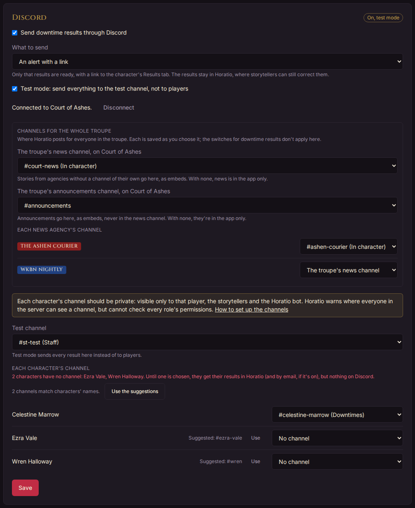

The list above the characters names any with no channel yet. They still get their results in Horatio, and by email if it's on, but nothing on Discord until one is chosen. Delivering a cycle warns of them too (see [Delivering results](#delivering-results)).

#### Trying it in test mode

Before the first real delivery, tick **Send downtime results through Discord** and **Test mode**, and save. Delivered results then go to the test channel, each naming its character, and you can see how they look without any player seeing them on Discord. Test mode only changes where the Discord copy goes: players still get their results in Horatio as usual. When it looks right, untick **Test mode** and save. Results delivered from then on go to each character's channel. Switching test mode off sends nothing by itself: results that went only to the test channel wait on the cycle's **Delivery** tab, listed under **Deliver results** as **Sent to the test channel only**. Choose **Send to players' channels** there to send them to players as they were delivered. It sends only those copies: players don't get the results again in Horatio, or a new notification.

#### Email

For **email**, set where **Replies go to** (the storytellers' address) and a **Test address**. Each result goes to the player's account address, one email per character.

## Customise: share settings

**Customise › Share settings** carries a troupe's customisation to another troupe: to start a new chronicle from rules you already have, or to give your rules to another storyteller, even one on another Horatio server.

### Exporting

Storytellers and assistant storytellers can export. The checklist lists each section that differs from Horatio's default, with how many items it holds, all ticked. Untick a section to leave it out, then choose **Export**. The file downloads as `<troupe>-settings-<date>.json`. It names traits, checks and categories by name, never by Horatio's internal ids, so it works on any server.

### Importing

Storytellers and the lead can import. Nothing can be imported into an archived troupe.

1. **Choose where from:** **Choose a file…** for an exported file, or **Or copy from a troupe you run** to take another troupe's settings straight across. You must run both troupes.
2. **Choose what comes in.** Each section shows how many of its items are ticked. Tick or untick a whole section, or **Show items** to choose one at a time. **Select all** and **Select none** do every section at once. Each item says where it stands:
   - **New**: this troupe doesn't have it yet.
   - **Changes yours**: this troupe has it, and it differs. **Yours** and **Becomes** show what changes.
   - **Same as yours**: nothing to do, so it's unticked.
   - **Can't import**: unticked, with why, such as a trait this troupe's rule set doesn't have.
3. **Edit the words on the way in.** An item with text, such as a house merit's description or a book trait's house wording, has **Edit**. Change the text and choose **Done**. **Find and replace** changes text across all the ticked items at once, and says how many matches it finds in how many items. Text that names the troupe it came from ("Court of Ashes: …") is the usual case, and Horatio offers to replace that name with this troupe's.
4. **Import.** The line above the button says what the import will do, such as "Adds 14, changes 6". **Download this troupe's settings first** keeps a copy of what you have, in case you want it back.

An import is all or nothing. Each item is checked as it would be if you made it by hand in Customise. If one fails, such as a house check whose condition doesn't fit this troupe's rules, nothing is saved, and the message names the item. The troupe log gets one entry: who imported, from which file or troupe, and how many items were added and changed in each section.

### Merging

An import merges. An item that matches one this troupe has replaces it: a house merit or flaw by its name, a price by its trait and condition, a written rule by its section and title, a fill table by its name, and so on. Everything else is added. Nothing the file leaves out is reset or removed. Specialisations are only ever added. A house check or teacher rule just like one you have isn't added twice.

### What is and isn't carried

Carried, where it differs from Horatio's default: the troupe settings, and everything under **Rules** (checks, costs, starting points, downtime actions, downtime keywords, languages, house merits and flaws, written rules, book traits, location rules, quest settings, Retainers, backstory settings, free changes and teachers). Also the troupe's specialisations, fill tables, and news agencies: an agency's name, description and colour only, never its picture or Discord channel. Archived house merits, retired keywords and retired agencies are left out.

Never carried:

- characters, NPCs and anything else that's play, not settings;
- staff, players, games, downtime cycles and logs;
- the troupe's name, description, profile, portrait, banner, contact and whether it is public;
- connectors (Discord channels, tokens);
- the troupe's titles and seated clans, its own equipment templates, house location qualities and backstory question sets.

If the backstory settings coming in need questions this troupe doesn't have, the review says so: add them under **Rules › Backstories**.

## Approvals

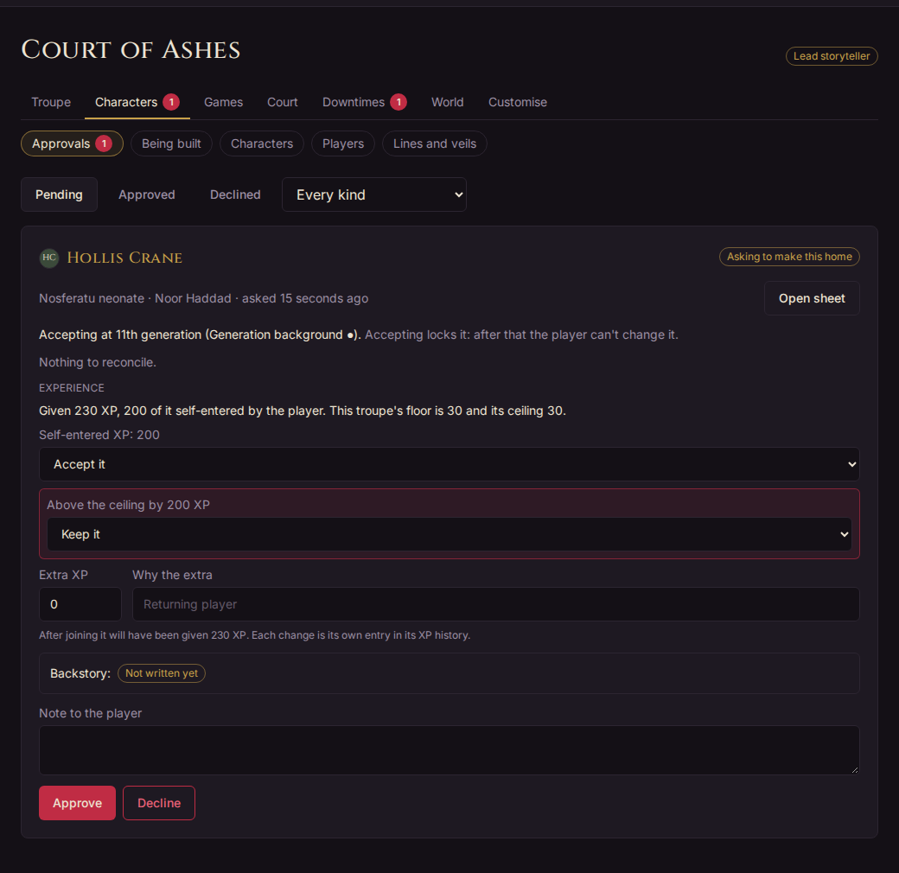

**Characters › Approvals** is where storytellers and assistant storytellers decide what waits on the home troupe. Show **Pending**, **Approved**, **Declined** or **Withdrawn**, and filter by kind: **Home troupe requests**, **Disciplines**, **Rule reviews**, **Exceptions**, **Diablerie**, **Merits and flaws**, and **Blood bonds**.

Each approval says what was asked and when, with **Open sheet**. Add a **Note to the player** if you like, then **Approve** or **Decline**. The player sees the player's side in [Players](players.md#spending-xp).

### Characters asking to join

A character asking to make the troupe its home is marked **Asking to make this home**. Before approving, settle:

- **Reconciliation**: each difference between the character's purchases and starting dots and this troupe's rules, with the player's proposed settlement. Keep it or choose another.
- **Experience**: the character's XP against the troupe's floor and ceiling. Accept or remove self-entered XP, top up below the floor, keep or remove XP above the ceiling, and give **Extra XP** with a reason.
- **Free traits the player chose**: accepting confirms them.
- **The backstory**: if the troupe needs it approved, approve it first (see [Approving backstories](#approving-backstories)).
- Anything it holds that the troupe bans: accepting keeps it, flagged on the sheet.

Approving accepts the character: its sheet as it stands becomes the accepted sheet, which its player can't lower, and it takes part in the troupe's downtimes from the next cycle. What players do is in [Players](players.md#your-home-troupe).

### Discipline and teacher purchases

A discipline dot bought by a character whose home this is waits as **Discipline** (or **Taught**, for another trait that needs a teacher under [Teachers](#teachers)). The XP is already spent: approving keeps the dot; declining refunds the XP and takes the dot back. The approval says who taught it, and whether the teacher's player has confirmed spending the Willpower teaching costs. It can be approved once they have.

### Merit and flaw requests

Once a character is accepted, a player asks to add or remove a merit or flaw, marked **Merit** or **Flaw**. Nothing changes on the sheet until you approve. A merit's XP, or the XP to buy off a flaw, is held meanwhile and refunded if you decline.

> **If your troupe uses this:** with quests on, **Answer with a quest** builds a quest instead. Completing the quest approves the request; failing or closing it declines it and refunds the XP held.

### Rule reviews and free changes

A **Rule review** is a change that broke a check the troupe plays as **Allow, for our review**. It went through, and waits here: declining takes it back and refunds the XP. A **Free change** is a trait lowered while the character's free changes are open, already refunded; declining puts the dots back and takes the XP back.

### Exceptions

A player can ask for an exception: a trait despite the rules, or for free. It is marked **Exception** or **Exception, free**, and says which rules it breaks. It is on the sheet already, waiting on you. Approving keeps it, and the sheet stops flagging those rules for it; declining takes it back (and refunds the XP, if any was paid). For a free one, **Approve, at normal cost** keeps it but charges the usual XP.

### Giving a trait by exception

Storytellers and assistant storytellers can also give a trait themselves. On the character's Sheet tab, choose **Give** beside a part of the sheet:

1. Choose the trait, its detail and its **Rating**.
2. Tick **Free: at no XP cost** if it is.
3. Give a **Reason**: it is kept with the trait, and in the XP history.
4. Choose **Check**. Horatio says what it costs and which rules it breaks.
5. If it breaks rules, tick **Give it despite these rules**.
6. Choose **Give**.

It needs no approval, and the player is told. Some things can't be set aside this way; Horatio says so.

### Diablerie

A player can say their character committed diablerie, marked **Diablerie**. Before approving, you can name **Who was diablerized** (only staff see it) and adjust what happens. Horatio lists what approving will do to the sheet. Declining changes nothing.

### Blood bonds

Where the troupe's **Blood bonds** setting (under **Settings**) is **Players report and staff approves**, each drink of vampire blood a player reports for their character waits here, marked **Blood bond**: who drank whose blood, on which night, at a game or in a downtime. Approving adds the drink to the bond's log, starting the bond if there isn't one; a drink the regnant's player reported also marks the bond known to its regnant. Declining tells the player your note. Horatio warns you when the thrall holds a full bond to someone else, which makes them immune to other bonds (Errata, p. 295), and won't approve it.

The four settings:

- **Off** (the default): no bonds anywhere. What was recorded, and any drink still waiting, is kept and comes back when it's switched on.
- **Staff manages**: running staff record every drink on **Characters › Bonds**.
- **Players report and staff approves**: players report their characters' drinks from the sheet or the Play View, and you approve them here.
- **Players manage**: a player records a drink their character took, and it counts at once. One the regnant's player records waits for the thrall's player to confirm, or for you when the thrall is an NPC or a name only.

Changing the setting leaves drinks already waiting where they are. **Characters › Bonds** lists every drink still waiting, whoever it waits on, to approve or decline there too. In any mode, a drink in a bond's **Drinks log** can be changed (its night and note) or taken out with a reason; taking out the last one removes the bond. Players can't record a night to come, one before the character was made in Horatio, or a drink while their character holds a full bond to someone else.

#### Bonds Horatio knows by rule

Some bonds need no one to record them, and Horatio adds them itself while the setting isn't **Off**:

- **The Embrace**: every childe has a one-drink bond to their sire, since the Embrace itself is a drink of the sire's blood (MET: VTM p. 295). Running an Embrace on a ghoul's sheet adds it, from the night of the Embrace.
- **A ghoul's domitor**: a ghoul is fully bound to their domitor (p. 296). Setting a ghoul's domitor adds the full bond; a ghoul made before any troupe accepted it gets it when its home troupe accepts it. Changing the domitor ends the bond to the old one, since the book has a ghoul change domitor only once that bond has faded, and adds the new.
- **Ghoul Retainers**: a vampire's ghoul Retainer is fully bound to them. The bond is by the Retainer's name until you link the Retainer to an NPC, when it moves to the NPC. The vampire's player made the Retainer a ghoul, so this one is known to them; the others aren't until you mark them known.

None is added if the two already have a bond, if a full bond to someone else makes the thrall immune, or if either side is retired. Each goes in the logs with the book's reason.

For characters from before the troupe tracked bonds, **Characters › Bonds** shows **Fill in known bonds**: the bonds Horatio can work out from Embraces, domitors and ghoul Retainers that the troupe doesn't keep yet. Look the list over and add them all at once; once they're in, it goes away.

#### The web of bonds

**Characters › Bonds › Web** draws the same bonds as a web: an arrow from each thrall to their regnant, heavier and brighter for a stronger bond, with fading, ended and broken bonds faint and dashed. Each person is a dot coloured by clan and sized by how many thralls they hold; a name only has a dashed edge. Filter to those still in play or everyone, full bonds only, one clan, title holders, or add ended and broken bonds. Point at or select someone to light up their bonds; **Open their bonds** opens the list on just theirs. Under the web, **Most thralls** names who holds the most, and **Chains of bonds** shows where someone bound to another holds thralls of their own. Every chart has **Show as table**. Only the staff who can open **Characters › Bonds** see the web; players never do.

#### When a regnant or a thrall meets Final Death

"If a regnant is killed, the bond will slowly fade over the next month" (MET: VTM p. 296). When a character is retired with **Final Death** (or why it left is changed to Final Death), each bond it's the regnant of starts **fading**. On **Characters › Bonds** it says so, with the day it ends, 30 days on. **Change the fade** moves that day, with a reason; choose today to end it now.

The thrall still feels the bond all that month, so nothing their player sees changes: the bond stays on their sheet as it was, with no notification and nothing in their character's log. The fade goes only in the troupe's log. On the day, the bond ends as faded, but the thrall's sheet still shows it until their player is told, with the troupe's next downtime results: "Agnes's bond to Bram has faded", never why. **Characters › Bonds** marks a faded bond whose thrall isn't told yet.

Retiring a regnant **Off-field** or **Inactive** leaves its bonds alone. If you change a regnant's Final Death to something else, its bonds still fading are felt again; those already faded stay ended.

A thrall's Final Death ends its bonds. A regnant has no sense of a thrall's death, so a regnant's player who knew of the bond goes on seeing it as it was; **Stop showing the regnant** clears it when the regnant would know.

Players can still learn of a death in other ways, which are yours to choose: listing the character under **No longer with us** on the Who's Who, opening Remembrances for it, or logging the withdrawal of its dots from a shared background. Hold off on these until its bonds have faded if the thralls shouldn't know yet.

#### Bonds that fade with time

A bond must be kept up (MET: VTM p. 296). A **full bond drops to two drinks** after three months without the thrall drinking the regnant's blood. A **two-drink bond ends** after six months without the two meeting or speaking, and a **one-drink bond** after a year. A drink counts as meeting. So does a game both characters checked in at. For other meetings, such as one in a downtime, use **Log a meeting** on the bond. Each bond on **Characters › Bonds** says what happens to it next, and when ("Drops to two drinks on 12 Feb 2027 unless Agnes drinks again").

There's no clock running at night: Horatio makes the changes due when the troupe's bonds are next looked at, or its downtime results delivered. Under **Staff manages** and **Players manage** it makes them by itself. Under **Players report and staff approves** each waits on **Characters › Bonds**, marked **Due**, until you **Confirm** it; log a meeting or a drink instead if the two did keep it up. A change goes in the troupe's log only. The thrall's player is told with the next downtime results, "Agnes's bond to Bram has weakened" or "has faded", and until then their sheet shows the bond as it was.

No bond drops or ends for time before the troupe's bonds started fading with time, or before it last switched bonds back on from **Off**: nothing could be logged while they were off.

A full bond makes the thrall immune to other bonds until it drops (Errata, p. 295). Recording a drink from anyone else, or entering a bond to them, is refused with why; give a **Reason to record it anyway** if the story calls for it, and it goes in the log.

#### The Vinculum

A troupe that allows the Sabbat (its allowed sects are any, or include the Sabbat) and tracks blood bonds has **The Vinculum** at the foot of **Characters › Bonds** (MET: VTM pp. 433–435). A Camarilla-only troupe never sees it.

- **Record a Vaulderie**: who took part (characters of the troupe, or names), anyone among them who was a **false Sabbat**, drinking but giving no blood, who officiated, and the night. It counts at once.
- **Ratings** come from the Vaulderies two shared, each night counted once: 1 after the first, for good; 2 if more than once in the past year; 3 if more than 10 times; 4 if about weekly for three months, never missing more than two weeks in a row; 5 if every few days for three months. They thin as the history does, so a 2 returns to 1 after a year without another. Both of a pair feel the same rating, except that nobody gains one toward a false Sabbat (Errata, p. 434). The **Ratings** table shows everyone's, or pick one Vaulderie under **Show** to see just that circle, such as a pack.
- **Enter a background tie** for two who shared Vaulderies before Horatio, at the rating it stood at on a night, with a reason. It thins with time as Vaulderies would.
- **The errata's blood bond rule**: taking part in a Vaulderie lowers every blood bond this troupe keeps for each participant, as thrall, a step, at most once a night (Errata, p. 434); a one-drink bond ends. It shows in the bond's log, and the thrall's player sees it at once, as their character took part.
- **Take out** a Vaulderie entered by mistake, with a reason: it stops counting toward ratings, but the bonds it lowered stay lowered; put a bond back by hand.
- Where players report drinks, they can report a Vaulderie their character took part in. It waits under **Vaulderies waiting** for you to **Approve** or **Decline** with a reason, under either player mode, as it changes the other participants' ratings and bonds too.

Each character's player sees the ratings their character feels, on the sheet's **Blood bonds** card and, from 2 up, with what each costs in Willpower in the Play View. Nobody else does.

### Approving backstories

Storytellers and assistant storytellers read a character's backstory on its **Backstory** tab, or opened in its home troupe request. Under **Your reading**:

- **Send back with feedback**, on the whole backstory or one section, without declining the character. The player revises and resubmits it with a reply, and the thread is kept.
- **Approve the backstory**, with an optional note. If the player changes it later, it shows as changed since it was approved, and you can **Approve it again**.

Narrators and visiting troupes' staff never read backstories. The player's side is in [Players](players.md#your-backstory).

### Characters leaving or retiring

A player can leave the home troupe for none, from the character's Home troupe card; its titles there end and its requests waiting there are withdrawn. A player can also retire a character, with a reason: **Final Death**, **Off-field** or **Inactive**. Retiring gives up every title it holds, in each troupe, and the status they gave; the retire dialog names them first, and its storytellers are told. Storytellers and assistant storytellers of its home troupe can change why a retired character left, and whether the Who's Who lists it under "No longer with us", from the **Retired** card on its page. *If your troupe uses this:* they can also open [Remembrances](#remembrances) for it there.

## Downtime cycles

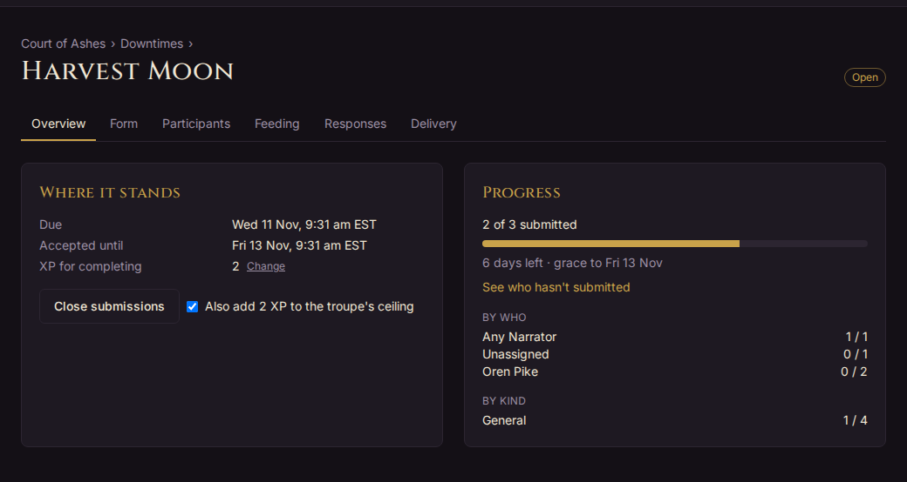

A downtime cycle is one round of downtimes. Storytellers and assistant storytellers run it from **Downtimes › Cycles**. A cycle goes from **Draft** to **Open** to **Closed** to **Complete**. The player's side is in [Players](players.md#downtimes).

### Creating a cycle

1. Choose **New cycle**.
2. Give it a **Name**, such as the month.
3. Set **Due**, a day and a time, in your time zone; everyone sees it in theirs. Wherever the cycle shows, its Due shows with its time, such as "Due Sat 14 Nov, 6:00 pm".
4. Set **Accepted until**: the end of the grace period, while late downtimes are still taken.
5. Set **XP for completing**: what each character gets when it submits its downtime. It starts at the troupe's usual amount.

The new cycle starts as a draft, with a copy of the last cycle's form.

### The form and its questions

On the cycle's **Form** tab, change the questions. Action questions spend one of the character's actions of a kind. **Add a custom question** adds one that spends no action, such as a plot prompt: give it a **Prompt**, an **Answer type**, **Help text** and, for a choice, its options. **Add the Quest action** adds the Quest action, if the troupe runs quests. Move questions up and down, and choose **Save form**. Once the cycle is open, players see changes straight away.

### Opening the cycle

On the cycle's **Overview**, choose **Open for submissions**. Opening fixes who takes part (the characters whose home is the troupe) and how many actions each has.

### Chasing submissions

The **Participants** tab shows each character, its player, where its downtime stands (**Not started**, **Started**, **Submitted** or **Removed**) and when it was last saved.

- **Remind those not submitted** sends each player a notification, and an email if they've chosen to. It names the cycle's **Due**, or once that has passed, its **Accepted until**, in the player's own time zone.
- **Add a character** adds one whose home is this troupe that joined after the cycle opened.
- A character's ⋯ shows its actions and where each comes from, as its player sees them, and lets you **Adjust** its allowance for this cycle with a reason, **Log influence**, **Accept late** (after the grace period, or when the troupe's absentee downtimes would shut it out), or **Remove from cycle**.

### Feeding in a cycle

> **If your troupe uses this:** the Feeding tab shows while the troupe tracks feeding.

The **Feeding** tab starts with **Feeding by clan**: how many feeding actions each clan needs this cycle, which you can change with a reason. The next cycle starts with these numbers. Each character's card shows what it put towards its feeding and Horatio's tally; you answer **Full Blood next game**, **Half Blood next game** or something else, with flavour or a fill table. With the Vol. 2 rules on, it also has the Resonance and Dyscrasia, **The Rack** (lay out cards, then change any), and the cycle's feeding territories and poaching.

A character holding Triumphant needs one feeding action fewer, and never poaches. A character using **Quick Hands, Quick Work** is marked on its card: it doesn't feed, and its results say it starts the next game at half Blood without your answering.

### Assigning and writing responses

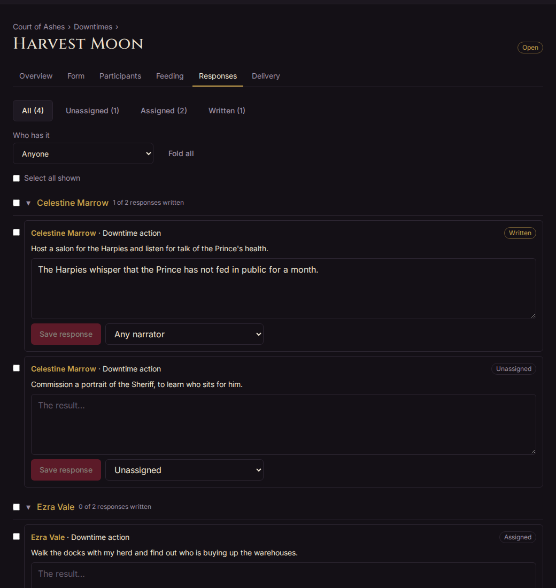

The **Responses** tab holds every response in the cycle, by character. Filter by **All**, **Unassigned**, **Assigned** or **Written**, by who has it, by question, and by [keyword](#downtime-keywords). **Order** › **In resolution order** lists them in the troupe's resolution order instead, under each step, so you can work through them in turn. Each response names its keyword and its step, and what the keyword's fields say, such as the territory or the item wanted. An answer from before keywords counts as Narrative.

- Choose who writes each response: a staff member, or **Any narrator**. Tick several and assign them in one go from the bar at the foot of the screen.
- Write a response and choose **Save response**. A **Fill table** can roll a random result into it.
- **Effects on allowances and backgrounds**, for storytellers and assistant storytellers, applies what the action does to downtimes or backgrounds, with **Take back** to undo it:
  - **Call of the Hungry Dead:** another character loses 1 action the next time it has downtime actions. It doesn't stack.
  - **Indirect influence attack:** on a general influence action, another character loses 1 action for every 2 levels, or all it has. Use it where you choose the book's mechanical penalty.
  - **Crafts** or **Performance:** Resources or Fame +1 until the next cycle opens.
  - **Overtaxed Resources:** Resources −2 for six games or three months, whichever is later; and, from another action, **Recovering from overtaxing** halves the wait.

  Actions lost come off the character's current downtime if it hasn't submitted, or else its next one.

- **Give an item** gives the character equipment from the response, such as an item bought beyond its means or one it crafted. It opens the [Equipment](#equipment) editor, set to that character. **Add a quality** puts a quality, such as Antique, Stylish or Nondescript, on an item the character already holds; it must fit the item's grade, as any quality does.

Only storytellers and assistant storytellers assign. Everyone writes what is assigned to them, from here or from [My work](#my-work).

What a response gives shows under it, marked **With the results**: it reaches the character when the response is delivered, not before. Until then, **Change** or **Take off** it. Once delivered it's marked **Given**, and it's an item like any other, changed on the Equipment tab. Only storytellers and assistant storytellers give equipment; narrators see what a response gives, but can't add to it.

### Actions aimed at characters

A player can aim an action at one or more characters of the troupe, home or visiting. The cycle's **Aimed at** tab lists, for each character, the submitted actions aimed at them: who, which question and the answer, each with a link to its response. Responses show who they're aimed at too. Only storytellers and assistant storytellers see either: no player learns who aimed at them, and a narrator writing the response doesn't see it. The troupe log notes each action aimed at someone as the downtime is submitted.

- **A Haven's Location** (MET: VTM p. 102). An action aimed at a character whose Haven, on the troupe's [Locations](#locations), has the Location advantage costs two actions. The player sees only "This costs 2 actions". If it isn't against them, such as a friendly visit, or they no longer stay in their Haven, tick the box under it on its response and it costs 1; the player gets the action back.
- **Cancel and Observe** (p. 93). A character with the Computer skill can make one action a month a **Cancel** or an **Observe** of one character's actions, by its keyword. On the **Aimed at** tab, choose which of that character's actions it works on; the two then show together, there and on both responses. Whether it works is yours to judge.

### Projects

Projects are work a character does over several cycles: a **Path change**, **Research** or **Other**. Each has a number of actions it takes and, if you like, a least number each month, or it starts over.

- **Starting one.** On the character's **Projects** tab, choose **Start a project**. A player can propose one from their Downtime tab; you're told in the bell, and **Confirm** or **Decline** it there or on the cycle's **Projects** tab. **Stop** ends one under way. Each shows its kind beside its progress.
- **A quest instead.** A goal with things to gather and tests to pass is a quest, not a project. While the troupe runs quests, the project form says so, with a link to the Quests tab (the player's, or the troupe's for you). On a proposed Research or Other project, **Make it a quest request instead** declines it and puts a quest request for the character in the queue, its name the objective. It counts toward the character's quest requests for the cycle. A Path change stays a project.
- **Progress.** A player counts an action toward a project under **Counts toward**. When you mark a cycle complete, each project goes up by the actions spent on it in submitted downtimes. One with fewer than its least that month starts over, back to none. The cycle's **Projects** tab shows what each has had so far this cycle, and warns in red of any that will start over; so does **Mark complete**. A character not taking part in a cycle keeps its progress.
- **A Path change** takes the book's numbers: 9 actions with a teacher, 18 without, at least 1 a month (MET: VTM p. 306). When it finishes, you're told in the bell to change the character's Morality to the new Path on the sheet, which lowers Morality by 1. Make the change as usual, then choose **It's on the sheet**.

### Fill tables

**Downtimes › Fill tables** gives random results for common actions. Make a table with a **Name** and its entries, one a line. An entry can name another table in square brackets, such as "You hunt near [Location].", to fill that part from it. **Roll** tries it. Storytellers and assistant storytellers keep the tables; narrators can roll them.

### Closing the cycle

On the Overview, choose **Close submissions**. Horatio says how many have submitted and whether the grace period is still running before you confirm. Tick **Also add … XP to the troupe's ceiling** to raise the XP ceiling by the completion XP. You can change the completion XP until the cycle closes; characters who have already submitted keep what they got.

### Delivering results

The **Delivery** tab sends each submission's responses to its player.

1. Under **Deliver results**, Horatio lists what is **Ready**, what is **Partly written**, what was delivered with nothing changed since, and what has **Nothing written yet**.
2. Tick **Also deliver the partly written** to send those with what's written so far.
3. Choose **Deliver** (it says how many downtimes go).
4. If Discord is on, and not in test mode, and a character going has no Discord channel, Horatio says so first and names them. **Choose their channels** goes to [Connectors](#choosing-each-characters-channel); **Deliver anyway** sends the results now, and those characters get them in Horatio (and by email, if it's on) but not on Discord.

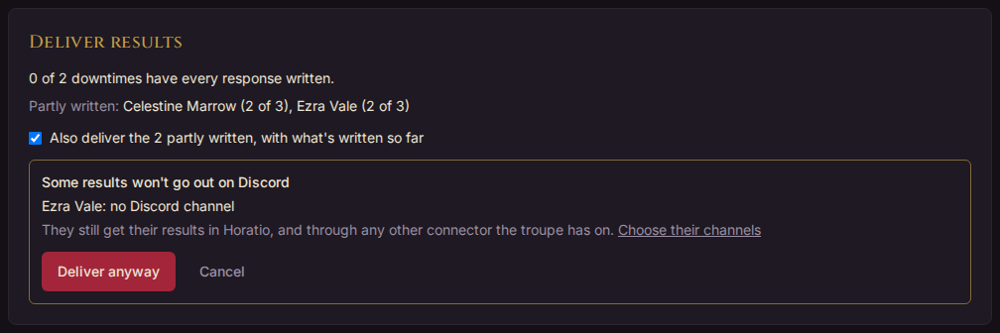

Results always appear in Horatio, and on each connector the troupe has on. Equipment a response gives goes to the character as its results are delivered, and the results say **You received**. A response written or changed after delivery goes out with the next delivery, as an update, and the table marks it **Changed since delivery**; so does equipment added to a response already delivered. If something can't be given, such as a quality on an item the character no longer holds, Horatio stops the delivery and says which; change it or take it off the response, then deliver again. A connector copy that failed can be retried, or marked as sent if you sent it yourself.

### Marking a cycle complete

Once results are out, choose **Mark complete** on the Overview. Horatio says first what is unwritten or undelivered, and which [projects](#projects) start over. Completing the cycle counts its actions toward projects. You can still deliver from a complete cycle; those are the last results.

### Player Nominations

> **If your troupe uses this:** switch on **Player Nominations** under [Customise › Troupe settings](#downtimes).

Each downtime form gets a **Player Nominations** section, where players write short notes praising someone's roleplaying, each optionally linked to a character in the troupe or one of its staff. They don't use actions. You read them on the cycle's **Nominations** tab, open to storytellers and assistant storytellers, once a player submits their downtime.

- Each row shows the nomination, who it's about, and who wrote it (character and player). Players never see who wrote one.
- The ⋯ on a row holds **Star** (or **Unstar**), **Edit…** and **Remove…** (or **Put back**). An edit is for small things, such as a typo or a real name the player asked to keep private, and is marked **Edited by staff**. Removing one keeps it on the tab, with an optional reason only staff see.
- The counts at the top say how many are written, removed and starred.

**Publish nominations** works once the cycle is past **Due**, and once only. It publishes the cycle's nominations to the troupe's players, shuffled once and without names, on the troupe's **Nominations** tab, and tells them in the bell. The player of each character named in one, and each member of staff named, gets a line saying so. Nominations written afterwards, during the grace period, wait on the tab for **Publish … more**. You can still remove a published nomination: it disappears for players at once.

Every starred nomination, from every month, rotates in a quiet line at the foot of the troupe's pages for its players and staff, until someone unstars it, here or from the **Nominations** tab. Removing, putting back, starring, editing and publishing go in the troupe's log.

### Remembrances

> **If your troupe uses this:** switch on **Remembrances** under [Customise › Troupe settings](#downtimes).

When a character leaves play, the troupe can ask everyone in the next downtime for a memory of them.

- **Opening them.** Storytellers and assistant storytellers open them for a retired character with **Open remembrances**: from the **Remembrances** card on its page, or from its entry under "No longer with us" on the Who's Who. A player retiring their own character can tick **Ask the storytellers to open remembrances in the next downtime**; you're told in the bell, and confirm by opening them. Staff retiring a character tick **Open remembrances in the next downtime** to open them at once.
- **Which cycle asks.** The cycle that's open now, if it isn't yet past Due; otherwise the next cycle that opens. The card says which before and after you open them.
- **Writing.** That cycle's downtime form has a **Remembrances** section with each character remembered: their portrait, why they left, and a box for a memory. Everyone submitting a downtime in the troupe can write one memory of each, the remembered character's own player included.
- **Reviewing.** The cycle's **Nominations** tab (**Remembrances**, if the troupe doesn't use Player Nominations) has a card for each character remembered, with each memory and who wrote it. Remove, put back and edit them as nominations; they're never starred.
- **Publishing.** The same **Publish** publishes the cycle's nominations and memories together, once it's past Due. Memories are shuffled within each character. The troupe's players are told that remembrances for the character are up, and the character's own player gets a notification of their own.

Published memories show without names on the month's page, above its nominations, on the retired character's **Remembrances** card, and from its entry on the Who's Who. Its player, the troupe's players and its staff read them. Removing one after publishing takes it away everywhere. Opening, removing, putting back, editing and publishing go in the troupe's log.

## Game nights

### The schedule

Storytellers and the lead add games on the [troupe's Profile](#the-troupe-profile-and-public-page). Games to come show on the About tab, in the troupe's calendar, and on the public profile if it is public.

### RSVPs and the calendar

On the About tab, each game to come asks **Coming**, **Maybe** or **Not coming**; tapping your answer again takes it back. Players see how many said each; all staff can also **See who answered**, with the characters each plays here.

**Subscribe to the calendar** gives a link for the troupe's games and downtime dates, for this troupe or all your troupes, with how to add it in Google Calendar, Apple Calendar and Outlook. Keep it to yourself: anyone with it can see those dates.

### Check-in at the door

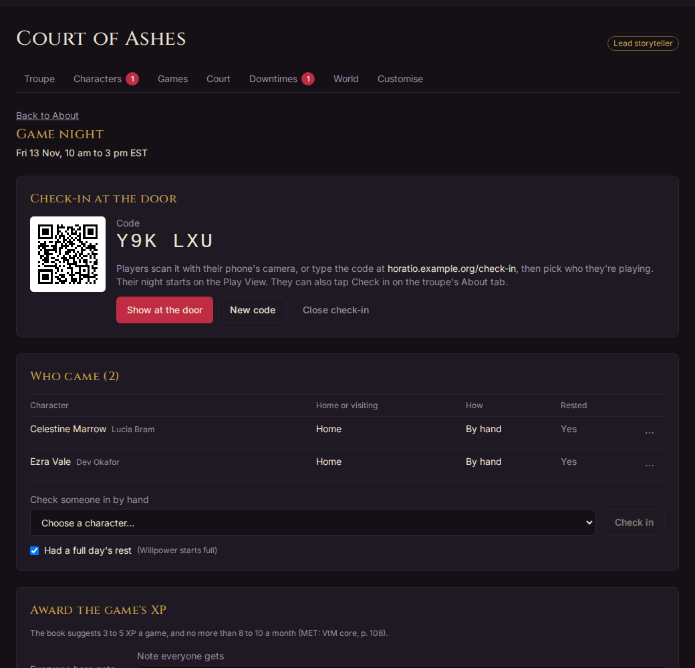

On the About tab, storytellers and assistant storytellers choose **Check-in and attendance** under a game to open its night. Check-in can open from 12 hours before the game starts.

1. Choose **Open check-in**. The door gets a code and a QR code.
2. Choose **Show at the door** for a full-screen code to hold up. Players scan it with their phone's camera, or type the code on the check-in page, then pick who they're playing. They can also tap **Check in** on the troupe's About tab.
3. Checking in starts the character's night on its Play View: Willpower full after a day's rest, and Blood as the troupe's settings say.
4. **New code** replaces the code; **Close check-in** stops players checking in. You can still check people in by hand.

Check-in closes by itself when the game's XP is awarded.

### Checking in by hand and absentees

Under **Who came**, a table shows each character checked in, with its player: whether it's home or **Visiting**, how it checked in (**By hand**, or by its player), whether it had a day's rest, and, if your troupe fixes the source of status at check-in, its **Status tonight**. On a phone, each character folds into a card that shows only what's out of the ordinary. Each character's **⋯**, at the end of its row, holds **Check out**, and **Choose status** (or **Change status**), which opens its Play View on the Status tab.

To check someone in yourself, choose a character under **Check someone in by hand**, untick **Had a full day's rest** if they didn't (their Willpower then starts where the last game left it), and choose **Check in**. A visitor's XP is awarded by its own home troupe.

> **If your troupe uses this:** with **Record absentee games** on in the game XP chart, once the game has started you can **Mark absentee** a home character who missed it. It never counts as attended, and gets the chart's absentee XP. Payments aren't tracked in Horatio: marking a character absentee is the record, paid or not. Absentees get a table of their own under **Absentee**; **Take back the absentee game** on a character's **⋯** undoes it. A character who checked in came, so it can't be marked absentee: check it out first.

### Awarding a game's XP

Under **Award the game's XP**, on the game's night, everyone checked in whose home is this troupe gets the game's XP, once the game has started.

1. Set what **Everyone here gets** (and **Absentees get**), or with a chart, check each character's figure from its band.
2. Tick any adjustments for a character, or set one figure by hand, with a reason.
3. Write the **Note everyone gets**, the reason on each character's XP history.
4. Tick **Also add to floor and ceiling** to raise the troupe's XP floor and ceiling.
5. Choose **Award…**, then confirm.

If an award takes a character past the monthly figure, Horatio warns you (or, with a cap, stops at it). Afterwards the card shows what each character got; correct a mistake from the character's Experience tab (see [Correcting an award](#correcting-an-award)).

### The At game tab and the Play View

**Characters › At game** shows each character's Blood, Willpower and health as their Play View has them, with their player's lines and veils. Open a character to tap for them, run an NPC, or read what they spent and why. How the Play View works is in [Players](players.md#at-game).

### Scenes

**Open the scenes** on the At game tab puts several characters on one page, side by side, to run a scene: tap Blood, Willpower, health and Beast traits for each, with Undo and the log. Stock NPCs show their pool and resource to tap.

- Make a scene with **Name of a new scene**, then find characters and NPCs by name to put them in it.
- Scenes are kept for the troupe: every storyteller and assistant storyteller sees them all and can put characters in any.
- A scene's maker, or the lead storyteller, renames or removes it. Removing a scene leaves its characters as they are.
- The lead can clear **Old scenes** not used since a date.

### Scenes at a game with no signal

At a venue with no signal, you can still run a fight from your phone if you keep the troupe's scenes on it first.

1. On your phone, turn on **Your account › This device › Keep my characters on this device** (it says the phone is yours; see [Using Horatio at a game with no signal](players.md#using-horatio-at-a-game-with-no-signal)).
2. While you have signal, open the troupe's **Scenes** page and press **Keep tonight's scenes on this phone**. It keeps every scene of the troupe, every character on their cards (NPCs, Stock NPCs and the PCs in them) and what each card needs, for this troupe only. It then says when, and how much: *Kept 6:55 pm · 3 scenes, 14 NPCs, 2 PCs*, with **Update** and **Remove**.

With signal, kept scenes follow what you see: a scene you open, a character you put in one or take out, and every tap. Press **Update** before you leave to be sure you have the newest.

With no signal, the Scenes page and every kept scene open as usual. Tap the cards as ever: the taps wait on the phone, and a line under the header says how old the scenes are and how many taps are waiting. When the phone gets signal again they're sent. Two storytellers tapping the same NPC on two phones both count, in the order they were tapped. Changing a scene needs signal: making, renaming or removing one, and putting a character in or taking one out, all say **Needs a connection**. A scene made after you kept them says it isn't kept on this phone. No other staff screen works without signal.

Kept scenes are listed in **This device**, each troupe with its own **Remove**. Turning **Keep my characters on this device** off, or signing out, removes them.

### Resetting after the game

Under **After the game**, **Reset everyone…** then **Reset everyone for the next game** puts every character's trackers back. Each game's log is kept, under Past games on their Play View. Checking a character in at the next game does the same for that character.

## XP

Storytellers and assistant storytellers give XP only to characters whose home troupe this is. A visiting troupe never awards XP.

### Awarding XP

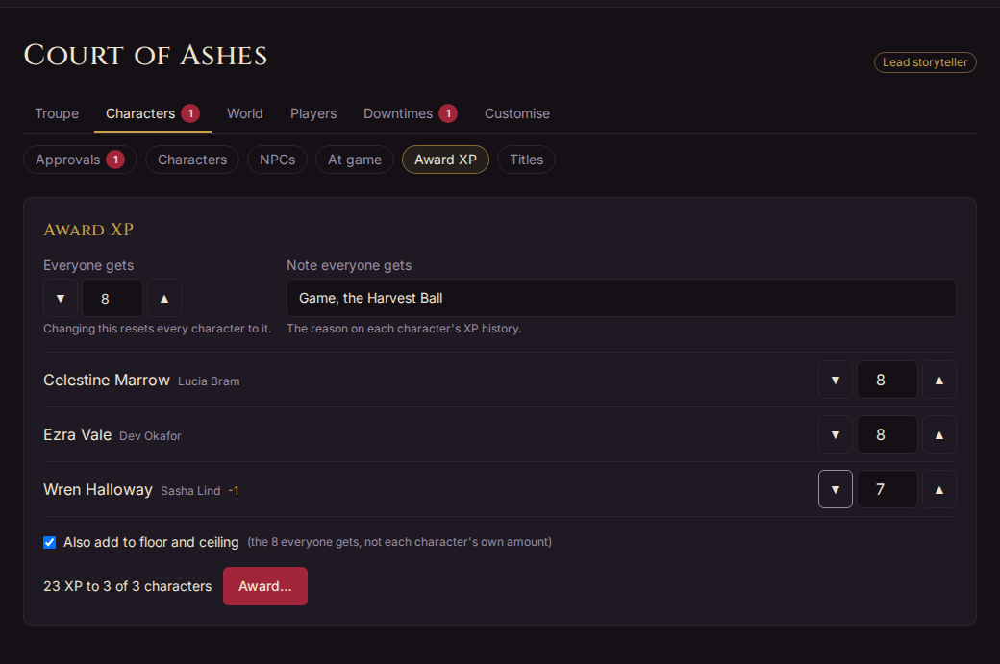

There are three ways:

- **A game's XP**, from its night after check-in (see [Awarding a game's XP](#awarding-a-games-xp)).
- **Characters › Award XP**, for the whole troupe at once without check-in: set what **Everyone gets**, raise or lower it per character with the arrows (0 for someone who missed it), write the **Note everyone gets**, and choose **Award…**. Tick **Also add to floor and ceiling** to raise them by the amount everyone gets.
- **Award XP…** on one character's ⋯ on the [Characters list](#each-characters-actions).

Completing a downtime gives the cycle's completion XP by itself, as the character submits.

### The XP floor and ceiling

The **XP floor and ceiling** card (on the About tab and in Troupe settings) shows:

- **Ceiling**: the most XP a character here could have by now: the starting XP, every game's XP and every downtime's XP.
- **Floor**: the same without the downtimes. New characters built for the troupe start at the floor.

Awarding a game's XP and closing a cycle can add to them (the tick boxes above). **What changed them** lists each change. For a chronicle that began before Horatio, storytellers can **Set by hand** either figure, with **Why**; games and downtimes still add to them afterwards.

When a character asks to join, Horatio sets its XP against these figures: below the floor it is offered a top-up, and above the ceiling staff choose to keep or take away the excess (see [Characters asking to join](#characters-asking-to-join)).

### Correcting an award

On a character's **Experience** tab, under an award, **Correct this award** opens a small form: say what it **Should give**, and **Why**, then choose **Correct**. The award stays in the history, and a correction entry makes up the difference. The home troupe's storytellers and assistant storytellers correct awards.

### XP debt

A character's **XP debt** card, on its Experience tab, shows what it owes, from a ghoul's Embrace or put on by staff. The home troupe's storytellers and assistant storytellers can **Add** to it or **Forgive** some, with a reason. All the XP the character earns pays the debt first.

### The game XP chart

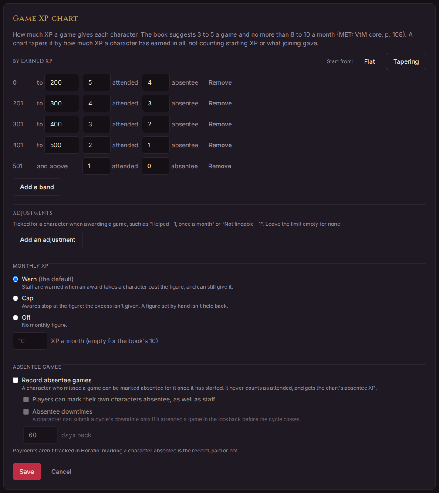

With nothing set, a game gives everyone there the same XP, and staff are warned past 10 a month, as the book has it. Storytellers can change that under **Customise › Troupe settings › Game XP chart**:

- **By earned XP**: bands of earned XP, each with XP for a game attended (and an absentee game). **Start from** *Flat* or *Tapering* (less XP a game as earned XP grows), **Add a band**, or remove one. Earned XP doesn't count starting XP or what joining gave.
- **Adjustments**: extras staff tick for a character when awarding, such as "Helped +1, once a month", each with an optional limit a month.
- **Monthly XP**: **Warn** (the default), **Cap** or **Off**, at the book's 10 a month or your own figure.
- **Absentee games**: **Record absentee games**, whether players can mark their own characters absentee, and **Absentee downtimes**: a character can submit a cycle's downtime only if it attended a game in the last so many days before the cycle closes.

Players see the chart on the House rules tab.
